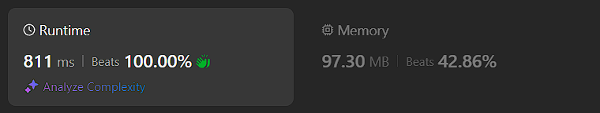

# Kotlin. Beats 100% (811 ms). OOP + simple DFS.

**Author:** mobdev778
**Votes:** 2
**Link:** [https://leetcode.com/problems/all-ancestors-of-a-node-in-a-directed-acyclic-graph/solutions/5388114/](https://leetcode.com/problems/all-ancestors-of-a-node-in-a-directed-acyclic-graph/solutions/5388114/)

---



# Code
```
class Solution {
    fun getAncestors(n: Int, edges: Array<IntArray>): List<List<Int>> {
        val nodes = Array(n) { GNode(it) }

        for ((from, to) in edges) {
            nodes[from].links.add(nodes[to])
        }

        for (i in 0 until n) {
            for (child in nodes[i].links) {
                dfs(child, i)
            }
        }

        val result = ArrayList<List<Int>>()
        for (i in 0 until n) {
            result.add(nodes[i].ancestors)
        }
        return result
    }

    private fun dfs(node: GNode, ancestor: Int) {
        if (node.last == ancestor) return
        node.last = ancestor
        node.ancestors.add(ancestor)
        for (child in node.links) {
            dfs(child, ancestor)
        }
    }

    class GNode(val index: Int) {
        var last: Int = -1
        val ancestors = ArrayList<Int>()
        val links = ArrayList<GNode>()
    }
}
```

In this problem, we must solve two problems:

1) Find all ancestors of every graph node
2) At the same time, observe the order of sorting.

To fulfill both conditions, we can first form a graph using an object-oriented approach, where each graph node is an instance of a specific class "GNode".

First we just need to form a graph using the class GNode:
```
class GNode {
    val links = ArrayList<GNode>()
}
```

After the class is created, we can write a code that forms a graph in an object-oriented form:

```
val nodes = Array(n) { GNode() }

for ((from, to) in edges) {
    nodes[from].links.add(nodes[to])
}
```

But this only creates the structure of the graph. To solve the problem, we also need to add another field to each node of the graph - a list of ancestors:

```
class GNode {
    val ancestors = ArrayList<Int>()
    val links = ArrayList<GNode>()
}
```

And write a recursive algorithm, which first adds the "0" node to every node that is "reachable" from "0" node. Then we recursively repeat the same operation for the "1" node and others:

```
fun getAncestors(n: Int, edges: Array<IntArray>): List<List<Int>> {
    val nodes = Array(n) { GNode() }

    for ((from, to) in edges) {
        nodes[from].links.add(nodes[to])
    }

    for (i in 0 until n) {
        for (child in nodes[i].links) {
            dfs(child, i)
        }
    }

    val result = ArrayList<List<Int>>()
    for (i in 0 until n) {
        result.add(nodes[i].ancestors)
    }
    return result
}

private fun dfs(node: GNode, ancestor: Int) {
    node.ancestors.add(ancestor)
    for (child in node.links) {
        dfs(child, ancestor)
    }
}

class GNode {
    val ancestors = ArrayList<Int>()
    val links = ArrayList<GNode>()
}
```

But there is one small trap: during the DFS, we can get into the same node twice (first through a shorter path, then through a longer one). And then we will have "doubles" (repeated values) in our list, which we would like to avoid:

```
[[], [], [], [0, 1], [0, 2], [0, 1, 3], [0, 0, 1, 2, 3, 4], [0, 1, 2, 3]]

// [0, 0, 1, 2, 3, 4]
```

To remove doubles, we can store the last added element in each node:
```
class GNode {
    var last: Int = -1
    val ancestors = ArrayList<Int>()
    val links = ArrayList<GNode>()
}
```

And check before adding whether the same element was added earlier.

```
if (node.last == ancestor) return
node.last = ancestor
```