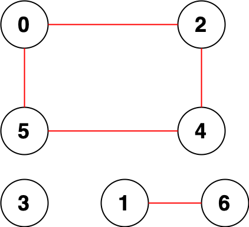

# [2316. Count Unreachable Pairs of Nodes in an Undirected Graph](https://leetcode.com/problems/count-unreachable-pairs-of-nodes-in-an-undirected-graph/)

| Category | Difficulty | Likes | Dislikes |
| :------: | :--------: | :---: | :------: |
| Algorithms | Medium | 2228 | 55 |

**Tags:** [`depth-first-search`](https://leetcode.com/tag/depth-first-search), [`breadth-first-search`](https://leetcode.com/tag/breadth-first-search), [`union-find`](https://leetcode.com/tag/union-find), [`graph`](https://leetcode.com/tag/graph)

**Companies:** `amazon`, `snapchat`, `google`

## Description

You are given an integer `n`. There is an **undirected** graph with `n` nodes, numbered from `0` to `n - 1`. You are given a 2D integer array `edges` where `edges[i] = [a_i, b_i]` denotes that there exists an **undirected** edge connecting nodes `a_i` and `b_i`.

Return *the **number of pairs** of different nodes that are **unreachable** from each other*.

 

**Example 1:**


```

Input: n = 3, edges = [[0,1],[0,2],[1,2]]
Output: 0
Explanation: There are no pairs of nodes that are unreachable from each other. Therefore, we return 0.

```

**Example 2:**


```

Input: n = 7, edges = [[0,2],[0,5],[2,4],[1,6],[5,4]]
Output: 14
Explanation: There are 14 pairs of nodes that are unreachable from each other:
[[0,1],[0,3],[0,6],[1,2],[1,3],[1,4],[1,5],[2,3],[2,6],[3,4],[3,5],[3,6],[4,6],[5,6]].
Therefore, we return 14.

```

 

**Constraints:**

	- `1 <= n <= 10^5`

	- `0 <= edges.length <= 2 * 10^5`

	- `edges[i].length == 2`

	- `0 <= a_i, b_i < n`

	- `a_i != b_i`

	- There are no repeated edges.

---

**Links:** [Submissions](https://leetcode.com/problems/count-unreachable-pairs-of-nodes-in-an-undirected-graph/) | [Solutions](https://leetcode.com/problems/count-unreachable-pairs-of-nodes-in-an-undirected-graph/)
