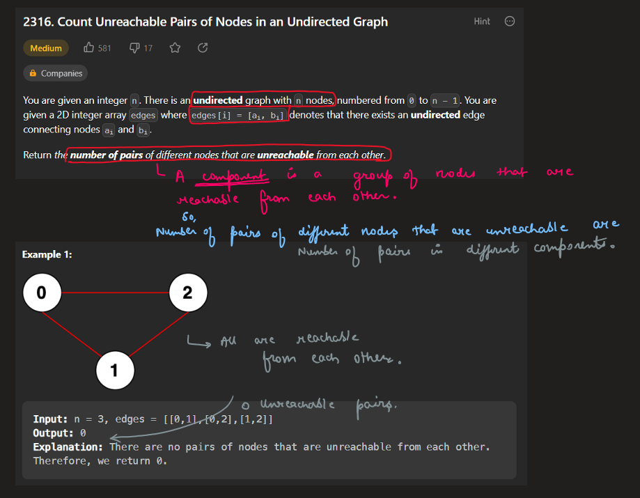
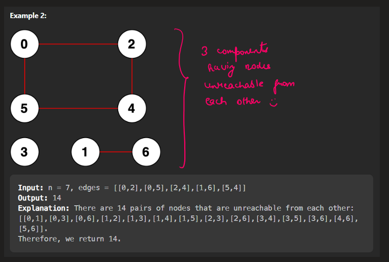
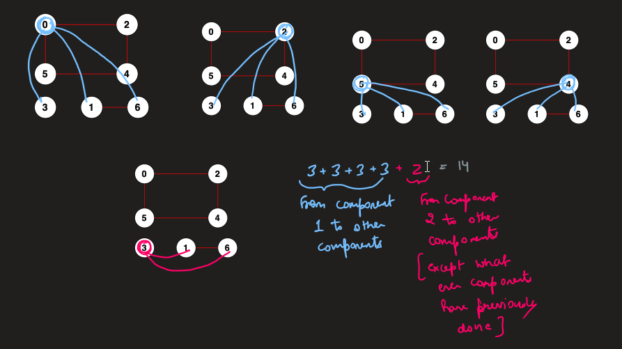
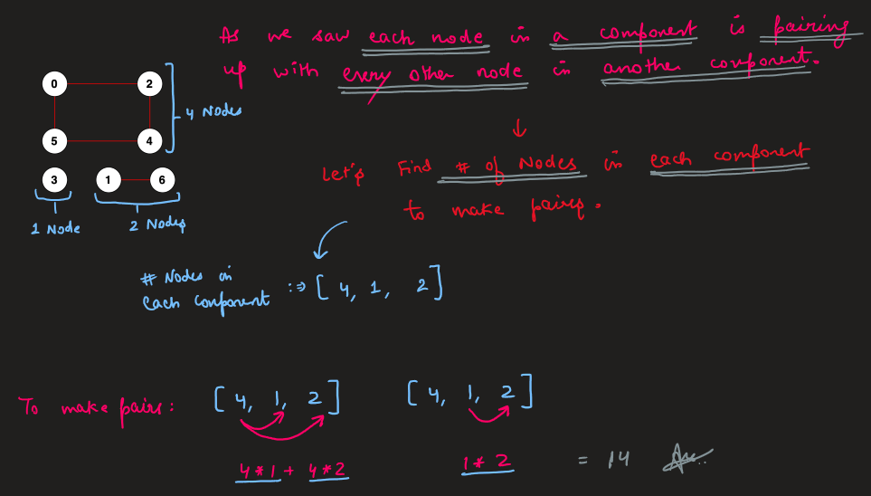
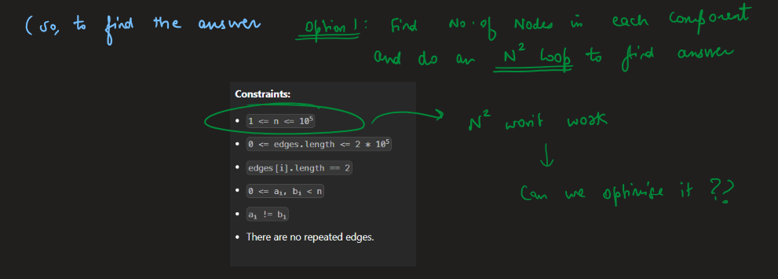
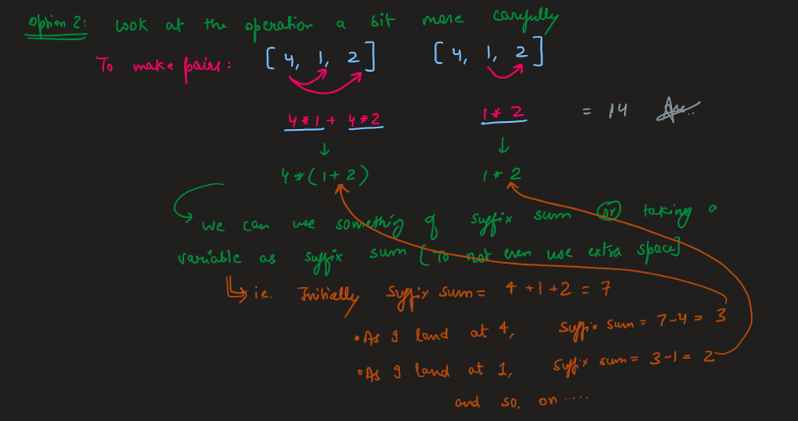
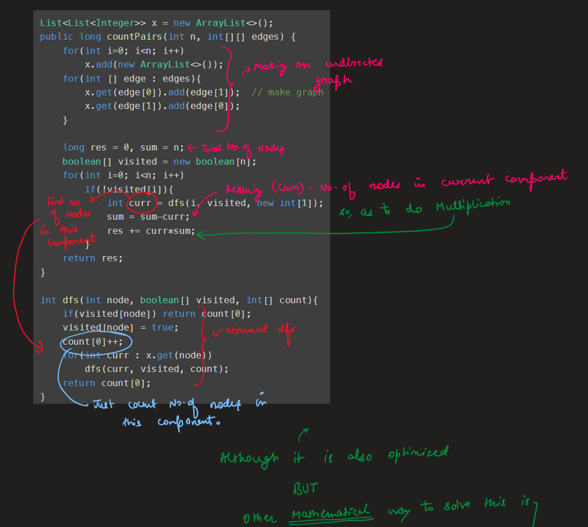
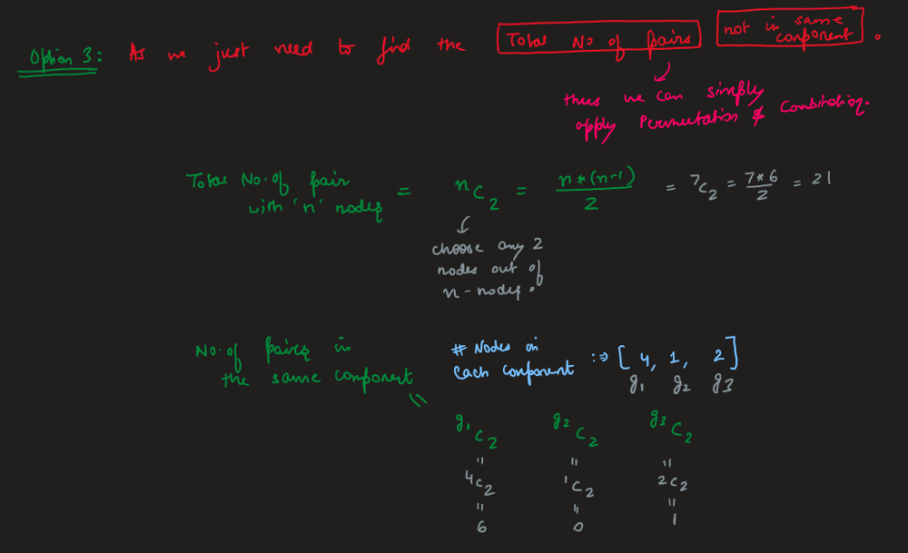
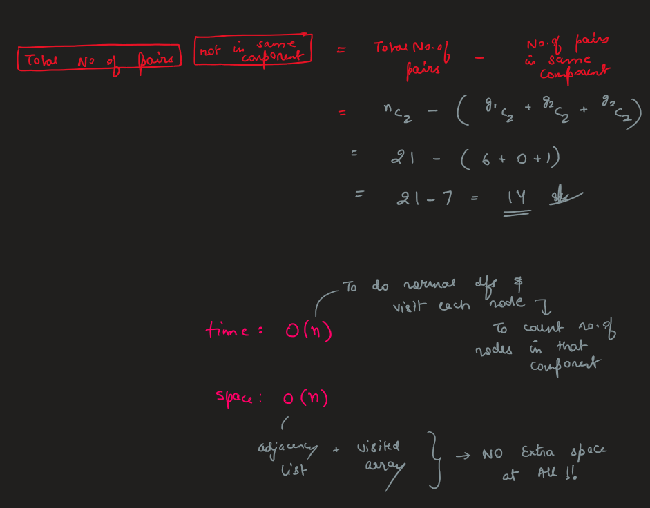
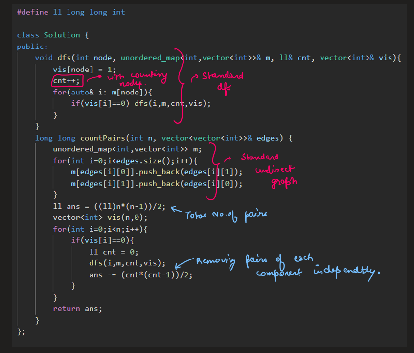

# Image Explanation🏆- [3 Approaches - DFS] - C++/Java/Python

**Author:** aryan_0077
**Votes:** 58
**Link:** [https://leetcode.com/problems/count-unreachable-pairs-of-nodes-in-an-undirected-graph/solutions/3337574/](https://leetcode.com/problems/count-unreachable-pairs-of-nodes-in-an-undirected-graph/solutions/3337574/)

---

# Video Solution (`Aryan Mittal`)

`Count Unreachable Pairs of Nodes in an Undirected Graph` by `Aryan Mittal`


# Approach & Intution












# Code
```C++ []
#define ll long long int

class Solution {
public:
    void dfs(int node, unordered_map<int,vector<int>>& gr, ll& cnt, vector<int>& vis){
        vis[node] = 1;
        cnt++;
        for(auto& i: gr[node]){
            if(vis[i]==0) dfs(i,gr,cnt,vis);   
        }
    }
    long long countPairs(int n, vector<vector<int>>& edges) {
        unordered_map<int,vector<int>> gr;
        for(int i=0;i<edges.size();i++){
            gr[edges[i][0]].push_back(edges[i][1]);
            gr[edges[i][1]].push_back(edges[i][0]);
        }
        ll ans = ((ll)n*(n-1))/2;
        vector<int> vis(n,0);
        for(int i=0;i<n;i++){
            if(vis[i]==0){
                ll cnt = 0;
                dfs(i,gr,cnt,vis);
                ans -= (cnt*(cnt-1))/2;
            }
        }
        return ans;
    }
};
```
```Java []
class Solution {
    List<List<Integer>> x = new ArrayList<>();
    public long countPairs(int n, int[][] edges) {
        for(int i=0; i<n; i++)
            x.add(new ArrayList<>());
        for(int [] edge : edges){
            x.get(edge[0]).add(edge[1]);
            x.get(edge[1]).add(edge[0]);
        }

        long sum = (Long.valueOf(n)*(n-1))/2;
        boolean[] visited = new boolean[n];
        for(int i=0; i<n; i++)
            if(!visited[i]){
                int cnt = dfs(i, visited, new int[1]);
                sum -= (Long.valueOf(cnt) * (cnt-1))/2;
            }
        return sum;
    }

    int dfs(int node, boolean[] visited, int[] count){ 
        if(visited[node]) return count[0];
        visited[node] = true;
        count[0]++;
        for(int curr : x.get(node))
            dfs(curr, visited, count);
        return count[0];
    }
}
```
```Python3 []
class Solution:
    def countPairs(self, n: int, edges: List[List[int]]) -> int:
        def dfs(node):
            if visited[node]:
                return 0
            visited[node] = True
            res = 1
            for nbr in graph[node]:
                res += dfs(nbr)
            return res
        graph = {}
        for i in range(n):
            graph[i] = []
        for edge in edges:
            graph[edge[0]].append(edge[1])
            graph[edge[1]].append(edge[0])
            
        visited = [False for _ in range(n)]
        components = []
        for node in range(n):
            if visited[node] == False:
                components.append(dfs(node))   
        
        ans = n * (n - 1) // 2
        for k in components:
            ans -= k * (k - 1) // 2
        
        return ans
```