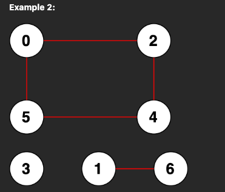

# Ruby Solution. Explained

**Author:** user8466o
**Votes:** 2
**Link:** [https://leetcode.com/problems/count-unreachable-pairs-of-nodes-in-an-undirected-graph/solutions/3339079/](https://leetcode.com/problems/count-unreachable-pairs-of-nodes-in-an-undirected-graph/solutions/3339079/)

---

# Intuition

A connected component means a bunch of nodes connected to each other. Like in Example 2, 

- (0),(2),(4),(5) is a connected component, with 4 nodes. 
- (1), (6) is another connected component, because there is no edge connecting to other components. Also, the number of nodes is 2.

## Unreachable pair count?

Let's look at Example 2 in the description:



Let's run the loop from 0 to n-1. We don't know the unreachable count yet, so:

```
unreachable_count = 0
```

### We start from (0).

We dfs (0) to see how many nodes are connected to it, and mark them as visited along the way. 4 nodes: (0),(2),(4),(5) are marked as visited at this moment.

### Next, we look at node (1).

(1) is not visited yet, so it belongs to its own connected component. By dfs we know it is connected with (6). This means (1) and (6) are not connected to any of the previously visited 4 nodes.

Then we know the count of unreachable pairs:

```plaintext
[1, 0], [1, 2], [1, 4], [1, 5]
[6, 0], [6, 2], [6, 4], [6, 5]
```

We just want the count of the above. which is
- previously visited node count * number of nodes in this connected component = 4 * 2 = 8
- unreachable_count + 8 = 8

Now, we've visited (0,2,4,5) + (1,6) = 4+2 = `6` nodes.

### Next, we look at node (2). 

It is already visited. Skip.

### Next, we look at node (3).

(3) is not visited yet, so it belongs to its own connected component. It has no neighbors so dfs will return directly with count=1. This means (3) is not connected to any of the previously visited 6 nodes.

Then we know the count of unreachable pairs:

```plaintext
[3, 0], [3, 2], [3, 4], [3, 5], [3, 1], [3, 6]
```

We just want the count of the above. which is
- previously visited node count * number of nodes in this connected component= 6 * 1 = 6
- unreachable_count + 6 = 14

### Next, we look at node (4). Visited, Skip.
### Next, we look at node (5). Visited, Skip.
### Next, we look at node (6). Visited, Skip.

Done. The number of total unreachable pairs is `14`.

# Complexity

- Time complexity: $$O(n)$$

The 0~n-1 loop with dfs will run through all n nodes exactly once. If we visited all the nodes, the loop ends earlier.

- Space complexity: $$O(n^2)$$

If every node connects with each other, we will have to store n-2 nodes inside each neighbors array with length n.

```ruby
#     node         
#      0            1       etc.
[[1,2,..n-1], [0,2,..n-1], etc.]
```
<!-- Add your space complexity here, e.g. $$O(n)$$ -->

# Code
```
# @param {Integer} n
# @param {Integer[][]} edges
# @return {Integer}
def count_pairs(n, edges)
  neighbors = Array.new(n) {Array.new}
  visited = Array.new(n, false)
  unreachable = 0
  visited_count = 0
  
  # This neighbors 2d array keeps track of the the 
  #   neighbors of each node, and will be used by dfs to 
  #   get all the neighbors of a node.
  #         [[2,4,5],    [6], [0,4], [], [2,5], [0,4], [1]]
  edges.each do |(src, dst)|
    neighbors[src] << dst
    neighbors[dst] << src
  end

  0.upto(n-1) do |node|
    if !visited[node] 
      # if not visited, try to visit every one it connects to
      connected = dfs(neighbors, visited, node)
      unreachable += connected * visited_count
      visited_count+= connected
    end
    if visited_count == n # All nodes are visited = finished
      break
    end
  end
  unreachable
end

# Starting from node,
# - Mark it as visited
# - Calculate the number of nodes in this connected component. 
#   (self + how many nodes are connected with it)
def dfs(neighbors, visited, node)
  visited[node] = true
  connected = 1 

  neighbors[node].each do |neighbor|
    if !visited[neighbor]
      connected += dfs(neighbors, visited, neighbor)
    end
  end
  connected
end


```