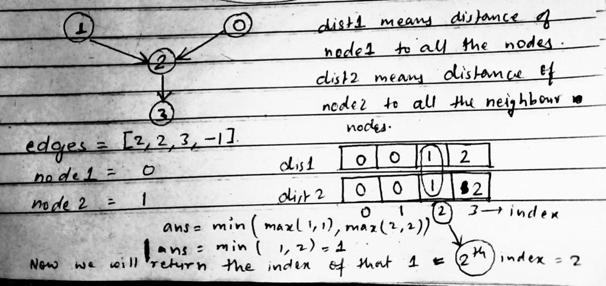

# Day 25 || Graph - DFS || Easiest Beginner Friendly Sol || O(n) time and O(n) space

**Author:** singhabhinash
**Votes:** 173
**Link:** [https://leetcode.com/problems/find-closest-node-to-given-two-nodes/solutions/3095888/](https://leetcode.com/problems/find-closest-node-to-given-two-nodes/solutions/3095888/)

---

# Intuition


<!-- Describe your first thoughts on how to solve this problem. -->

# Approach
1. Initialize variables n to the size of the edges array, ans to -1, and minDist to the maximum value of an int.
2. Create two arrays dist1 and dist2 of size n and initialize all elements to 0. Also, create two arrays visited1 and visited2 of size n and initialize all elements to false.
3. Run the depth-first search (DFS) algorithm from node1 and update the dist1 and visited1 arrays accordingly.
4. Run the DFS algorithm from node2 and update the dist2 and visited2 arrays accordingly.
5. Iterate through all nodes currNode in the graph.
6. For each node, check if it has been visited by both DFS calls, and if its maximum distance from node1 and node2 (i.e. max(dist1[currNode], dist2[currNode])) is less than the current value of minDist.
7. If the above conditions are met, update the value of minDist and ans to the current node's distance and index, respectively.
8. Return ans as the result.
This algorithm finds the closest meeting point between two given nodes in a graph by using DFS to calculate the distance from each node to all other nodes in the graph. It only considers nodes that are reachable from both given nodes, and chooses the one that has the smallest maximum distance from the two given nodes.
<!-- Describe your approach to solving the problem. -->

# Code
```C++ []
class Solution {
public:
    void dfs(int node, vector<int>& edges, vector<int>& distance, vector<bool>& visited){
        visited[node] = true;
        int neighbor = edges[node];
        if (neighbor != -1 && visited[neighbor] == false) {
            distance[neighbor] = distance[node] + 1;
            dfs(neighbor, edges, distance, visited);
        }
    }
    //we are using DFS to solve this problem
    int closestMeetingNode(vector<int>& edges, int node1, int node2) {
        int n = edges.size();
        int ans = -1;
        int minDist = INT_MAX;
        //dist1 store the distance from node1 to all the neighbour nodes and dist2 store the distance from node2 to all the neighbour nodes
        vector<int> dist1(n, 0), dist2(n, 0);
        //visited array helps us to identify wheather we visited to particular node form node1 or not similarly for visited2
        vector<bool> visited1(n, false), visited2(n, false);
        //calling dfs from both the nodes i.e. node1 and node2
        dfs(node1, edges, dist1, visited1);
        dfs(node2, edges, dist2, visited2);

        for(int currNode = 0; currNode < n; currNode++){
            if(visited1[currNode] == true && visited2[currNode] == true && minDist > max(dist1[currNode], dist2[currNode])){
                minDist = max(dist1[currNode], dist2[currNode]);
                ans = currNode;
            }
        }
        return ans;
    }
};
```
```Java []
class Solution {
    public void dfs(int node, int[] edges, int[] distance, boolean[] visited) {
        visited[node] = true;
        int neighbor = edges[node];
        if (neighbor != -1 && !visited[neighbor]) {
            distance[neighbor] = distance[node] + 1;
            dfs(neighbor, edges, distance, visited);
        }
    }

    public int closestMeetingNode(int[] edges, int node1, int node2) {
        int n = edges.length;
        int ans = -1;
        int minDist = Integer.MAX_VALUE;
        int[] dist1 = new int[n];
        int[] dist2 = new int[n];
        boolean[] visited1 = new boolean[n];
        boolean[] visited2 = new boolean[n];
        dfs(node1, edges, dist1, visited1);
        dfs(node2, edges, dist2, visited2);

        for (int currNode = 0; currNode < n; currNode++) {
            if (visited1[currNode] && visited2[currNode] && minDist > Math.max(dist1[currNode], dist2[currNode])) {
                minDist = Math.max(dist1[currNode], dist2[currNode]);
                ans = currNode;
            }
        }
        return ans;
    }
}

```
```Python []
class Solution:
    def dfs(self, node, edges, distance, visited):
        visited[node] = True
        neighbor = edges[node]
        if neighbor != -1 and visited[neighbor] == False:
            distance[neighbor] = distance[node] + 1
            self.dfs(neighbor, edges, distance, visited)

    def closestMeetingNode(self, edges, node1, node2):
        n = len(edges)
        ans = -1
        minDist = float("inf")
        dist1 = [0] * n
        dist2 = [0] * n
        visited1 = [False] * n
        visited2 = [False] * n
        self.dfs(node1, edges, dist1, visited1)
        self.dfs(node2, edges, dist2, visited2)

        for currNode in range(n):
            if visited1[currNode] and visited2[currNode] and minDist > max(dist1[currNode], dist2[currNode]):
                minDist = max(dist1[currNode], dist2[currNode])
                ans = currNode

        return ans

```

# Complexity
- Time complexity: **O(n)** // where n is the number of nodes
<!-- Add your time complexity here, e.g. $$O(n)$$ -->

- Space complexity: **O(n)** // we are using visited, distance array of size n
<!-- Add your space complexity here, e.g. $$O(n)$$ -->