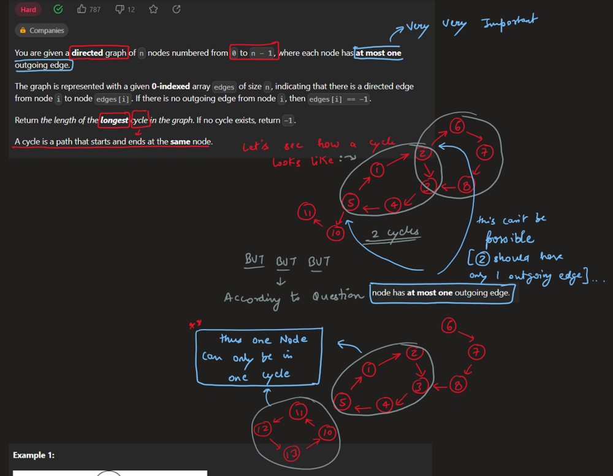
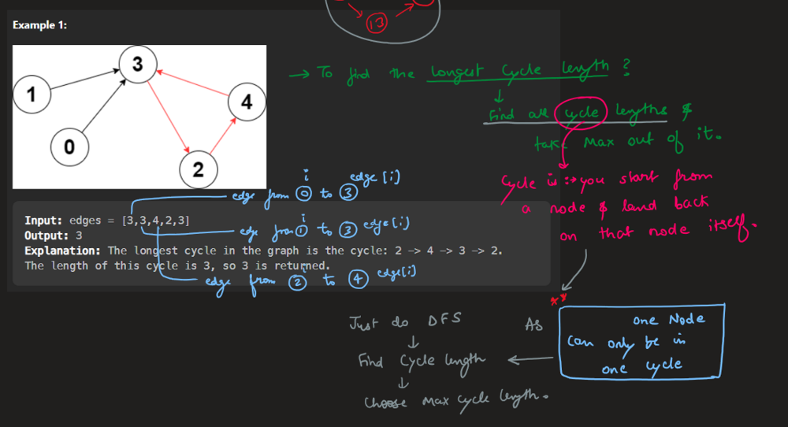
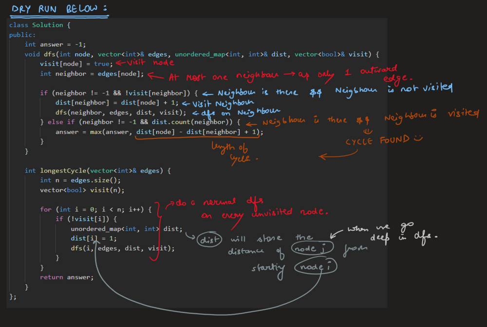
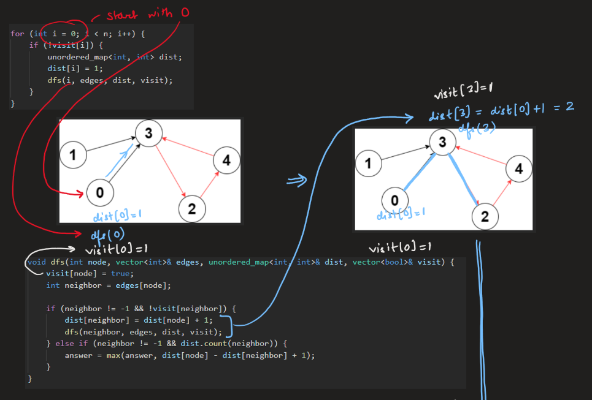
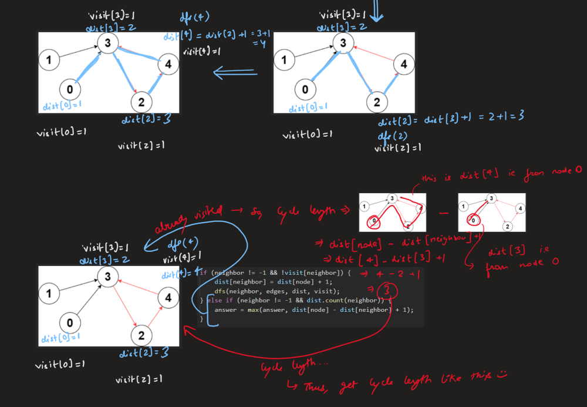

# Image Explanation🏆- [Complete Intuition - DFS] - C++/Java/Python

**Author:** aryan_0077
**Votes:** 49
**Link:** [https://leetcode.com/problems/longest-cycle-in-a-graph/solutions/3342721/](https://leetcode.com/problems/longest-cycle-in-a-graph/solutions/3342721/)

---

# Video Solution (`Aryan Mittal`)

`Longest Cycle in a Graph` by `Aryan Mittal`


# Approach & Intution







# Code
```C++ []
class Solution {
public:
    int answer = -1;
    void dfs(int node, vector<int>& edges, unordered_map<int, int>& dist, vector<bool>& visit) {
        visit[node] = true;
        int neighbor = edges[node];

        if (neighbor != -1 && !visit[neighbor]) {
            dist[neighbor] = dist[node] + 1;
            dfs(neighbor, edges, dist, visit);
        } else if (neighbor != -1 && dist.count(neighbor)) {
            answer = max(answer, dist[node] - dist[neighbor] + 1);
        }
    }

    int longestCycle(vector<int>& edges) {
        int n = edges.size();
        vector<bool> visit(n);

        for (int i = 0; i < n; i++) {
            if (!visit[i]) {
                unordered_map<int, int> dist;
                dist[i] = 1;
                dfs(i, edges, dist, visit);
            }
        }
        return answer;
    }
};
```
```Java []
class Solution {
    int answer = -1;

    public void dfs(int node, int[] edges, Map<Integer, Integer> dist, boolean[] visit) {
        visit[node] = true;
        int neighbor = edges[node];

        if (neighbor != -1 && !visit[neighbor]) {
            dist.put(neighbor, dist.get(node) + 1);
            dfs(neighbor, edges, dist, visit);
        } else if (neighbor != -1 && dist.containsKey(neighbor)) {
            answer = Math.max(answer, dist.get(node) - dist.get(neighbor) + 1);
        }
    }

    public int longestCycle(int[] edges) {
        int n = edges.length;
        boolean[] visit = new boolean[n];

        for (int i = 0; i < n; i++) {
            if (!visit[i]) {
                Map<Integer, Integer> dist = new HashMap<>();
                dist.put(i, 1);
                dfs(i, edges, dist, visit);
            }
        }
        return answer;
    }
}
```
```Python3 []
from typing import List, Dict

class Solution:
    answer = -1

    def dfs(self, node: int, edges: List[int], dist: Dict[int, int], visit: List[bool]):
        visit[node] = True
        neighbor = edges[node]

        if neighbor != -1 and not visit[neighbor]:
            dist[neighbor] = dist[node] + 1
            self.dfs(neighbor, edges, dist, visit)
        elif neighbor != -1 and neighbor in dist:
            self.answer = max(self.answer, dist[node] - dist[neighbor] + 1)

    def longestCycle(self, edges: List[int]) -> int:
        n = len(edges)
        visit = [False] * n

        for i in range(n):
            if not visit[i]:
                dist = {i: 1}
                self.dfs(i, edges, dist, visit)

        return self.answer
```
