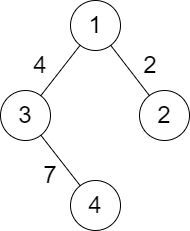

# [2492. Minimum Score of a Path Between Two Cities](https://leetcode.com/problems/minimum-score-of-a-path-between-two-cities/)

| Category | Difficulty | Likes | Dislikes |
| :------: | :--------: | :---: | :------: |
| Algorithms | Medium | 1888 | 322 |

**Tags:** [`depth-first-search`](https://leetcode.com/tag/depth-first-search), [`breadth-first-search`](https://leetcode.com/tag/breadth-first-search), [`union-find`](https://leetcode.com/tag/union-find), [`graph`](https://leetcode.com/tag/graph)

**Companies:** `bloomberg`, `google`, `amazon`, `unbxd`

## Description

You are given a positive integer `n` representing `n` cities numbered from `1` to `n`. You are also given a **2D** array `roads` where `roads[i] = [a_i, b_i, distance_i]` indicates that there is a **bidirectional **road between cities `a_i` and `b_i` with a distance equal to `distance_i`. The cities graph is not necessarily connected.

The **score** of a path between two cities is defined as the **minimum **distance of a road in this path.

Return *the **minimum **possible score of a path between cities *`1`* and *`n`.

**Note**:

	- A path is a sequence of roads between two cities.

	- It is allowed for a path to contain the same road **multiple** times, and you can visit cities `1` and `n` multiple times along the path.

	- The test cases are generated such that there is **at least** one path between `1` and `n`.

 

**Example 1:**


```

Input: n = 4, roads = [[1,2,9],[2,3,6],[2,4,5],[1,4,7]]
Output: 5
Explanation: The path from city 1 to 4 with the minimum score is: 1 -&gt; 2 -&gt; 4. The score of this path is min(9,5) = 5.
It can be shown that no other path has less score.

```

**Example 2:**


```

Input: n = 4, roads = [[1,2,2],[1,3,4],[3,4,7]]
Output: 2
Explanation: The path from city 1 to 4 with the minimum score is: 1 -&gt; 2 -&gt; 1 -&gt; 3 -&gt; 4. The score of this path is min(2,2,4,7) = 2.

```

 

**Constraints:**

	- `2 <= n <= 10^5`

	- `1 <= roads.length <= 10^5`

	- `roads[i].length == 3`

	- `1 <= a_i, b_i <= n`

	- `a_i != b_i`

	- `1 <= distance_i <= 10^4`

	- There are no repeated edges.

	- There is at least one path between `1` and `n`.

---

**Links:** [Submissions](https://leetcode.com/problems/minimum-score-of-a-path-between-two-cities/) | [Solutions](https://leetcode.com/problems/minimum-score-of-a-path-between-two-cities/)
