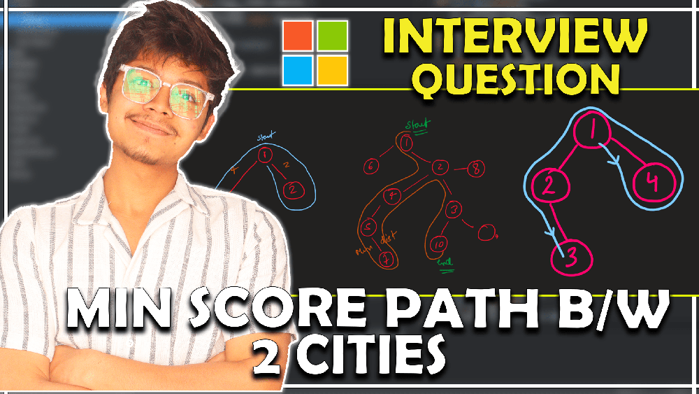
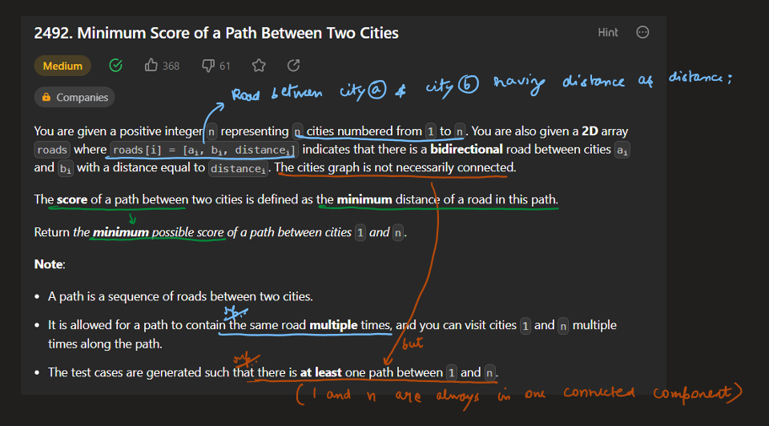
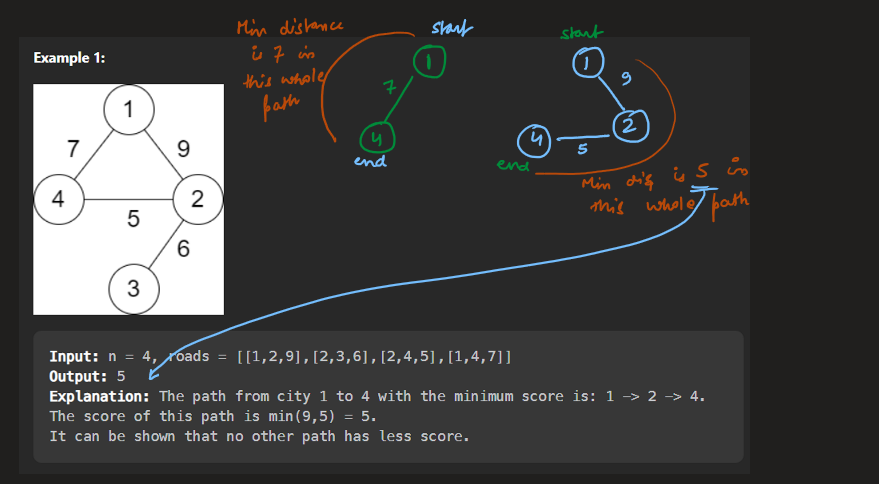
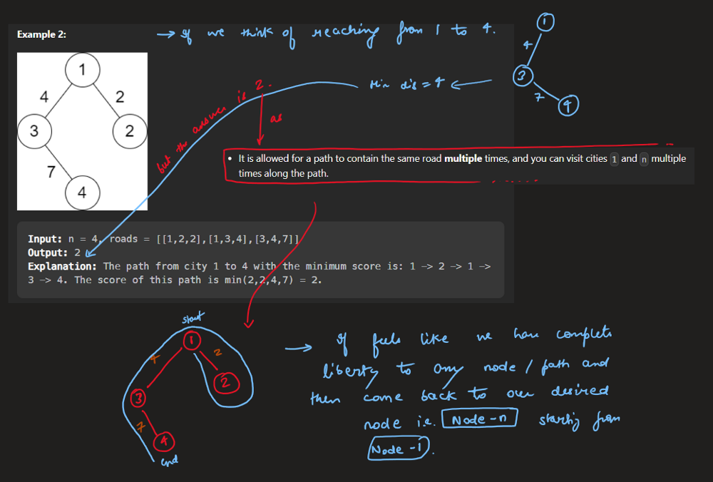
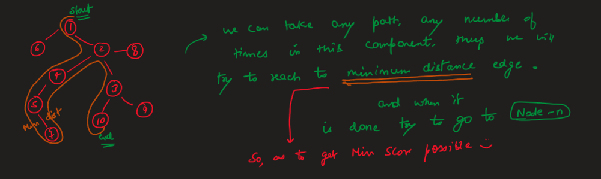
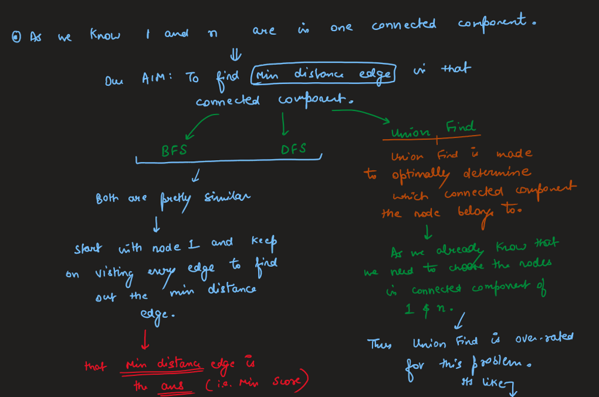
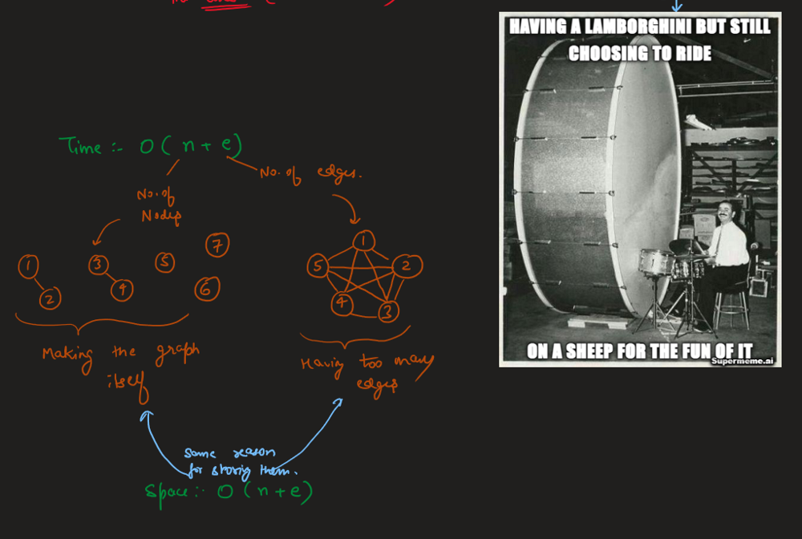
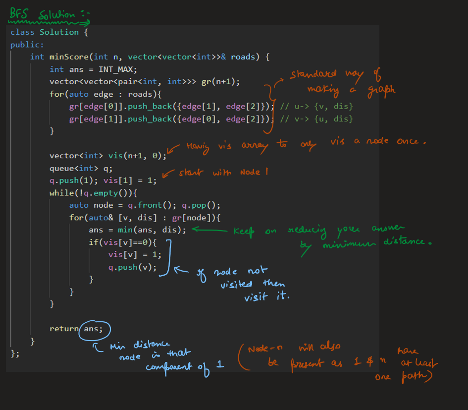
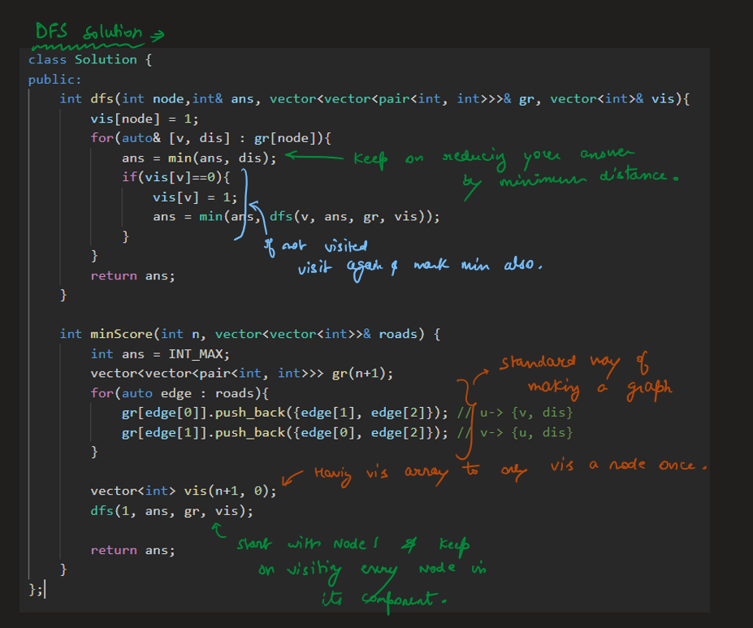

# Image Explanation🏆- [Both BFS & DFS Approaches] - C++/Java/Python (Union Find is Overrated)

**Author:** aryan_0077
**Votes:** 112
**Link:** [https://leetcode.com/problems/minimum-score-of-a-path-between-two-cities/solutions/3326775/](https://leetcode.com/problems/minimum-score-of-a-path-between-two-cities/solutions/3326775/)

---

# Video Solution
`Minimum Score of a Path Between Two Cities by Aryan Mittal`



# Approach & Intution










# BFS Code
```C++ []
class Solution {
public:
    int minScore(int n, vector<vector<int>>& roads) {
        int ans = INT_MAX;
        vector<vector<pair<int, int>>> gr(n+1);
        for(auto edge : roads){ 
            gr[edge[0]].push_back({edge[1], edge[2]}); // u-> {v, dis}
            gr[edge[1]].push_back({edge[0], edge[2]}); // v-> {u, dis}
        }

        vector<int> vis(n+1, 0);
        queue<int> q;
        q.push(1); vis[1] = 1;
        while(!q.empty()){
            auto node = q.front(); q.pop();
            for(auto& [v, dis] : gr[node]){
                ans = min(ans, dis);
                if(vis[v]==0){
                    vis[v] = 1;
                    q.push(v);
                }
            }
        }

        return ans;
    }
};
```
```Java []
class Solution {
    public int minScore(int n, int[][] roads) {
        int ans = Integer.MAX_VALUE;
        List<List<Pair<Integer, Integer>>> gr = new ArrayList<>();
        for(int i = 0; i < n+1; i++) {
            gr.add(new ArrayList<Pair<Integer, Integer>>());
        }

        for(int[] edge : roads) { 
            gr.get(edge[0]).add(new Pair<>(edge[1], edge[2])); // u-> {v, dis}
            gr.get(edge[1]).add(new Pair<>(edge[0], edge[2])); // v-> {u, dis}
        }

        int[] vis = new int[n+1];
        Arrays.fill(vis, 0);
        Queue<Integer> q = new LinkedList<>();
        q.add(1);
        vis[1] = 1;
        while(!q.isEmpty()) {
            int node = q.poll();
            for(Pair<Integer, Integer> pair : gr.get(node)) {
                int v = pair.getKey();
                int dis = pair.getValue();
                ans = Math.min(ans, dis);
                if(vis[v]==0) {
                    vis[v] = 1;
                    q.add(v);
                }
            }
        }

        return ans;
    }
}
```
```Python []
from queue import Queue
from sys import maxsize

class Solution:
    def minScore(self, n: int, roads: List[List[int]]) -> int:
        ans = maxsize
        gr = [[] for _ in range(n+1)]
        for edge in roads:
            gr[edge[0]].append((edge[1], edge[2])) # u-> {v, dis}
            gr[edge[1]].append((edge[0], edge[2])) # v-> {u, dis}

        vis = [0] * (n+1)
        q = Queue()
        q.put(1)
        vis[1] = 1
        while not q.empty():
            node = q.get()
            for v, dis in gr[node]:
                ans = min(ans, dis)
                if vis[v] == 0:
                    vis[v] = 1
                    q.put(v)

        return ans
```

# DFS Code
```C++ []
class Solution {
public:
    int dfs(int node,int& ans, vector<vector<pair<int, int>>>& gr, vector<int>& vis){
        vis[node] = 1;
        for(auto& [v, dis] : gr[node]){
            ans = min(ans, dis);
            if(vis[v]==0){
                vis[v] = 1;
                ans = min(ans, dfs(v, ans, gr, vis));
            }
        }
        return ans;
    }

    int minScore(int n, vector<vector<int>>& roads) {
        int ans = INT_MAX;
        vector<vector<pair<int, int>>> gr(n+1);
        for(auto edge : roads){ 
            gr[edge[0]].push_back({edge[1], edge[2]}); // u-> {v, dis}
            gr[edge[1]].push_back({edge[0], edge[2]}); // v-> {u, dis}
        }

        vector<int> vis(n+1, 0);
        dfs(1, ans, gr, vis);

        return ans;
    }
};
```
