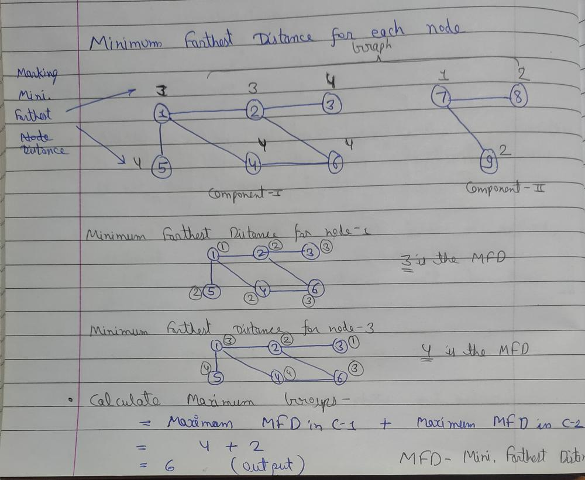

# ✅C++ | ✅Use Bipartite & Farthest Node Concept | ✅Explanation | ✅BFS+DFS

**Author:** Yash2arma
**Votes:** 26
**Link:** [https://leetcode.com/problems/divide-nodes-into-the-maximum-number-of-groups/solutions/2881606/](https://leetcode.com/problems/divide-nodes-into-the-maximum-number-of-groups/solutions/2881606/)

---

**Approach:**
1. Graph must be bipatite for dividing it into group by following given condition. If it's not bipartite then we return -1.
2. If graph is bipartite then we need to calculate minimum farthest distance of all nodes in the graph. (Here distance equals to number of nodes in the path) and among all minimum farthest distance of nodes, maximum value is the maximum number of groups into which you can divide the nodes. 
3. At last, for disconnected graph we need to calculate maximum number of groups for each component and add them which is our result.

**To understand how to calculate Minimum Farthest Distance:**


**Code:**
```
class Solution 
{
public:
    
    //function for checking whether a graph component is bipartite or not (for disconnected graph)
    bool bipartite(int src, vector<int> adj[], int color[])
    {
        queue<int> q;
        q.push(src);
        color[src]=1;
        while(!q.empty())
        {
            int node=q.front();
            q.pop();
            
            for(auto it:adj[node])
            {
                if(color[it]==-1)
                {
                    color[it] = 1-color[node];
                    q.push(it);
                }
                else if(color[it]==color[node])
                    return false;
            }
        }
        return true;  
    }
    
    //function for checking whether a graph is bipartite or not
    bool checkBipartite(int &n, vector<int> adj[])
    {
        int color[n+1];
        memset(color, -1, sizeof color);
        for(int i=1; i<=n; i++)
        {
            if(color[i]==-1)
            {
                if(!bipartite(i, adj, color)) return false;
            }
        }
        return true;
    }
    
    //function for finding distance of farthest node from the current node
    //To get the maximum number of groups
    int findFarthestDistBFS(int src, int n, vector<int> adj[])
    {
        vector<int> vis(n+1, 0);
        int cnt=0;
        queue<int> q;
        q.push(src);
        vis[src]=1;
                    
        while(!q.empty())
        {
            int sz=q.size();
            cnt++;
            
            for(int i=0; i<sz; i++)
            {
                int node = q.front();
                q.pop();

                for(auto it:adj[node])
                {
                    if(!vis[it])
                    {
                        q.push(it);
                        vis[it]=1;
                    }
                }
            }
           
        }
        return cnt;
    }
    
    //For finding maximum groups of multiple components of a graph
    int dfsForComponents(int node, vector<int> adj[], vector<int> &vist, vector<int> &dist)
    {
        vist[node]=1;
        int maxi=dist[node];
        for(auto it:adj[node])
        {
            if(!vist[it])
            {
                maxi = max(maxi, dfsForComponents(it, adj, vist, dist));
            }
        }
        return maxi;
    }
    
    //Given function
    int magnificentSets(int n, vector<vector<int>>& edges) 
    {
        //creating adjacency list
        vector<int> adj[n+1];
        for(int i=0; i<edges.size(); i++)
        {
            adj[edges[i][0]].push_back(edges[i][1]);
            adj[edges[i][1]].push_back(edges[i][0]);
        }
        
        //check whether a graph is bipartite or not
        if(!checkBipartite(n, adj)) return -1;
        
        //calcuate farthest node from each node and store in dist vector
        vector<int> dist(n+1, 0);
        for(int i=1; i<=n; i++)
        {
            dist[i] = findFarthestDistBFS(i, n, adj);
        }
        
        //for multiple components, count maximum number of groups
        vector<int> vist(n+1, 0);
        int maxi=0;
        for(int i=1; i<=n; i++)
        {
            if(vist[i]==0)
            {
                maxi += dfsForComponents(i, adj, vist, dist);
            }
        }
        return maxi;
        
    }
};
```

***For better understanding refer this video:*** [https://youtu.be/MSG7qX_UiKQ](https://youtu.be/MSG7qX_UiKQ)

**Please upvote if you find this solution helpful :)**