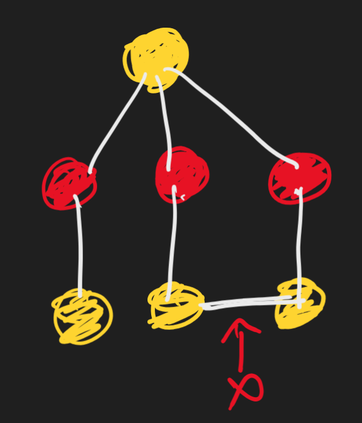
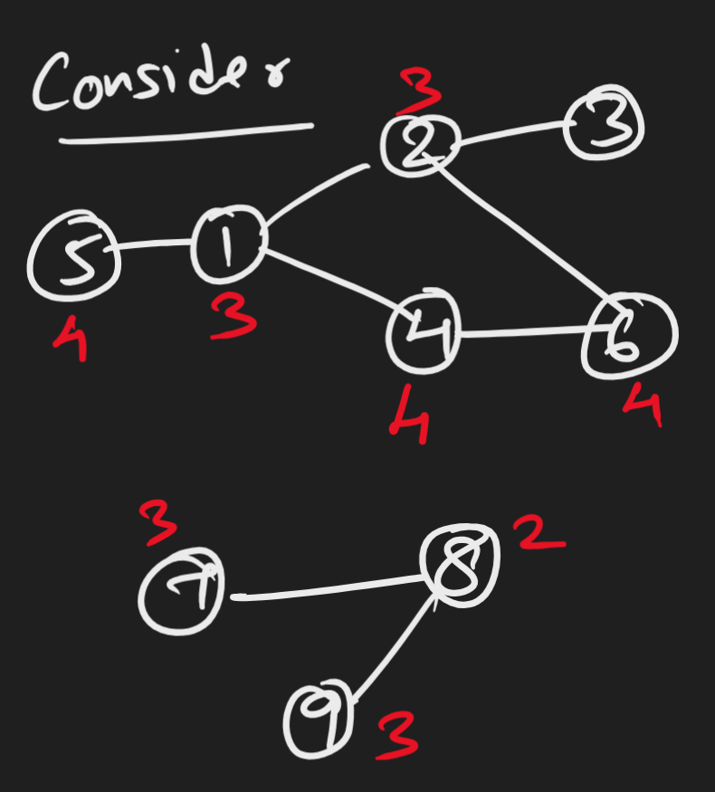
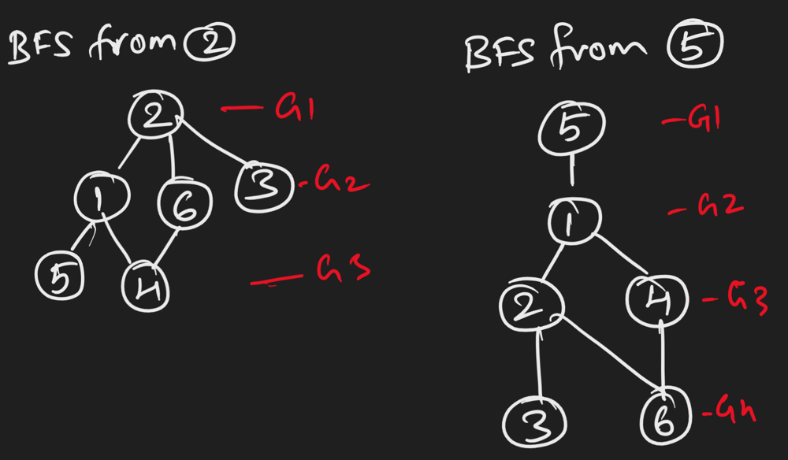

# BFS | IsBipartite & TotalGroupCount [With Explaination & Pics]

**Author:** dhinesh_kumar
**Votes:** 0
**Link:** [https://leetcode.com/problems/divide-nodes-into-the-maximum-number-of-groups/solutions/4433199/](https://leetcode.com/problems/divide-nodes-into-the-maximum-number-of-groups/solutions/4433199/)

---

# Intuition
<!-- Describe your first thoughts on how to solve this problem. -->

# Approach
**Step 1** : If all the components are not BiPartitite, return -1

Why to Identify BiPartite?
The problem statement mentions if 2 nodes are in connected by edge, they have to be in different groups. 

How to Identify Bipartite? (Please skip this if you alreay know what is Bipartite)
Consider you want split a group of people in 2 teams(Yellow/Red). But each person has some enemies, so you dont want to put them in same team.
If we start with a random person and put him/her in Yellow team, his enemies will be in Team Red. Then you see who are the enemies of those in team red and put them in Yellow team. This will be good until you find your enemy is part of your team already. 




**Step 2 **: If Bipartite, get the sum of Maximum GroupCount in each components.

What is a GroupCount?
Consider you hold the tree from a node and lift it up, the groupCount is the max levels you can go(starting from 1).The root node will be in group 1 and then the group# increases. So the groupCount of a node will be total levels in BFS(starting from 1).

Consider the below graph: (ignore the red number for now)



If we do BFS from different nodes, see we can get different group counts.



As you see, from Node 2 the group count is 3 and from Node 5 total groups formed is 4.
In the initial graph example above, the red texts represents the GroupCount when we formed BFS tree from those nodes.

I believe its clear that we know what is a GroupCount now. So the next step is easy.
We need to get the maximum group count in each components available and then sum them.

In the above example we have 2 components, so for Component 1 which ahs 1-6 nodes the MaxGroupCount = 4. And for Component 2 the MaxGroupCount = 3

So the TotalGroupCount which is the result for this probelm is the sum the MaxGroupCounts in each components.

TotalGroupCount = MaxGroupCount(Component1) + MaxGroupCount(Component2).
TotalGroupCount = 4 + 3 = 7 !!

# Complexity
- Time complexity:
<!-- Add your time complexity here, e.g. $$O(n)$$ -->

- Space complexity:
<!-- Add your space complexity here, e.g. $$O(n)$$ -->

# Code
```
public class Solution {
    public int MagnificentSets(int n, int[][] edges) {

        //Form a AdjList from the given edges
        List<List<int>> adjList = new List<List<int>>(
            Enumerable.Repeat(1,n).Select(x=> new List<int>()));
        foreach(var edge in edges){
            adjList[edge[0]-1].Add(edge[1]-1);
            adjList[edge[1]-1].Add(edge[0]-1);
        }


        //Step 1 : If all the components are not BiPartitite, return -1
        if(!isAllComponentsBipartite())
            return -1;
        //Step 2 : If Bipartite, get the sum of maximum depth in each components.
        return getTotalGroups();


        bool isAllComponentsBipartite(){
            var color = new List<int>(Enumerable.Repeat(-1,n)); //This acts as a visited array as well. To make sure the same node is not visited twice. Also used to color alternative row in different color

            for(int i=0; i<=n-1; i++){
                if(color[i] == -1)
                    if(!isBipartite(i))
                        return false;
            }                
            return true;

                //To check if the component rooted at 'root' node is bipartite
                bool isBipartite(int root){
                    Queue<int> q = new Queue<int>();
                    q.Enqueue(root);
                    color[root] = 0;

                    while(q.Count > 0){
                        int node = q.Dequeue();
                        foreach(int neighbor in adjList[node]){
                            if(color[neighbor] == -1){
                                color[neighbor] = (color[node]==0 ? 1: 0); //Change color for the next level
                                q.Enqueue(neighbor);
                            }
                            else{ //If already visited
                                if(color[neighbor] == color[node])  //And the neighbor has same color, it is a cross node within same level.
                                    return false;
                            }
                        }
                    }
                    return true;
                }
        }

        int getTotalGroups(){
            var groupCount = new List<int>(Enumerable.Repeat(-1,n));

            //Get Distance of each node in the graph
            for(int i=0; i<=n-1; i++)
                groupCount[i] = getGroupCount(i);  

            var visited = new List<int>(Enumerable.Repeat(-1,n)); //using visited to identify different component
            int totalOfMaxGroups = 0;

            //Get the max distance of each components and sum them
            for(int i=0; i<=n-1; i++){
                if(visited[i] == -1)
                    totalOfMaxGroups += getMaxGroupCountInComponent(i);
            }
            return totalOfMaxGroups;

            int getMaxGroupCountInComponent(int root){
                
                int maxGroupCount = 1;

                Queue<int> q = new Queue<int>();
                q.Enqueue(root);
                visited[root] = 1;

                while(q.Count > 0){
                    int node = q.Dequeue();
                    maxGroupCount = Math.Max(maxGroupCount, groupCount[node]);
                    foreach(int neighbor in adjList[node]){
                        if(visited[neighbor] == -1){
                            visited[neighbor] = 1;
                            q.Enqueue(neighbor);
                        }
                    }
                }
                return maxGroupCount;
            }            
        }

        int getGroupCount(int root){
            var group = new List<int>(Enumerable.Repeat(-1,n));
            int groupCount = 1;

            Queue<int> q = new Queue<int>();
            q.Enqueue(root);
            group[root] = 1;

            while(q.Count > 0){
                int node = q.Dequeue();
                groupCount = Math.Max(groupCount, group[node]);
                foreach(int neighbor in adjList[node]){
                    if(group[neighbor] == -1){
                        group[neighbor] = 1 + group[node];
                        q.Enqueue(neighbor);
                    }
                }
            }
            return groupCount;
        }
        
    }
}
```