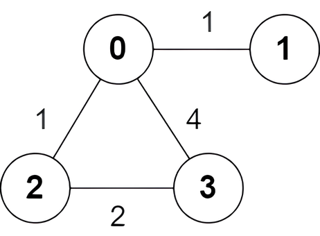

# [3123. Find Edges in Shortest Paths](https://leetcode.com/problems/find-edges-in-shortest-paths/)

| Category | Difficulty | Likes | Dislikes |
| :------: | :--------: | :---: | :------: |
| Algorithms | Hard | 299 | 5 |

**Tags:** [`depth-first-search`](https://leetcode.com/tag/depth-first-search), [`breadth-first-search`](https://leetcode.com/tag/breadth-first-search), [`graph`](https://leetcode.com/tag/graph), [`heap-priority-queue`](https://leetcode.com/tag/heap-priority-queue), [`shortest-path`](https://leetcode.com/tag/shortest-path)

**Companies:** `doordash`, `weride`

## Description

You are given an undirected weighted graph of `n` nodes numbered from 0 to `n - 1`. The graph consists of `m` edges represented by a 2D array `edges`, where `edges[i] = [a_i, b_i, w_i]` indicates that there is an edge between nodes `a_i` and `b_i` with weight `w_i`.

Consider all the shortest paths from node 0 to node `n - 1` in the graph. You need to find a **boolean** array `answer` where `answer[i]` is `true` if the edge `edges[i]` is part of **at least** one shortest path. Otherwise, `answer[i]` is `false`.

Return the array `answer`.

**Note** that the graph may not be connected.

 

**Example 1:**

**Input:** n = 6, edges = [[0,1,4],[0,2,1],[1,3,2],[1,4,3],[1,5,1],[2,3,1],[3,5,3],[4,5,2]]

**Output:** [true,true,true,false,true,true,true,false]

**Explanation:**

The following are **all** the shortest paths between nodes 0 and 5:

	- The path `0 -> 1 -> 5`: The sum of weights is `4 + 1 = 5`.

	- The path `0 -> 2 -> 3 -> 5`: The sum of weights is `1 + 1 + 3 = 5`.

	- The path `0 -> 2 -> 3 -> 1 -> 5`: The sum of weights is `1 + 1 + 2 + 1 = 5`.

**Example 2:**

**Input:** n = 4, edges = [[2,0,1],[0,1,1],[0,3,4],[3,2,2]]

**Output:** [true,false,false,true]

**Explanation:**

There is one shortest path between nodes 0 and 3, which is the path `0 -> 2 -> 3` with the sum of weights `1 + 2 = 3`.

 

**Constraints:**

	- `2 <= n <= 5 * 10^4`

	- `m == edges.length`

	- `1 <= m <= min(5 * 10^4, n * (n - 1) / 2)`

	- `0 <= a_i, b_i < n`

	- `a_i != b_i`

	- `1 <= w_i <= 10^5`

	- There are no repeated edges.

---

**Links:** [Submissions](https://leetcode.com/problems/find-edges-in-shortest-paths/) | [Solutions](https://leetcode.com/problems/find-edges-in-shortest-paths/)
