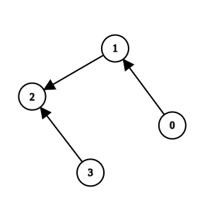
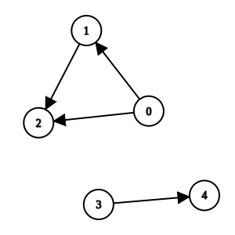

# [3310. Remove Methods From Project](https://leetcode.com/problems/remove-methods-from-project/)

| Category | Difficulty | Likes | Dislikes |
| :------: | :--------: | :---: | :------: |
| Algorithms | Medium | 155 | 57 |

**Tags:** [`depth-first-search`](https://leetcode.com/tag/depth-first-search), [`breadth-first-search`](https://leetcode.com/tag/breadth-first-search), [`graph`](https://leetcode.com/tag/graph)

## Description

You are maintaining a project that has `n` methods numbered from `0` to `n - 1`.

You are given two integers `n` and `k`, and a 2D integer array `invocations`, where `invocations[i] = [a_i, b_i]` indicates that method `a_i` invokes method `b_i`.

There is a known bug in method `k`. Method `k`, along with any method invoked by it, either **directly** or **indirectly**, are considered **suspicious** and we aim to remove them.

A group of methods can only be removed if no method **outside** the group invokes any methods **within** it.

Return an array containing all the remaining methods after removing all the **suspicious** methods. You may return the answer in *any order*. If it is not possible to remove **all** the suspicious methods, **none** should be removed.

 

**Example 1:**

**Input:** n = 4, k = 1, invocations = [[1,2],[0,1],[3,2]]

**Output:** [0,1,2,3]

**Explanation:**

Method 2 and method 1 are suspicious, but they are directly invoked by methods 3 and 0, which are not suspicious. We return all elements without removing anything.

**Example 2:**

**Input:** n = 5, k = 0, invocations = [[1,2],[0,2],[0,1],[3,4]]

**Output:** [3,4]

**Explanation:**

Methods 0, 1, and 2 are suspicious and they are not directly invoked by any other method. We can remove them.

**Example 3:**

**Input:** n = 3, k = 2, invocations = [[1,2],[0,1],[2,0]]

**Output:** []

**Explanation:**

All methods are suspicious. We can remove them.

 

**Constraints:**

	- `1 <= n <= 10^5`

	- `0 <= k <= n - 1`

	- `0 <= invocations.length <= 2 * 10^5`

	- `invocations[i] == [a_i, b_i]`

	- `0 <= a_i, b_i <= n - 1`

	- `a_i != b_i`

	- `invocations[i] != invocations[j]`

---

**Links:** [Submissions](https://leetcode.com/problems/remove-methods-from-project/) | [Solutions](https://leetcode.com/problems/remove-methods-from-project/)
