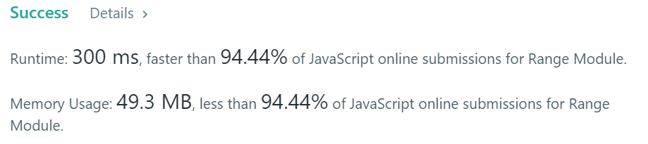

# Javascript Simple Solution With Explanation

**Author:** TheBigBadWolf
**Votes:** 13
**Link:** [https://leetcode.com/problems/range-module/solutions/831142/](https://leetcode.com/problems/range-module/solutions/831142/)

---

```
var RangeModule = function() {
    this.intervals = [];
};

/** 
 * @param {number} left 
 * @param {number} right
 * @return {void}
 */
RangeModule.prototype.addRange = function(left, right) {
    let newInterval = [left, right];
    let i = 0;
    // skip all the intervals until starts
    while(i < this.intervals.length && this.intervals[i][1] < newInterval[0]) {
        i++;
    }
    // merge all overlapping intervals to one considering newInterval
    while(i < this.intervals.length && this.intervals[i][0] <= newInterval[1]) {
        newInterval = [Math.min(newInterval[0], this.intervals[i][0]), Math.max(newInterval[1], this.intervals[i][1])];
        this.intervals.splice(i, 1);
        // no need to increment i because we spliced
    }
    // add the union of intervals we got
    this.intervals.splice(i, 0, newInterval);
    // the rest are fine so we finished  
};

/** 
 * @param {number} left 
 * @param {number} right
 * @return {boolean}
 */
RangeModule.prototype.queryRange = function(left, right) {
    let low = 0;
    let high = this.intervals.length-1;
    while(low <= high) {
        let mid = low + (Math.floor((high - low) / 2));
        if(this.intervals[mid][0] <= left && this.intervals[mid][1] >= right) {
            return true;
        } else if (this.intervals[mid][0] > left) {
            high = mid - 1;
        } else {
            low = mid + 1;
        }
    }
    return false;
};

/** 
 * @param {number} left 
 * @param {number} right
 * @return {void}
 */
RangeModule.prototype.removeRange = function(left, right) {
    let i = 0;
    while(i < this.intervals.length && this.intervals[i][1] < left) {
        i++;
    }
    if(i < this.intervals.length && this.intervals[i][0] < left) {
        let newIntervalBefore = [this.intervals[i][0], left];
        // the interval to delete is between one of the intervals
        if(right < this.intervals[i][1]) {
            let newIntervalAfter = [right, this.intervals[i][1]];
            this.intervals.splice(i, 1, newIntervalBefore, newIntervalAfter);
            return;
        }
        this.intervals.splice(i, 1, newIntervalBefore);
        i++;
    }
    while(i < this.intervals.length && right >= this.intervals[i][1]) {
        this.intervals.splice(i, 1);
    }
    if(i < this.intervals.length && right > this.intervals[i][0]) {
        let newIntervalAfter = [right, this.intervals[i][1]];
        this.intervals.splice(i, 1, newIntervalAfter);
    }
}
```
addRange - time complexity o(n) 
queryRange - time complexity o(logn)
removeRange - time complexity o(n)

