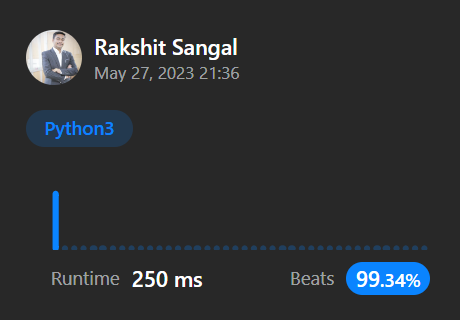

# Beating 99.34% Python Easiest Solution

**Author:** celestial2897
**Votes:** 18
**Link:** [https://leetcode.com/problems/number-of-recent-calls/solutions/3568692/](https://leetcode.com/problems/number-of-recent-calls/solutions/3568692/)

---




# Code
```
from collections import deque
class RecentCounter:

    def __init__(self):
        self.q = deque()
        
    def ping(self, t: int) -> int:
        self.q.append(t)
        
        while t - self.q[0] > 3000:
            self.q.popleft()
            
        return len(self.q)
        
# Your RecentCounter object will be instantiated and called as such:
# obj = RecentCounter()
# param_1 = obj.ping(t)
```