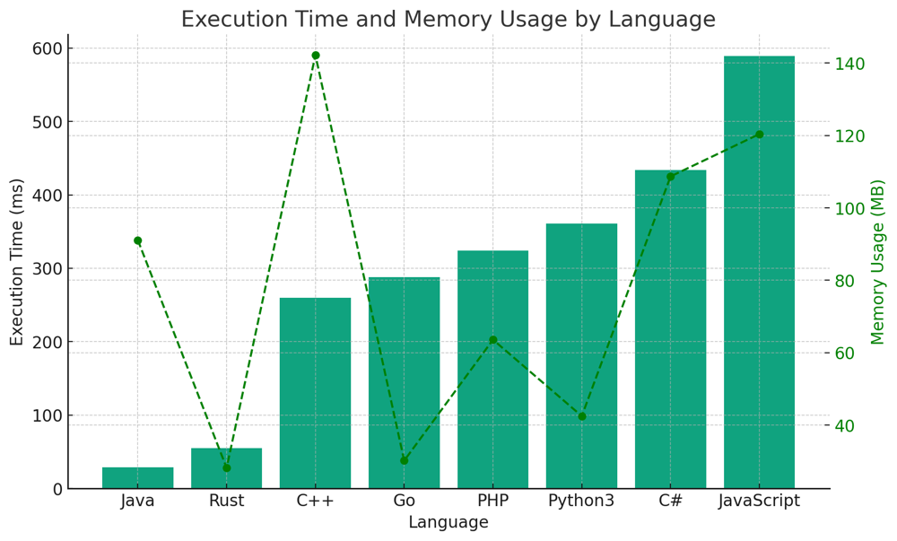

# ✅ 98.78%  Counter and Min-Heap

**Author:** vanAmsen
**Votes:** 95
**Link:** [https://leetcode.com/problems/seat-reservation-manager/solutions/4254452/](https://leetcode.com/problems/seat-reservation-manager/solutions/4254452/)

---

# Intuition
When we think about reserving and unreserving seats, our first thought is that we need to keep track of the available seats in an ordered fashion. We should be able to reserve the smallest available seat quickly and also be able to unreserve any seat efficiently. This leads us to think of data structures like sorted lists or heaps.

# Live Coding & More
https://youtu.be/GUuaJSMM2_8?si=U3bh4PfssOM8266_

# Approach
The approach we've taken is a combination of a **Counter and Min-Heap** strategy.

1. **Counter (`last`)**: This keeps track of the latest continuous seat that's been reserved. For example, if seats 1, 2, and 3 are reserved and no unreservations have been made, `last` will be 3.
  
2. **Min-Heap (`pq`)**: This is used to keep track of seats that have been unreserved and are out of the continuous sequence. For instance, if someone reserves seats 1, 2, and 3, and then unreserves seat 2, then seat 2 will be added to the min-heap.

The logic for the `reserve` and `unreserve` functions is as follows:

- `reserve`:
  - If the min-heap is empty, simply increment the `last` counter and return it.
  - If the min-heap has seats (i.e., there are unreserved seats), pop the smallest seat from the heap and return it.

- `unreserve`:
  - If the seat being unreserved is the last seat in the continuous sequence, decrement the `last` counter.
  - Otherwise, add the unreserved seat to the min-heap.

# Complexity
- **Time complexity**:
  - `reserve`: Average $O(1)$ (when using the counter), but $O(\\log n)$ (when using the min-heap).
  - `unreserve`: $O(\\log n)$ (due to the min-heap operation).

- **Space complexity**: $O(n)$. This is the worst-case scenario where all seats have been reserved and then unreserved, filling up the min-heap.

# Code
``` Python []
class SeatManager:

    def __init__(self, n: int):
        self.last = 0
        self.pq = []

    def reserve(self) -> int:
        if not self.pq:
            self.last += 1
            return self.last
        return heapq.heappop(self.pq)

    def unreserve(self, seatNumber: int) -> None:
        if seatNumber == self.last:
            self.last -= 1
        else:
            heapq.heappush(self.pq, seatNumber)
```
``` Java []
public class SeatManager {
    private int last;
    private PriorityQueue<Integer> pq;

    public SeatManager(int n) {
        this.last = 0;
        this.pq = new PriorityQueue<>();
    }

    public int reserve() {
        if (pq.isEmpty()) {
            return ++last;
        } else {
            return pq.poll();
        }
    }

    public void unreserve(int seatNumber) {
        if (seatNumber == last) {
            --last;
        } else {
            pq.offer(seatNumber);
        }
    }
}
```
``` C++ []
class SeatManager {
private:
    int last;
    std::priority_queue<int, std::vector<int>, std::greater<int>> pq;

public:
    SeatManager(int n) : last(0) {}

    int reserve() {
        if (pq.empty()) {
            return ++last;
        } else {
            int seat = pq.top();
            pq.pop();
            return seat;
        }
    }

    void unreserve(int seatNumber) {
        if (seatNumber == last) {
            --last;
        } else {
            pq.push(seatNumber);
        }
    }
};
```
``` C# []
public class SeatManager {
    private int last;
    private SortedSet<int> pq;

    public SeatManager(int n) {
        this.last = 0;
        this.pq = new SortedSet<int>();
    }

    public int Reserve() {
        if (!pq.Any()) {
            return ++last;
        } else {
            int seat = pq.Min;
            pq.Remove(seat);
            return seat;
        }
    }

    public void Unreserve(int seatNumber) {
        if (seatNumber == last) {
            --last;
        } else {
            pq.Add(seatNumber);
        }
    }
}
```
``` Go []
package main

import (
	"container/heap"
)

type SeatManager struct {
	last int
	pq   IntHeap
}

func Constructor(n int) SeatManager {
	return SeatManager{
		last: 0,
		pq:   make(IntHeap, 0),
	}
}

func (this *SeatManager) Reserve() int {
	if len(this.pq) == 0 {
		this.last++
		return this.last
	}
	return heap.Pop(&this.pq).(int)
}

func (this *SeatManager) Unreserve(seatNumber int) {
	if seatNumber == this.last {
		this.last--
	} else {
		heap.Push(&this.pq, seatNumber)
	}
}

type IntHeap []int

func (h IntHeap) Len() int           { return len(h) }
func (h IntHeap) Less(i, j int) bool { return h[i] < h[j] }
func (h IntHeap) Swap(i, j int)      { h[i], h[j] = h[j], h[i] }

func (h *IntHeap) Push(x interface{}) {
	*h = append(*h, x.(int))
}

func (h *IntHeap) Pop() interface{} {
	old := *h
	n := len(old)
	x := old[n-1]
	*h = old[0 : n-1]
	return x
}
```
``` Rust []
use std::collections::BinaryHeap;
use std::cmp::Reverse;

struct SeatManager {
    last: i32,
    pq: BinaryHeap<Reverse<i32>>,
}

impl SeatManager {
    fn new(n: i32) -> Self {
        SeatManager {
            last: 0,
            pq: BinaryHeap::new(),
        }
    }

    fn reserve(&mut self) -> i32 {
        if self.pq.is_empty() {
            self.last += 1;
            self.last
        } else {
            let seat = self.pq.pop().unwrap().0;
            seat
        }
    }

    fn unreserve(&mut self, seat_number: i32) {
        if seat_number == self.last {
            self.last -= 1;
        } else {
            self.pq.push(Reverse(seat_number));
        }
    }
}
```
``` JavaScript []
class SeatManager {
    constructor(n) {
        this.last = 0;
        this.pq = [];
    }

    reserve() {
        if (this.pq.length === 0) {
            return ++this.last;
        } else {
            this.pq.sort((a, b) => a - b);
            return this.pq.shift();
        }
    }

    unreserve(seatNumber) {
        if (seatNumber === this.last) {
            this.last--;
        } else {
            this.pq.push(seatNumber);
        }
    }
}
```
``` PHP []
<?php
class SeatManager {
    private $last;
    private $pq;

    function __construct($n) {
        $this->last = 0;
        $this->pq = new SplPriorityQueue();
    }

    function reserve() {
        if ($this->pq->isEmpty()) {
            return ++$this->last;
        } else {
            return $this->pq->extract();
        }
    }

    function unreserve($seatNumber) {
        if ($seatNumber == $this->last) {
            $this->last--;
        } else {
            $this->pq->insert($seatNumber, -$seatNumber);
        }
    }
}
?>
```

# Performance

| Language | Execution Time (ms) | Memory Usage (MB) |
|----------|---------------------|-------------------|
| Java     | 29                  | 91.1              |
| Rust     | 55                  | 28.2              |
| C++      | 260                 | 142.2             |
| Go       | 288                 | 30.2              |
| PHP      | 324                 | 63.6              |
| Python3  | 361                 | 42.5              |
| C#       | 434                 | 108.7             |
| JavaScript       | 589                 | 120.4             |




# Why does it work?
The approach works because we are always prioritizing the smallest available seat. The counter (`last`) ensures that if we are in a continuous sequence of reservations, we avoid any complex operations and simply increment a value. The min-heap ensures that once seats are unreserved and out of sequence, we can still reserve the smallest available seat efficiently.

# What optimization was made?
The major optimization here is the introduction of the `last` counter. Instead of always relying on a heap or list operation (which can be log-linear or linear in time), we often use a constant-time operation when the seats are reserved in sequence.

# What did we learn?
Using a combination of simple counters and more complex data structures like heaps can offer a balance between simplicity and efficiency. The counter handles the common case (continuous seat reservation), and the heap handles the edge case (out-of-sequence unreservations). This ensures that our solution is both fast and handles all possible scenarios.