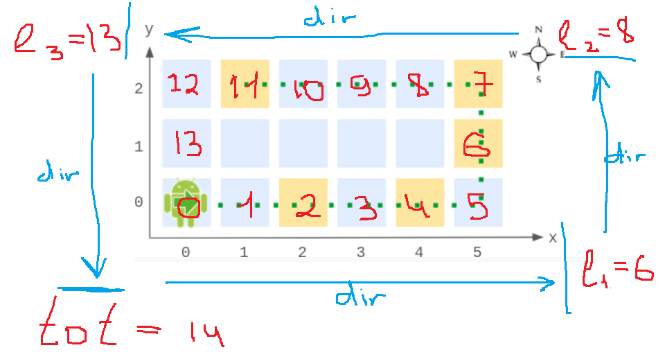

# c++(176ms 91%) O1time (commented)

**Author:** ZX007PI
**Votes:** 10
**Link:** [https://leetcode.com/problems/walking-robot-simulation-ii/solutions/1575907/](https://leetcode.com/problems/walking-robot-simulation-ii/solutions/1575907/)

---




**General idea:**
1. calculate **total path** as : (width + hight) * 2  - 4 
2. whan we calculate move : **new pos** = ( **old pos** + **num** ) % **total path**
3. when we calculate coordinates : check where our pos 
   first interval **[0; l1)** or second interval **[ l1 ; l2)** or third interval **[ l2 ; l3)** or last interval
4. when we calculate direction - we do like step 3 (exption is start position for this case I use **flag**)


Runtime: 176 ms, faster than 90.91% of C++ online submissions for Walking Robot Simulation II.
Memory Usage: 120.5 MB, less than 27.27% of C++ online submissions for Walking Robot Simulation II.
```
class Robot {
public:
  int pos, tot, l1, l2, l3, max_y, max_x;
  bool flag = true;
  
  Robot(int w, int h) {
    pos = 0;
    max_y = h - 1, max_x = w - 1; 
    l1  = w;
    l2  = l1 + h - 1;
    l3  = l2 + w - 1;
    tot = l3 + h - 2;
  }
    
  void move(int num){
    flag = false;
    pos = (pos + num)%tot;
  }
    
  vector<int> getPos() {
    if(pos < l1) return {pos, 0};
    if(pos < l2) return {max_x, pos - l1 + 1};
    if(pos < l3) return {l3 - pos - 1, max_y};
    
    return {0 , tot - pos};      
  }
    
  string getDir() {
    if(flag) return "East";
    
    if(pos == 0) return "South";
    if(pos < l1) return "East";
    if(pos < l2) return "North";
    if(pos < l3) return "West";
    
    return "South"; 
  }
};
```