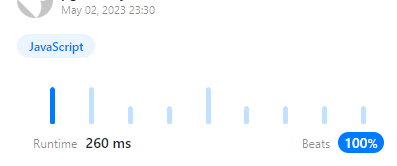

# [JavaScript] 2069. Walking Robot Simulation II

**Author:** pgmreddy
**Votes:** 10
**Link:** [https://leetcode.com/problems/walking-robot-simulation-ii/solutions/3478796/](https://leetcode.com/problems/walking-robot-simulation-ii/solutions/3478796/)

---

# Intuition
<!-- Describe your first thoughts on how to solve this problem. -->

# Approach

I struggled intial tries

On paper, we can easily derive below:
- Robot always walks on the outer rim of the grid ( circle/ cycle )
- 0,0 position changes from East to South once we cricle back to it

# Complexity
- Time complexity:
<!-- Add your time complexity here, e.g. $$O(n)$$ -->

- Space complexity:
<!-- Add your space complexity here, e.g. $$O(n)$$ -->

# Code

1
```
var Robot = function (W, H) {
    const dirs = ["East", "North", "West", "South"];

    const a = []; // single dimension array of [x, y, direction] of grid's outer rim
    for (let x = 0; x < W; x++)      a.push([x, 0, 0]);     // go East
    for (let y = 1; y < H; y++)      a.push([W - 1, y, 1]); // go North
    for (let x = W - 2; x >= 0; x--) a.push([x, H - 1, 2]); // go West
    for (let y = H - 2; y > 0; y--)  a.push([0, y, 3]);     // go South

    let i = 0;
    Robot.prototype.step = function (num) {
        i = (i + num) % a.length;   // mod to simulate cycle/ circle
        a[0][2] = 3;                // once moved, direction becomes South for 0,0
    };
    Robot.prototype.getPos = function () {
        return a[i].slice(0, 2);    // 1st two - x & y
    };
    Robot.prototype.getDir = function () {
        return dirs[ a[i][2] ];       // last one - direction - as string
    };
};
```

---



---
