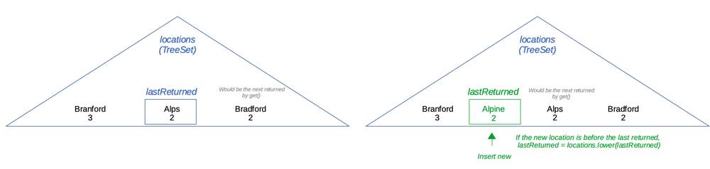

# [Java] TreeSet + pointer (simple)

**Author:** tobias2code
**Votes:** 41
**Link:** [https://leetcode.com/problems/sequentially-ordinal-rank-tracker/solutions/1623437/](https://leetcode.com/problems/sequentially-ordinal-rank-tracker/solutions/1623437/)

---

Idea: 
- Use a TreeSet to maintain sorted locations
- Use a pointer to keep track of the last returned index
- When adding a location, shift the pointer if needed (using `TreeMap.lower` to get the previous element)




```
class SORTracker {
    private TreeSet<Location> locations = new TreeSet<>(); 
    private Location lastReturned = new Location("", Integer.MAX_VALUE); // Last returned (or equivalent)
    
    public void add(String name, int score) {
        Location location = new Location(name, score);
        locations.add(location);
        
		// If the new location is before the last returned, we need to update the pointer
        if (location.compareTo(lastReturned) < 0) {
            lastReturned = locations.lower(lastReturned);
        }
    }
    
    public String get() {
        // Update the pointer
        lastReturned = locations.higher(lastReturned);
        
        return lastReturned.name;
    }
    
    private static class Location implements Comparable<Location> {
        private final String name;
        private final int score;
        
        public Location(String name, int score) {
            this.name = name;
            this.score = score;
        }
        
        public int compareTo(Location l) {
            // Sort by score (desc), then name (asc)
            return score != l.score ? -Integer.compare(score, l.score) : name.compareTo(l.name);
        }
    }
}
```

Comments and questions welcome :)