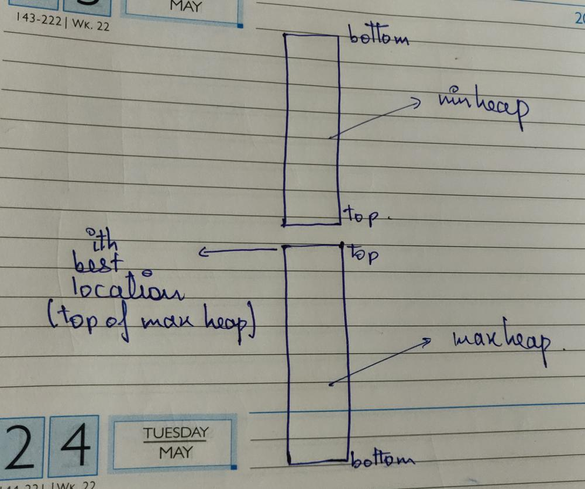

# Python | Two Solutions | sortedContainers and minHeap+maxHeap with Explanation

**Author:** jaidev2
**Votes:** 3
**Link:** [https://leetcode.com/problems/sequentially-ordinal-rank-tracker/solutions/3842245/](https://leetcode.com/problems/sequentially-ordinal-rank-tracker/solutions/3842245/)

---

First Solution (Using sortedcontainers):
Here we use SortedList which is implemented using divide & conquer and binary search, sortedlist always maintain the sorted order, so we can just query the ith index nd get the Ithe best location
More at: https://github.com/grantjenks/python-sortedcontainers/blob/master/src/sortedcontainers/sortedlist.py

```
from sortedcontainers import SortedList
class SORTracker1:
    def __init__(self):
        self.storage=SortedList()
        self.queryNum=0
    
    def add(self, name: str, score: int) -> None:
        self.storage.add((-score,name))    

    def get(self) -> str:
        ans=self.storage[self.queryNum]
        self.queryNum+=1
        return ans[1]
```

Second Solution (using heaps):
Idea: 
1. First lets suppose, there is no condition of returing the ith best location. So, in this scenario we just have to use a maxheap and return the top element of the maxheap every time the get function is called.
But the catch in the question is that we have to return the ith best so, in this case we can not pop the top most element from the heap and just return it because in some cases we might need the popped location. Refer to provided example in the question description for more insight.
2. So, we also need the popped locations to be used further. To solve this scenario what we can do is use two heaps. 
3. See the diagram below:


4. In the diagram we can see, if we think of the min heap in inverted fashion then combining it with the max heap will give us the tracker. Because when we pop the ith best location, before returning it we will also push that to the min heap namely upper part of the tracker, so that the order of the best locations is maintained, now when we add a new location we will check if the new location is better than the top of min heap or i-1th location, if it is better than we will add the new location in the min heap or the upper part of the tracker and remove the top of min heap or the i-1 th location and push it to max heap or lower part of the tracker, in simple terms we have two parts, upper part contains 1 to (i-1)th locations and lower part contains i to nth locations, so whenever we get a location that fits in the upper part we push the new location there, now it has 1 to i locations so we push the (i-1)th location in the upper part, so that top of maxheap remains the ith best location. As we are using heaps so the order is maintained.

Note: In python, maxheap do not exist, so I have used a custom string class that will sort the location names in decreasing order in minheap if scores are equal. We do not need it in maxHeap, as the best location is decided by a big score and a lexicographically smaller name.

```
class CString:
    def __init__(self,word):
        self.word=word
    
    def __lt__(self,other):
        return self.word>other.word
    
    def __eq__(self,other):
        return self.word==other.word
        
class SORTracker:
    def __init__(self):
        self.upperPart=[] #minHeap
        self.lowerPart=[] #maxHeap
        
    def add(self, name, score):
        name=CString(name)
		#first check if there is any element in minHeap
        if self.upperPart:
            upperScore,upperName=self.upperPart[0]
			#check if we got a better location than the i-1th location
            if (upperScore<score) or (upperScore==score and upperName.word>name.word):
                heapq.heappop(self.upperPart)
                heapq.heappush(self.upperPart,(score,name))
				#negative score used below because its a maxheap
                heapq.heappush(self.lowerPart,(-upperScore,upperName.word))
                
            else:
			#if not we just add the new location to lower part
                heapq.heappush(self.lowerPart,(-score,name.word))
        else:
		#if not we just add the new location to lower part
            heapq.heappush(self.lowerPart,(-score,name.word))             
    
    def get(self):
		#remove from the ith position
        score,name=heapq.heappop(self.lowerPart)
		#add to the upper part of the tracker or minHeap
        heapq.heappush(self.upperPart,(-score,CString(name)))
        return name
        
```

Time Complexity (same for both solution):
add function: O(logn)
get function: O(logn)

Please upvote, if you like the explanation!
