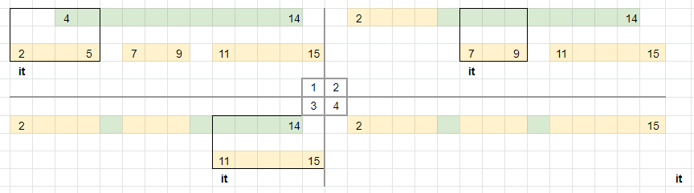

# Merge Intervals

**Author:** votrubac
**Votes:** 199
**Link:** [https://leetcode.com/problems/count-integers-in-intervals/solutions/2039706/](https://leetcode.com/problems/count-integers-in-intervals/solutions/2039706/)

---

We use a map to add new intervals in O(log n). As we add an interval, we need to merge it with the existing ones, and update the counter. That way, the `count` function is O(1).

Merging intervals is always tricky. The best is to use pen and paper to go through various scenarios.

When we add an interval, we check for overlapping intervals before and after. We extend `left` and `right` accordingly, remove all overlapping intervals, and add the new interval `[left, right]` in the end. This is an example how we merge `[4, 14]` interval with the existing ones:
- Note that all existing overlapping intervals are removed, and their integers substracted from `cnt`.
	- We remove 3 intervals, and subtract `12`  from `cnt`.
- We extend the new interval to `[2, 15]`.
- We add the new interval `[2, 15]` and add `14` to the count .
	- The new interval resulted in adding `14 - 12 == 2` new integers.  



**C++**
```cpp
class CountIntervals {
public:
    map<int, int> m;
    int cnt = 0;
    void add(int left, int right) {
        auto it = m.upper_bound(left);
        if (it != begin(m) && prev(it)->second >= left)
            it = prev(it);
        for (; it != end(m) && it->first <= right; m.erase(it++)) {
            left = min(left, it->first);
            right = max(right, it->second);
            cnt -= it->second - it->first + 1;
        }
        cnt += right - left + 1;
        m[left] = right;
    }
    int count() { return cnt; }
};
```

**Java**
```java
class CountIntervals {
    TreeMap<Integer, Integer> m = new TreeMap<>();
    int cnt = 0;
    public void add(int left, int right) {
        var it = m.floorEntry(left);
        if (it == null || it.getValue() < left)
            it = m.higherEntry(left);
        for (; it != null && it.getKey() <= right; it = m.higherEntry(left)) {
            left = Math.min(left, it.getKey());
            right = Math.max(right, it.getValue());
            cnt -= it.getValue() - it.getKey() + 1;
            m.remove(it.getKey());
        }
        m.put(left, right);
        cnt += right - left + 1;        
    }
    public int count() { return cnt; }
}
```