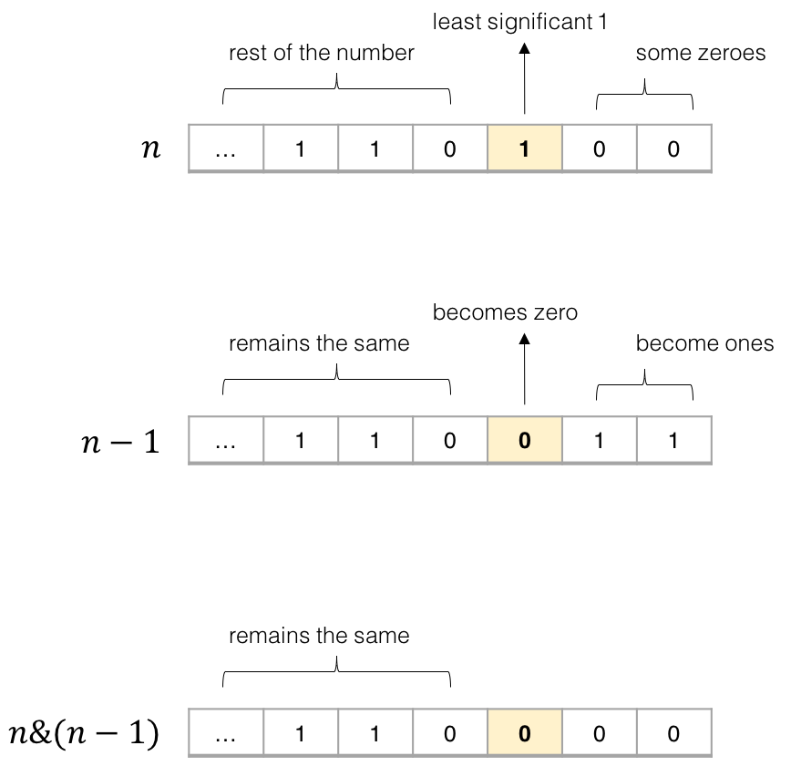

# Official Solution

**Link:** [https://leetcode.com/problems/number-of-1-bits/solution/](https://leetcode.com/problems/number-of-1-bits/solution/)

---

[TOC]

## Solution

---

### Approach 1: Loop and Flip

**Algorithm**

The solution is straight-forward. We check each of the $$32$$ bits of the number. If the bit is $$1$$, we add one to the number of $$1$$-bits.

We can check the $$i^{th}$$ bit of a number using a *bit mask*. We start with a mask $$m=1$$, because the binary representation of $$1$$ is,

$$
0000\ 0000\ 0000\ 0000\ 0000\ 0000\ 0000\ 0001
$$
Clearly, a logical AND between any number and the mask $$1$$ gives us the least significant bit of this number. To check the next bit, we shift the mask to the left by one.

$$
0000\ 0000\ 0000\ 0000\ 0000\ 0000\ 0000\ 0010
$$

And so on.

**Implementation**

<iframe src="https://leetcode.com/playground/ZdywTFuA/shared" frameBorder="0" name="ZdywTFuA" width="100%" height="241"></iframe>

**Complexity Analysis**

The run time depends on the number of bits in $$n$$. Because $$n$$ in this piece of code is a 32-bit integer, the time complexity is $$O(1)$$.

The space complexity is $$O(1)$$, since no additional space is allocated.

---
### Approach 2: Bit Manipulation

**Algorithm**

We can make the previous algorithm simpler and a little faster. Instead of checking every bit of the number, we repeatedly flip the least-significant $$1$$-bit of the number to $$0$$, and add $$1$$ to the sum. As soon as the number becomes $$0$$, we know that it does not have any more $$1$$-bits, and we return the sum.

The key idea here is to realize that for any number $$n$$, doing a bit-wise AND of $$n$$ and $$n - 1$$ flips the least-significant $$1$$-bit in $$n$$ to $$0$$. Why? Consider the binary representations of $$n$$ and $$n - 1$$.

{:width="400px"}

*Figure 1. AND-ing $$n$$ and $$n-1$$ flips the least-significant $$1$$-bit to 0.*

In the binary representation, the least significant $$1$$-bit in $$n$$ always corresponds to a $$0$$-bit in $$n - 1$$. Therefore, anding the two numbers $$n$$ and $$n - 1$$ always flips the least significant $$1$$-bit in $$n$$ to $$0$$, and keeps all other bits the same.

Using this trick, the code becomes very simple.

**Implementation**

<iframe src="https://leetcode.com/playground/EGLwLfLR/shared" frameBorder="0" name="EGLwLfLR" width="100%" height="190"></iframe>

**Complexity Analysis**

The run time depends on the number of $$1$$-bits in $$n$$. In the worst case, all bits in $$n$$ are $$1$$-bits. In case of a 32-bit integer, the run time is $$O(1)$$.

The space complexity is $$O(1)$$, since no additional space is allocated.

 