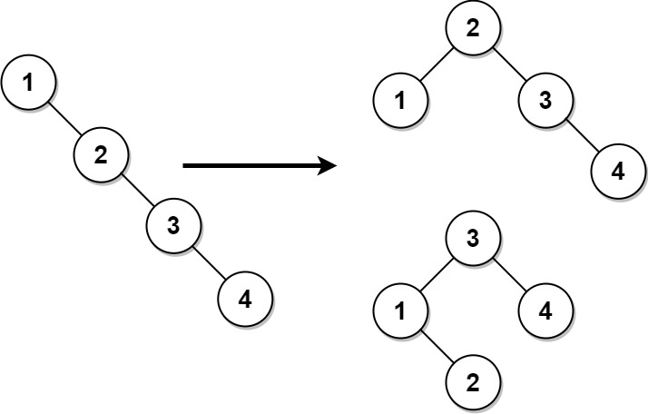
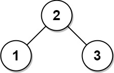

# [1382. Balance a Binary Search Tree](https://leetcode.com/problems/balance-a-binary-search-tree/)

| Category | Difficulty | Likes | Dislikes |
| :------: | :--------: | :---: | :------: |
| Algorithms | Medium | 3813 | 96 |

**Tags:** [`divide-and-conquer`](https://leetcode.com/tag/divide-and-conquer), [`greedy`](https://leetcode.com/tag/greedy), [`tree`](https://leetcode.com/tag/tree), [`depth-first-search`](https://leetcode.com/tag/depth-first-search), [`binary-search-tree`](https://leetcode.com/tag/binary-search-tree), [`binary-tree`](https://leetcode.com/tag/binary-tree)

**Companies:** `facebook`, `amazon`, `tiktok`, `google`

## Description

Given the `root` of a binary search tree, return *a **balanced** binary search tree with the same node values*. If there is more than one answer, return **any of them**.

A binary search tree is **balanced** if the depth of the two subtrees of every node never differs by more than `1`.

 

**Example 1:**


```

Input: root = [1,null,2,null,3,null,4,null,null]
Output: [2,1,3,null,null,null,4]
Explanation: This is not the only correct answer, [3,1,4,null,2] is also correct.

```

**Example 2:**


```

Input: root = [2,1,3]
Output: [2,1,3]

```

 

**Constraints:**

	- The number of nodes in the tree is in the range `[1, 10^4]`.

	- `1 <= Node.val <= 10^5`

---

**Links:** [Submissions](https://leetcode.com/problems/balance-a-binary-search-tree/) | [Solutions](https://leetcode.com/problems/balance-a-binary-search-tree/)
