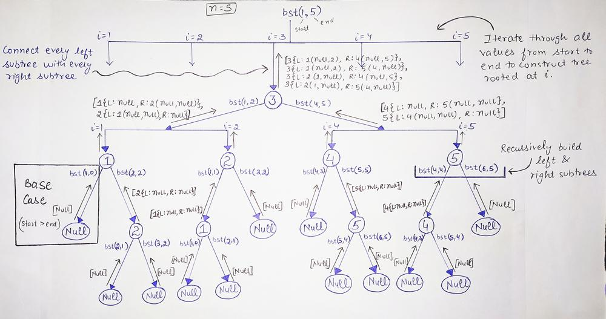

# 🚀 C++ || Detailed Explanation || Recursive Tree || With Comments

**Author:** sdkaur
**Votes:** 266
**Link:** [https://leetcode.com/problems/unique-binary-search-trees-ii/solutions/1849266/](https://leetcode.com/problems/unique-binary-search-trees-ii/solutions/1849266/)

---

**Problem**
> Given n, find all structurally unique BST's (binary search trees) that has n nodes with unique values from 1 to n

**Strategy:**
We will use a **recursive helper function** `bst(start, end)` that receives a range (*start to end*, within n) and returns all BST's rooted in that range.

Now let's look how our helper function will work!
* As there will be trees with root as 1, 2, 3...n.  Iterate through all values from start to end to construct tree rooted at i and construct its left and right subtree recursively.
* We know that in Binary Search Tree all nodes in left subtree are smaller than root and in right subtree are larger than root. So for start = 1 and end = n, if we have ith number as root, all numbers from 1 to i-1 will be in left subtree and i+1 to n will be in right subtree. 
**Therefore, we will build the tree recursively for left and right subtrees rooted at i as `leftSubTree = bst(start, i-1)` and `rightSubtree = bst(i + 1, end)`**
* So, till what moment we will recursively find the left and right subtrees?? Answer is until **start < end**!! 
`So when start > end, add NULL to the list and return`
This will be our base case!
* Now, we have leftSubtree and rightSubtree for node with root i. The last thing we need to do is connect leftSubTree and rightSubTree with root and add this tree(rooted at i) to the ans list!
\uD83D\uDCCC Here, we can have multiple left and right subtrees. So we need to loop through all left and right subtrees and connect every left subTree to right subTree and to current root(i) one by one.

**Recursive Tree**
See below recursive tree for more details, expanded for n = 5 and 3 as root!


	
		
**Code**
```cpp
vector<TreeNode*> buildTree(int start, int end) {
	vector<TreeNode*> ans;
        
    // If start > end, then subtree will be empty so add NULL in the ans and return it.
    if(start > end) {
		ans.push_back(NULL);
        return ans;
    }

    // Iterate through all values from start to end to construct left and right subtree recursively
	for(int i = start; i <= end; ++i) {
		vector<TreeNode*> leftSubTree = buildTree(start, i - 1);    // Construct left subtree
        vector<TreeNode*> rightSubTree = buildTree(i + 1, end);     // Construct right subtree
            
		// loop through all left and right subtrees and connect them to ith root  
		for(int j = 0; j < leftSubTree.size(); j++) {
			for(int k = 0; k < rightSubTree.size(); k++) {
				TreeNode* root = new TreeNode(i);   // Create root with value i
				root->left = leftSubTree[j];   // Connect left subtree rooted at leftSubTree[j]
                root->right = rightSubTree[k];   // Connect right subtree rooted at rightSubTree[k]
				ans.push_back(root);    // Add this tree(rooted at i) to ans data-structure
			}
		}
    }
        
	return ans;
}
    
vector<TreeNode*> generateTrees(int n) {
	return buildTree(1, n);
}
```
