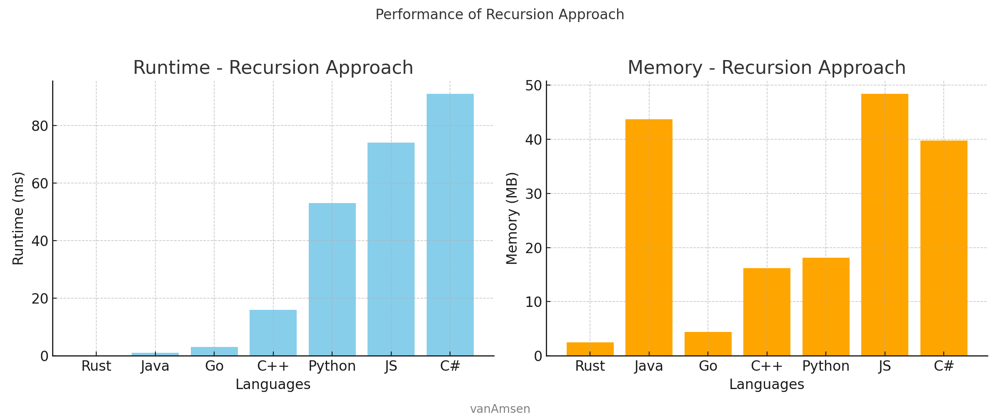
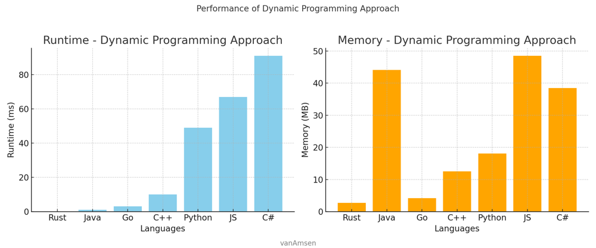

# ✅ Recursion & DP [VIDEO] Catalan Number - Unique BST

**Author:** vanAmsen
**Votes:** 105
**Link:** [https://leetcode.com/problems/unique-binary-search-trees-ii/solutions/3864900/](https://leetcode.com/problems/unique-binary-search-trees-ii/solutions/3864900/)

---

Given an integer \\( n \\), the task is to return all the structurally unique BST's (binary search trees) that have exactly \\( n \\) nodes of unique values from \\( 1 \\) to \\( n \\).

# Intuition Recursion & Dynamic Programming
The problem can be solved by utilizing the properties of a BST, where the left subtree has all values less than the root and the right subtree has values greater than the root. We can explore both recursive and dynamic programming (DP) approaches to generate all possible combinations of unique BSTs.

# Live Coding & Explenation Recursion
https://youtu.be/HeB6Oufsg_o

# n-th Catalan number

In the context of this task, the \\(n\\)-th Catalan number gives the number of distinct binary search trees that can be formed with \\(n\\) unique values. The \\(n\\)-th Catalan number is given by the formula:

$$
C_n = \\frac{1}{n+1} \\binom{2n}{n} = \\frac{(2n)!}{(n+1)!n!}
$$

The time and space complexity of generating these trees are both $$O(C_n)$$, which is equivalent to $$O\\left(\\frac{4^n}{n\\sqrt{n}}\\right)$$.

Here's how it relates to the task:

1. **Choosing the Root**: For each root value, we're essentially dividing the problem into two subproblems (left and right subtrees), and the number of combinations for each division aligns with the recursive definition of the Catalan numbers.
   
2. **Recursive and Dynamic Programming Solutions**: Both approaches inherently follow the recursive nature of the Catalan numbers. The recursive approach directly corresponds to the recursive formula for the Catalan numbers, while the dynamic programming approach leverages the computed results for smaller subproblems to build up to the solution.

3. **Number of Unique BSTs**: The fact that there are \\(C_n\\) unique BSTs with \\(n\\) nodes is a direct application of the Catalan numbers. The complexity of generating all these trees is thus closely tied to the value of the \\(n\\)-th Catalan number.

In conclusion, the complexity of the problem is inherently linked to the Catalan numbers, as they precisely describe the number of unique structures that can be formed, which in turn dictates the computational resources required to enumerate them.

# Approach Short

1. **Recursion**: Recursively construct left and right subtrees and combine them with each root.
2. **Dynamic Programming**: Use dynamic programming to store the result of subproblems (subtrees) and utilize them for constructing unique BSTs.

## Approach Differences
The recursive approach constructs the trees from scratch every time, while the DP approach reuses previously computed subtrees to avoid redundant work.

# Approach Recursion

The recursive approach involves the following steps:

1. **Base Case**: If the start index is greater than the end index, return a list containing `None`. This represents an empty tree and serves as the base case for the recursion.

2. **Choose Root**: For every number \\( i \\) in the range from `start` to `end`, consider \\( i \\) as the root of the tree.

3. **Generate Left Subtrees**: Recursively call the function to generate all possible left subtrees using numbers from `start` to \\( i-1 \\). This forms the left child of the root.

4. **Generate Right Subtrees**: Recursively call the function to generate all possible right subtrees using numbers from \\( i+1 \\) to `end`. This forms the right child of the root.

5. **Combine Subtrees**: For each combination of left and right subtrees, create a new tree with \\( i \\) as the root and the corresponding left and right subtrees. Append this tree to the list of all possible trees.

6. **Return Trees**: Finally, return the list of all trees generated.

# Complexity Recursion
- Time complexity: $$O(\\frac{4^n}{n\\sqrt{n}})$$
- Space complexity: $$ O(\\frac{4^n}{n\\sqrt{n}}) $$

# Performance Recursion

| Language   | Runtime (ms) | Beats (%) | Memory (MB) | Beats (%) |
|------------|--------------|-----------|-------------|-----------|
| Rust       | 0            | 100       | 2.5         | 80        |
| Java       | 1            | 99.88     | 43.7        | 66.87     |
| Go         | 3            | 56.88     | 4.4         | 63.30     |
| C++        | 16           | 75.53     | 16.2        | 20.99     |
| Python3    | 53           | 97.4      | 18.1        | 27.83     |
| JavaScript | 74           | 89.61     | 48.4        | 55.19     |
| C#         | 91           | 88.76     | 39.8        | 19.10     |




# Code Recursion
``` Python []
class Solution:
    def generateTrees(self, n: int):
        def generate_trees(start, end):
            if start > end:
                return [None,]
            
            all_trees = []
            for i in range(start, end + 1):
                left_trees = generate_trees(start, i - 1)
                right_trees = generate_trees(i + 1, end)
                
                for l in left_trees:
                    for r in right_trees:
                        current_tree = TreeNode(i)
                        current_tree.left = l
                        current_tree.right = r
                        all_trees.append(current_tree)
            
            return all_trees
        
        return generate_trees(1, n) if n else []
```
``` C++ []
class Solution {
public:
    vector<TreeNode*> generateTrees(int n) {
        return n ? generate_trees(1, n) : vector<TreeNode*>();
    }

private:
    vector<TreeNode*> generate_trees(int start, int end) {
        if (start > end) return {nullptr};

        vector<TreeNode*> all_trees;
        for (int i = start; i <= end; i++) {
            vector<TreeNode*> left_trees = generate_trees(start, i - 1);
            vector<TreeNode*> right_trees = generate_trees(i + 1, end);

            for (TreeNode* l : left_trees) {
                for (TreeNode* r : right_trees) {
                    TreeNode* current_tree = new TreeNode(i);
                    current_tree->left = l;
                    current_tree->right = r;
                    all_trees.push_back(current_tree);
                }
            }
        }
        return all_trees;
    }
};
```
``` Java []
class Solution {
    public List<TreeNode> generateTrees(int n) {
        return n > 0 ? generate_trees(1, n) : new ArrayList<>();
    }

    private List<TreeNode> generate_trees(int start, int end) {
        List<TreeNode> all_trees = new ArrayList<>();
        if (start > end) {
            all_trees.add(null);
            return all_trees;
        }

        for (int i = start; i <= end; i++) {
            List<TreeNode> left_trees = generate_trees(start, i - 1);
            List<TreeNode> right_trees = generate_trees(i + 1, end);

            for (TreeNode l : left_trees) {
                for (TreeNode r : right_trees) {
                    TreeNode current_tree = new TreeNode(i);
                    current_tree.left = l;
                    current_tree.right = r;
                    all_trees.add(current_tree);
                }
            }
        }
        return all_trees;
    }
}
```
``` JavaScript []
var generateTrees = function(n) {
    if (n === 0) return [];

    function generate_trees(start, end) {
        if (start > end) return [null];

        const all_trees = [];
        for (let i = start; i <= end; i++) {
            const left_trees = generate_trees(start, i - 1);
            const right_trees = generate_trees(i + 1, end);

            for (const l of left_trees) {
                for (const r of right_trees) {
                    const current_tree = new TreeNode(i);
                    current_tree.left = l;
                    current_tree.right = r;
                    all_trees.push(current_tree);
                }
            }
        }
        return all_trees;
    }

    return generate_trees(1, n);
};
```
``` C# []
public class Solution {
    public IList<TreeNode> GenerateTrees(int n) {
        return n > 0 ? GenerateTrees(1, n) : new List<TreeNode>();
    }

    private IList<TreeNode> GenerateTrees(int start, int end) {
        if (start > end) return new List<TreeNode> {null};

        var all_trees = new List<TreeNode>();
        for (int i = start; i <= end; i++) {
            var left_trees = GenerateTrees(start, i - 1);
            var right_trees = GenerateTrees(i + 1, end);

            foreach (var l in left_trees) {
                foreach (var r in right_trees) {
                    var current_tree = new TreeNode(i, l, r);
                    all_trees.Add(current_tree);
                }
            }
        }
        return all_trees;
    }
}
```
``` Rust []
use std::rc::Rc;
use std::cell::RefCell;

impl Solution {
    pub fn generate_trees(n: i32) -> Vec<Option<Rc<RefCell<TreeNode>>>> {
        if n == 0 {
            return Vec::new();
        }
        Self::generate(1, n)
    }

    fn generate(start: i32, end: i32) -> Vec<Option<Rc<RefCell<TreeNode>>>> {
        if start > end {
            return vec![None];
        }

        let mut all_trees = Vec::new();
        for i in start..=end {
            let left_trees = Self::generate(start, i - 1);
            let right_trees = Self::generate(i + 1, end);

            for l in &left_trees {
                for r in &right_trees {
                    let current_tree = Some(Rc::new(RefCell::new(TreeNode::new(i))));
                    current_tree.as_ref().unwrap().borrow_mut().left = l.clone();
                    current_tree.as_ref().unwrap().borrow_mut().right = r.clone();
                    all_trees.push(current_tree);
                }
            }
        }
        all_trees
    }
}
```
``` Go []
func generateTrees(n int) []*TreeNode {
	if n == 0 {
		return []*TreeNode{}
	}
	return generate(1, n)
}

func generate(start, end int) []*TreeNode {
	if start > end {
		return []*TreeNode{nil}
	}

	var allTrees []*TreeNode
	for i := start; i <= end; i++ {
		leftTrees := generate(start, i-1)
		rightTrees := generate(i+1, end)

		for _, l := range leftTrees {
			for _, r := range rightTrees {
				currentTree := &TreeNode{Val: i, Left: l, Right: r}
				allTrees = append(allTrees, currentTree)
			}
		}
	}
	return allTrees
}
```

# Approach Dynamic Programming

1. **Initialization**: Create a DP table `dp` where `dp[i]` will store all the unique BSTs with `i` nodes. Initialize `dp[0]` with a single `None` value representing an empty tree.

2. **Iterate Over Number of Nodes**: For every number `nodes` from 1 to `n`, iterate and construct all possible trees with `nodes` number of nodes.

3. **Choose Root**: For every possible root value within the current `nodes`, iterate and use the root to build trees.

4. **Use Previously Computed Subtrees**: For the chosen root, use the previously computed `dp[root - 1]` for left subtrees and `dp[nodes - root]` for right subtrees.

5. **Clone Right Subtree**: Since the right subtree's values will be affected by the choice of the root, clone the right subtree with an offset equal to the root value. The `clone` function handles this.

6. **Combine Subtrees**: Create a new tree by combining the current root with the left and right subtrees. Append this tree to `dp[nodes]`.

7. **Return Result**: Finally, return the trees stored in `dp[n]`.

# Complexity Dynamic Programming
- Time complexity: $$O(\\frac{4^n}{n\\sqrt{n}})$$
- Space complexity: $$ O(\\frac{4^n}{n\\sqrt{n}}) $$

# Performance Dynamic Programming

| Language   | Runtime (ms) | Beats (%) | Memory (MB) | Beats (%) |
|------------|--------------|-----------|-------------|-----------|
| Rust       | 0            | 100       | 2.7         | 20        |
| Java       | 1            | 99.88     | 44.1        | 8.87      |
| Go         | 3            | 56.88     | 4.2         | 90.83     |
| C++        | 10           | 96.72     | 12.5        | 86.56     |
| JavaScript | 67           | 96.75     | 48.5        | 55.19     |
| Python3    | 49           | 98.84     | 18.1        | 21.91     |
| C#         | 91           | 88.76     | 38.5        | 80.90     |




# Code Dynamic Programming
``` Python []
class Solution:
    def generateTrees(self, n: int):
        if n == 0:
            return []

        dp = [[] for _ in range(n + 1)]
        dp[0].append(None)
        for nodes in range(1, n + 1):
            for root in range(1, nodes + 1):
                for left_tree in dp[root - 1]:
                    for right_tree in dp[nodes - root]:
                        root_node = TreeNode(root)
                        root_node.left = left_tree
                        root_node.right = self.clone(right_tree, root)
                        dp[nodes].append(root_node)
        return dp[n]
    
    def clone(self, n: TreeNode, offset: int) -> TreeNode:
        if n:
            node = TreeNode(n.val + offset)
            node.left = self.clone(n.left, offset)
            node.right = self.clone(n.right, offset)
            return node
        return None
```
``` C++ []
class Solution {
public:
    vector<TreeNode*> generateTrees(int n) {
        if (n == 0) return {};

        vector<vector<TreeNode*>> dp(n + 1);
        dp[0].push_back(nullptr);
        for (int nodes = 1; nodes <= n; nodes++) {
            for (int root = 1; root <= nodes; root++) {
                for (TreeNode* left_tree : dp[root - 1]) {
                    for (TreeNode* right_tree : dp[nodes - root]) {
                        TreeNode* root_node = new TreeNode(root);
                        root_node->left = left_tree;
                        root_node->right = clone(right_tree, root);
                        dp[nodes].push_back(root_node);
                    }
                }
            }
        }
        return dp[n];
    }

private:
    TreeNode* clone(TreeNode* n, int offset) {
        if (n == nullptr) return nullptr;
        TreeNode* node = new TreeNode(n->val + offset);
        node->left = clone(n->left, offset);
        node->right = clone(n->right, offset);
        return node;
    }
};
```
``` Java []
class Solution {
    public List<TreeNode> generateTrees(int n) {
        if (n == 0) return new ArrayList<>();

        List<TreeNode>[] dp = new ArrayList[n + 1];
        dp[0] = new ArrayList<>();
        dp[0].add(null);
        for (int nodes = 1; nodes <= n; nodes++) {
            dp[nodes] = new ArrayList<>();
            for (int root = 1; root <= nodes; root++) {
                for (TreeNode left_tree : dp[root - 1]) {
                    for (TreeNode right_tree : dp[nodes - root]) {
                        TreeNode root_node = new TreeNode(root);
                        root_node.left = left_tree;
                        root_node.right = clone(right_tree, root);
                        dp[nodes].add(root_node);
                    }
                }
            }
        }
        return dp[n];
    }

    private TreeNode clone(TreeNode n, int offset) {
        if (n == null) return null;
        TreeNode node = new TreeNode(n.val + offset);
        node.left = clone(n.left, offset);
        node.right = clone(n.right, offset);
        return node;
    }
}
```
``` JavaScript []
var generateTrees = function(n) {
    if (n === 0) return [];

    const dp = Array.from({ length: n + 1 }, () => []);
    dp[0].push(null);
    for (let nodes = 1; nodes <= n; nodes++) {
        for (let root = 1; root <= nodes; root++) {
            for (const left_tree of dp[root - 1]) {
                for (const right_tree of dp[nodes - root]) {
                    const root_node = new TreeNode(root);
                    root_node.left = left_tree;
                    root_node.right = clone(right_tree, root);
                    dp[nodes].push(root_node);
                }
            }
        }
    }
    return dp[n];
};

function clone(n, offset) {
    if (n === null) return null;
    const node = new TreeNode(n.val + offset);
    node.left = clone(n.left, offset);
    node.right = clone(n.right, offset);
    return node;
}
```
``` C# []
public class Solution {
    public IList<TreeNode> GenerateTrees(int n) {
        if (n == 0) return new List<TreeNode>();

        var dp = new List<TreeNode>[n + 1];
        dp[0] = new List<TreeNode> { null };
        for (int nodes = 1; nodes <= n; nodes++) {
            dp[nodes] = new List<TreeNode>();
            for (int root = 1; root <= nodes; root++) {
                foreach (var left_tree in dp[root - 1]) {
                    foreach (var right_tree in dp[nodes - root]) {
                        TreeNode root_node = new TreeNode(root);
                        root_node.left = left_tree;
                        root_node.right = Clone(right_tree, root);
                        dp[nodes].Add(root_node);
                    }
                }
            }
        }
        return dp[n];
    }

    private TreeNode Clone(TreeNode n, int offset) {
        if (n == null) return null;
        TreeNode node = new TreeNode(n.val + offset);
        node.left = Clone(n.left, offset);
        node.right = Clone(n.right, offset);
        return node;
    }
}
```
``` Rust []
use std::rc::Rc;
use std::cell::RefCell;

impl Solution {
    pub fn generate_trees(n: i32) -> Vec<Option<Rc<RefCell<TreeNode>>>> {
        if n == 0 {
            return Vec::new();
        }

        let mut dp = vec![Vec::new(); (n + 1) as usize];
        dp[0].push(None);
        for nodes in 1..=n {
            let mut trees_per_node = Vec::new();
            for root in 1..=nodes {
                let left_trees = &dp[(root - 1) as usize];
                let right_trees = &dp[(nodes - root) as usize];
                for left_tree in left_trees {
                    for right_tree in right_trees {
                        let root_node = Some(Rc::new(RefCell::new(TreeNode::new(root))));
                        root_node.as_ref().unwrap().borrow_mut().left = left_tree.clone();
                        root_node.as_ref().unwrap().borrow_mut().right = Solution::clone(right_tree.clone(), root);
                        trees_per_node.push(root_node);
                    }
                }
            }
            dp[nodes as usize] = trees_per_node;
        }
        dp[n as usize].clone()
    }

    fn clone(tree: Option<Rc<RefCell<TreeNode>>>, offset: i32) -> Option<Rc<RefCell<TreeNode>>> {
        tree.map(|node| {
            Rc::new(RefCell::new(TreeNode {
                val: node.borrow().val + offset,
                left: Solution::clone(node.borrow().left.clone(), offset),
                right: Solution::clone(node.borrow().right.clone(), offset),
            }))
        })
    }
}
```
``` Go []
var generateTrees = function(n) {
    if (n === 0) return [];

    const dp = Array.from({ length: n + 1 }, () => []);
    dp[0].push(null);
    for (let nodes = 1; nodes <= n; nodes++) {
        for (let root = 1; root <= nodes; root++) {
            for (const left_tree of dp[root - 1]) {
                for (const right_tree of dp[nodes - root]) {
                    const root_node = new TreeNode(root);
                    root_node.left = left_tree;
                    root_node.right = clone(right_tree, root);
                    dp[nodes].push(root_node);
                }
            }
        }
    }
    return dp[n];
};

function clone(n, offset) {
    if (n === null) return null;
    const node = new TreeNode(n.val + offset);
    node.left = clone(n.left, offset);
    node.right = clone(n.right, offset);
    return node;
}
```

The time and space complexity for both approaches are the same. The $$ O(\\frac{4^n}{n\\sqrt{n}}) $$ complexity arises from the Catalan number, which gives the number of BSTs for a given \\( n \\).

I hope you find this solution helpful in understanding how to generate all structurally unique Binary Search Trees (BSTs) for a given number n. If you have any further questions or need additional clarifications, please don't hesitate to ask. If you understood the solution and found it beneficial, please consider giving it an upvote. Happy coding, and may your coding journey be filled with success and satisfaction! \uD83D\uDE80\uD83D\uDC68\u200D\uD83D\uDCBB\uD83D\uDC69\u200D\uD83D\uDCBB