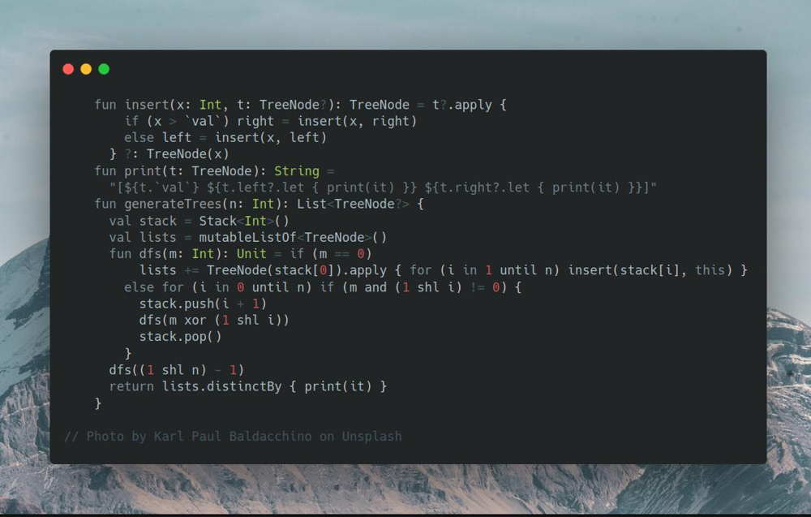
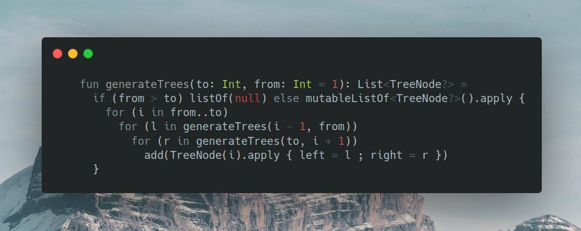

# Kotlin | backtrack, bitmask, hash

**Author:** SamoylenkoDmitry
**Votes:** 3
**Link:** [https://leetcode.com/problems/unique-binary-search-trees-ii/solutions/3865256/](https://leetcode.com/problems/unique-binary-search-trees-ii/solutions/3865256/)

---



#### Join me on Telegram

https://t.me/leetcode_daily_unstoppable/299

#### Problem TLDR

All possible Binary Search Trees for 1..n numbers

#### Intuition

One way to build all possible BST is to insert numbers in all possible ways. We can do this with a simple backtracking, given the small `n <= 8`. To remove duplicates, we can print the tree and use it as a hash key.

#### Approach

* use a bit mask and a Stack for backtracking

#### Complexity
- Time complexity:

$$O(n!* nlog(n))$$, as the recursion depth is n, each time iterations go as n * (n - 1) * (n - 2) * ... * 2 * 1, which is equal to n!. The final step of inserting elements is nlog(n), and building a hash is n, which is < nlogn, so not relevant.

- Space complexity:

$$O(n!)$$, is a number of permutations

#### Code

```kotlin


    fun insert(x: Int, t: TreeNode?): TreeNode = t?.apply {
        if (x > `val`) right = insert(x, right)
        else left = insert(x, left)
      } ?: TreeNode(x)
    fun print(t: TreeNode): String = 
      "[${t.`val`} ${t.left?.let { print(it) }} ${t.right?.let { print(it) }}]"
    fun generateTrees(n: Int): List<TreeNode?> {
      val stack = Stack<Int>()
      val lists = mutableListOf<TreeNode>()
      fun dfs(m: Int): Unit = if (m == 0) 
          lists += TreeNode(stack[0]).apply { for (i in 1 until n) insert(stack[i], this) }
        else for (i in 0 until n) if (m and (1 shl i) != 0) {
          stack.push(i + 1)
          dfs(m xor (1 shl i))
          stack.pop()
        }
      dfs((1 shl n) - 1)
      return lists.distinctBy { print(it) }
    }

```
Another divide-and-conquer solution, that I didn't think of


