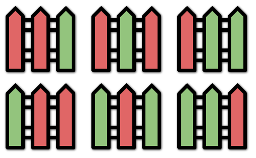

# [276. Paint Fence](https://leetcode.com/problems/paint-fence/)

| Category | Difficulty | Likes | Dislikes |
| :------: | :--------: | :---: | :------: |
| Algorithms | Medium | 1627 | 396 |

**Tags:** [`dynamic-programming`](https://leetcode.com/tag/dynamic-programming)

**Companies:** `snowflake`, `google`

## Description

You are painting a fence of `n` posts with `k` different colors. You must paint the posts following these rules:

	- Every post must be painted **exactly one** color.

	- There **cannot** be three or more **consecutive** posts with the same color.

Given the two integers `n` and `k`, return *the **number of ways** you can paint the fence*.

 

**Example 1:**


```

Input: n = 3, k = 2
Output: 6
Explanation: All the possibilities are shown.
Note that painting all the posts red or all the posts green is invalid because there cannot be three posts in a row with the same color.

```

**Example 2:**

```

Input: n = 1, k = 1
Output: 1

```

**Example 3:**

```

Input: n = 7, k = 2
Output: 42

```

 

**Constraints:**

	- `1 <= n <= 50`

	- `1 <= k <= 10^5`

	- The testcases are generated such that the answer is in the range `[0, 2^31 - 1]` for the given `n` and `k`.

---

**Links:** [Submissions](https://leetcode.com/problems/paint-fence/) | [Solutions](https://leetcode.com/problems/paint-fence/)
