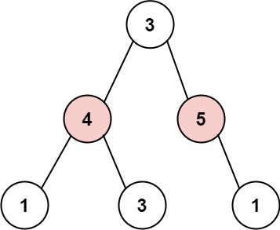

# C++ | with and without memo | Detailed explaination

**Author:** priyam_vd
**Votes:** 107
**Link:** [https://leetcode.com/problems/house-robber-iii/solutions/1611899/](https://leetcode.com/problems/house-robber-iii/solutions/1611899/)

---

So, robber is active again , let's see how we can calculate an efficient robbery !!

This again is a classic **DFS** problem where we have to look out for the recurrence relation and think dynamically ... The houses are present in the form of binary tree and if we are at the root_house then we have two choices :: 
**/a. to the rob the root house and skip it's children and move on to root's grandchildren.../**     OR     **/b. to skip this house and move on to left and right_subtree, with the hope that it will yeild better result./**
   * In case robber is robbing the *root_house*,    maximum money he is gonna rob == **root->val + answer(root->left->left + root->left->right + root->right->left + root->right->right)**{as then these nodes are gonna be the grandchildren of curr_root (in case they exist)}..
   * In case he is not robbing the *root_house*, maximum money he gonna rob == **answer(root->left + root->right)**.
   * And Final answer == **max(root_included, root_excluded)**
   * We are ready with the approach , just need to write base case and do recursion calls and then some calculations ... But before blindly making recursion calls , we should check out if we are calling on the same node multiple times or not !! If multiple calls on same is done, then Time Complexity would get screwed and we will have to memoize the solution !!
   * 
   * Here , in this example we can see that::
   *   When we include(root) , then it calls on (nodes with value 1,3 and 1) .... And when node with the value 4 will be the root and we will be excluding it , then it will call on those same nodes with value(1 and 3).... So memoization would be perfect way to go for this problem.....
   *   **Now we know, what calls to make , what calculation to do and we also know that we need to memoize**.... So here is the code for that !!!
   

### Solution 1 ... with MEMO 
```
class Solution {

private:
    unordered_map<TreeNode*,int>memo;
    int helper(TreeNode* root) {
        if (root == NULL) return 0;
        
        if (memo.count(root)){
            return memo[root];
        } 
    
        int ans_including_root = root->val;
    
        if (root->left != NULL) {
              ans_including_root += helper(root->left->left) + helper(root->left->right);
        }
    
        if (root->right != NULL) {
              ans_including_root += helper(root->right->left) + helper(root->right->right);
        }
        
        int ans_excluding_root = helper(root->left) + helper(root->right);
    
        int ans = max(ans_including_root , ans_excluding_root);
        
        memo[root]=ans;
    
        return ans;
   }
    
public:
    int rob(TreeNode* root) {
        return helper(root);
    }    
};
```

It's a good solution to come up with ... But why to use memo when we can have a better solution without it ? 
* Why was the memoization needed  ? Because we were going Top Down and we weren't sure whether to include the root_house at that instance or not .... So , we were making recursion calls for both cases , which led to the complication of situation and we had to cover it up with the map !!
* So , instead of going that Top-down way , let's try going the deepest and then while returning back, we will decide whether to choose that house or not !
* **We will return the Pair here, {case_when_curr_root_is_chosen, case_when_not_chosen}** ... 
  * Let's assume any particular node (H), gets the answer from it's left child as {a,b} and right child as{x,y} ....
  * So , b is the case when H->left was not included and y is the case when H->right was not included... So, if we are gonna rob the House (H) , then total money we can get, p == **H->val +y+b**
  * And when House will be not robbed then maximum money robbed, q == **max(a,b) + max(x,y)**..... and what this node H will return is {p,q}
 
 
###  Solution 2 -- without memo
```
class Solution {
private:
    pair<int,int> max_money_robbed(TreeNode* root){
        
        if(root==NULL)return {0,0};
        
        pair<int,int>left = max_money_robbed(root->left);
        pair<int,int>right = max_money_robbed(root->right);
        
        int root_house_robbed = left.second + right.second + root->val;
        int root_house_not_robbed = max(left.first,left.second)+ max(right.first,right.second);
        
        pair<int,int>ans;
        
        ans.first = root_house_robbed, ans.second = root_house_not_robbed;
        
        return ans;
        
    }
public:
    int rob(TreeNode* root) {
        pair<int,int>result = max_money_robbed(root);
        return max(result.first,result.second);
    }
};

**If you reached here, Thanks for giving it a read !!**
      


   
