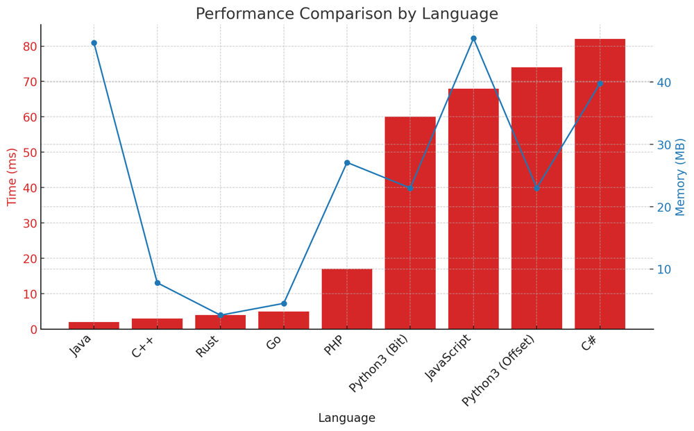

# ✅ 97.97% DP + Bit Manipulation & Offset

**Author:** vanAmsen
**Votes:** 168
**Link:** [https://leetcode.com/problems/counting-bits/solutions/3986178/](https://leetcode.com/problems/counting-bits/solutions/3986178/)

---

# Interview Guide - Counting Bits in Binary Representation of Integers

## Problem Understanding

### Description
The problem at hand asks us to count the number of 1's in the binary representation of integers from 0 to  `n` . It's a classic problem that combines elements of dynamic programming and bitwise operations, serving as an excellent exercise to understand both concepts in depth. The goal is to return an array where the `i-th` element is the number of 1's in the binary representation of `i`.

---

## Key Points to Consider

### 1. Understand the Constraints
- Number Range: $$ 0 \\leq n \\leq 10^5 $$

### 2. Importance of Bit Manipulation
This problem is fundamentally about understanding binary numbers and bitwise operations. Bit manipulation allows us to count the number of 1's in an efficient manner, especially when combined with dynamic programming.

### 3. Algorithmic Approaches
There are two elegant ways to tackle this problem: a Dynamic Programming method that leverages Bit Manipulation (Method 1) and another Dynamic Programming method that uses an Offset (Method 2).

#### Dynamic Programming with Bit Manipulation
In this approach, we exploit the fact that shifting a number to the right by one bit (i.e., dividing by 2) removes the last bit. So, the number of 1's in the binary representation of `i` is the same as $$ \\frac{i}{2} $$ plus the last bit of `i`.

#### Dynamic Programming with Offset
The second method utilizes a fascinating property of binary numbers, where numbers `i` and $$i + 2^k$$ share the same number of 1's, except for an additional 1 at the  `k-th` bit for $$ i + 2^k $$.

### 4. Key Concepts in Each Approach

#### The Magic of "Shifting Bits" (Method 1)
In the first method, we use bitwise shift and AND operations. Bitwise right shifting `i >> 1` essentially removes the last bit, and `i & 1` extracts the last bit. This helps us compute the result for `i` using previously computed results.

#### The Power of "Offset" (Method 2)
The second approach introduces the concept of an "offset," which is a power of 2. We use this offset to calculate the number of 1's for new numbers based on previously calculated results. 

---

# Live Coding & More
https://youtu.be/V1FM02_l4_k?si=9O-fEySLX0wrUcNp

---

## Method 1: Dynamic Programming with Bit Manipulation

### Intuition and Logic Behind the Solution
The idea here is to use the number of 1's in `i >> 1` (i.e., `i` divided by 2) and the last bit in `i` to find the number of 1's in `i`.

### Step-by-step Explanation
- **Initialization**: Create an array `ans`  of length  `n + 1`, initialized with zeros.
- **Main Algorithm**: Iterate from 1 to  `n`, and for each `i`, set `ans[i] = ans[i >> 1] + (i & 1)`.

### Complexity Analysis
- **Time Complexity**: $$ O(n) $$ \u2014 We iterate through the array once.
- **Space Complexity**: $$ O(n) $$ \u2014 For the output array.

---

## Method 2: Dynamic Programming with Offset

### Intuition and Logic Behind the Solution
Here, we use an offset to help us quickly calculate the number of 1's for `i + 2^k` based on `i`.

### Step-by-step Explanation
- **Initialization**: Create an array `ans` of length `n + 1`, initialized with zeros.
- **Main Algorithm**: Iterate from 1 to  `n` . Use an offset variable to keep track of the nearest lower power of 2. Update `ans[i] = ans[i - offset] + 1` .

### Complexity Analysis
- **Time Complexity**: $$ O(n) $$ \u2014 We iterate through the array once.
- **Space Complexity**: $$ O(n) $$ \u2014 For the output array.

---

# Performance

| Language           | Time (ms) | Memory (MB) |
|--------------------|-----------|-------------|
| Java               | 2         | 46.3        |
| C++                | 3         | 7.8         |
| Rust               | 4         | 2.6         |
| Go                 | 5         | 4.5         |
| PHP                | 17        | 27.1        |
| Python3 (Bit)      | 60        | 23          |
| JavaScript         | 68        | 47          |
| Python3 (Offset)   | 74        | 23          |
| C#                 | 82        | 39.8        |




# Code 1
``` Python []
class Solution:
    def countBits(self, n: int) -> List[int]:
        ans = [0] * (n + 1)
        for i in range(1, n + 1):
            ans[i] = ans[i >> 1] + (i & 1)
        return ans
```
``` C++ []
class Solution {
public:
    vector<int> countBits(int n) {
    std::vector<int> ans(n + 1, 0);
    for (int i = 1; i <= n; ++i) {
        ans[i] = ans[i >> 1] + (i & 1);
    }
    return ans;
}
};
```
``` Go []
func countBits(n int) []int {
    ans := make([]int, n + 1)
    for i := 1; i <= n; i++ {
        ans[i] = ans[i >> 1] + (i & 1)
    }
    return ans
}
```
``` Rust []
impl Solution {
    fn count_bits(n: i32) -> Vec<i32> {
        let mut ans = vec![0; (n + 1) as usize];
        for i in 1..=n {
            ans[i as usize] = ans[(i >> 1) as usize] + (i & 1);
        }
        ans
    }
}
```
``` Java []
public class Solution {
    public int[] countBits(int n) {
        int[] ans = new int[n + 1];
        for (int i = 1; i <= n; i++) {
            ans[i] = ans[i >> 1] + (i & 1);
        }
        return ans;
    }
}
```
``` JavaScript []
/**
 * @param {number} n
 * @return {number[]}
 */
var countBits = function countBits(n) {
    const ans = new Array(n + 1).fill(0);
    for (let i = 1; i <= n; i++) {
        ans[i] = ans[i >> 1] + (i & 1);
    }
    return ans;
}
```
``` PHP []
class Solution {

    /**
     * @param Integer $n
     * @return Integer[]
     */
    function countBits($n) {
    $ans = array_fill(0, $n + 1, 0);
    for ($i = 1; $i <= $n; $i++) {
        $ans[$i] = $ans[$i >> 1] + ($i & 1);
    }
    return $ans;
    }
}
```
``` C# []
public class Solution {
    public int[] CountBits(int n) {
        int[] ans = new int[n + 1];
        for (int i = 1; i <= n; i++) {
            ans[i] = ans[i >> 1] + (i & 1);
        }
        return ans;
    }
}
```
# Code 2
```
class Solution:
    def countBits(self, n: int) -> List[int]:
        ans = [0] * (n + 1)
        offset = 1
        for i in range(1, n + 1):
            if offset * 2 == i:
                offset *= 2
            ans[i] = ans[i - offset] + 1
        return ans
```

Feel free to compare these methods and choose the one that you find most intuitive. Understanding the underlying principles behind each approach will not only help you solve this specific problem but also equip you with the tools to tackle a wide range of similar problems.