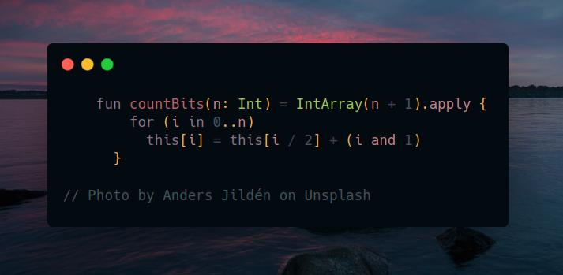

# Kotlin | tabulation

**Author:** SamoylenkoDmitry
**Votes:** 6
**Link:** [https://leetcode.com/problems/counting-bits/solutions/3986528/](https://leetcode.com/problems/counting-bits/solutions/3986528/)

---




#### Join me on Telegram

https://t.me/leetcode_daily_unstoppable/326

#### Problem TLDR

Array of bits count for numbers `0..n`

#### Intuition

There is a tabulation technique used for caching bits count answer in O(1): for number `xxxx0` bits count is `count(xxxx) + 0`, but for number `xxxx1` bits count is `count(xxxx) + 1`. Now, to make a switch `xxxx1 -> xxxx` simple divide by 2. Result can be cached.

#### Approach

We can use DFS + memo, but bottom-up also simple. Result is a DP array itself: `DP[number] = bits_count(number)`. The last bit can be checked by `%` operation, but `and` also works. 

#### Complexity

- Time complexity:
$$O(n)$$

- Space complexity:
$$O(n)$$

#### Code

```kotlin

    fun countBits(n: Int) = IntArray(n + 1).apply {
        for (i in 0..n) 
          this[i] = this[i / 2] + (i and 1)
      }

```