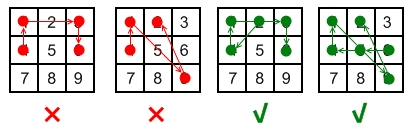

# [351. Android Unlock Patterns](https://leetcode.com/problems/android-unlock-patterns/)

| Category | Difficulty | Likes | Dislikes |
| :------: | :--------: | :---: | :------: |
| Algorithms | Medium | 208 | 238 |

**Tags:** [`dynamic-programming`](https://leetcode.com/tag/dynamic-programming), [`backtracking`](https://leetcode.com/tag/backtracking), [`bit-manipulation`](https://leetcode.com/tag/bit-manipulation), [`bitmask`](https://leetcode.com/tag/bitmask)

**Companies:** `google`

## Description

Android devices have a special lock screen with a `3 x 3` grid of dots. Users can set an "unlock pattern" by connecting the dots in a specific sequence, forming a series of joined line segments where each segment's endpoints are two consecutive dots in the sequence. A sequence of `k` dots is a **valid** unlock pattern if both of the following are true:

	- All the dots in the sequence are **distinct**.

	- If the line segment connecting two consecutive dots in the sequence passes through the **center** of any other dot, the other dot **must have previously appeared** in the sequence. No jumps through the center non-selected dots are allowed.
	
		For example, connecting dots `2` and `9` without dots `5` or `6` appearing beforehand is valid because the line from dot `2` to dot `9` does not pass through the center of either dot `5` or `6`.

		- However, connecting dots `1` and `3` without dot `2` appearing beforehand is invalid because the line from dot `1` to dot `3` passes through the center of dot `2`.

	
	

Here are some example valid and invalid unlock patterns:



	- The 1st pattern `[4,1,3,6]` is invalid because the line connecting dots `1` and `3` pass through dot `2`, but dot `2` did not previously appear in the sequence.

	- The 2nd pattern `[4,1,9,2]` is invalid because the line connecting dots `1` and `9` pass through dot `5`, but dot `5` did not previously appear in the sequence.

	- The 3rd pattern `[2,4,1,3,6]` is valid because it follows the conditions. The line connecting dots `1` and `3` meets the condition because dot `2` previously appeared in the sequence.

	- The 4th pattern `[6,5,4,1,9,2]` is valid because it follows the conditions. The line connecting dots `1` and `9` meets the condition because dot `5` previously appeared in the sequence.

Given two integers `m` and `n`, return *the **number of unique and valid unlock patterns** of the Android grid lock screen that consist of **at least** *`m`* keys and **at most** *`n`* keys.*

Two unlock patterns are considered **unique** if there is a dot in one sequence that is not in the other, or the order of the dots is different.

 

**Example 1:**

```

Input: m = 1, n = 1
Output: 9

```

**Example 2:**

```

Input: m = 1, n = 2
Output: 65

```

 

**Constraints:**

	- `1 <= m, n <= 9`

---

**Links:** [Submissions](https://leetcode.com/problems/android-unlock-patterns/) | [Solutions](https://leetcode.com/problems/android-unlock-patterns/)
