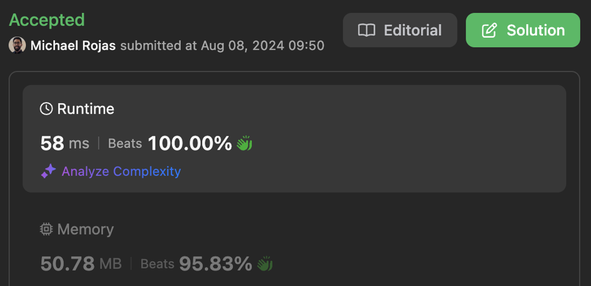

# DFS

**Author:** rojas
**Votes:** 0
**Link:** [https://leetcode.com/problems/android-unlock-patterns/solutions/5447577/](https://leetcode.com/problems/android-unlock-patterns/solutions/5447577/)

---

[toc]

# DFS + Math

When considering if the next digit is reachable from the current digit, we trace a line between them and make sure each intermediate digit has already been visited.

```typescript []
function numberOfPatterns(m: number, n: number): number {
    const visited = new Array(9).fill(false);
    return 4 * (
        dfs(visited, 0, 1, m, n) 
        + dfs(visited, 1, 1, m, n)
    ) + dfs(visited, 4, 1, m, n);
};

function dfs(visited: boolean[], a: number, i: number, m: number, n: number): number {
    let sum = +(++i > m);
    if (i > n) {
        return sum;
    }

    visited[a] = true;
    for (let b = 0; b < 9; ++b) {
        if (!visited[b] && isReachable(visited, a, b)) {
            sum += dfs(visited, b, i, m, n);
        }
    }
    visited[a] = false;

    return sum;
}

function toCoord(i: number): [number, number] {
    const x = i % 3;
    return [(i - x) / 3, x];
}

function toIndex(y: number, x: number): number {
    return (3*y + x);
}

function isReachable(visited: boolean[], a: number, b: number): boolean {
    const [y0, x0] = toCoord(a);
    const [y1, x1] = toCoord(b);
    const mx = Math.sign(x1 - x0);

    if (mx == 0) {
        const m = (y0 > y1) ? -3 : 3;
        for (let c = a; c != b; c += m) {
            if (!visited[c]) {
                return false;
            }
        }
        return true;
    }
    
    const my = mx * (y1 - y0) / (x1 - x0);
    for (let y = y0, x = x0; x != x1; x += mx) {
        if (Number.isInteger(y) && !visited[toIndex(y, x)]) {
            return false;
        }
        y += my;
    }
    
    return true;
}
```

```javascript []
/**
 * @param {number} m
 * @param {number} n
 * @return {number}
 */
 function numberOfPatterns(m, n) {
    const visited = new Array(9).fill(false);
    return 4 * (
        dfs(visited, 0, 1, m, n) 
        + dfs(visited, 1, 1, m, n)
    ) + dfs(visited, 4, 1, m, n);
};

/**
 * @param {boolean[]} visited
 * @param {number} a
 * @param {number} i
 * @param {number} m
 * @param {number} n
 * @return {number}
 */
function dfs(visited, a, i, m, n) {
    let sum = +(++i > m);
    if (i > n) {
        return sum;
    }

    visited[a] = true;
    for (let b = 0; b < 9; ++b) {
        if (!visited[b] && isReachable(visited, a, b)) {
            sum += dfs(visited, b, i, m, n);
        }
    }
    visited[a] = false;

    return sum;
}

/**
 * @param {number} i
 * @return {[number,number]}
 */
function toCoord(i) {
    const x = i % 3;
    return [(i - x) / 3, x];
}

/**
 * @param {number} y
 * @param {number} x
 * @return {number}
 */
function toIndex(y, x) {
    return (3*y + x);
}

/**
 * @param {boolean[]} visited
 * @param {number} a
 * @param {number} b
 * @return {boolean}
 */
function isReachable(visited, a, b) {
    const [y0, x0] = toCoord(a);
    const [y1, x1] = toCoord(b);
    const mx = Math.sign(x1 - x0);

    if (mx == 0) {
        const m = (y0 > y1) ? -3 : 3;
        for (let c = a; c != b; c += m) {
            if (!visited[c]) {
                return false;
            }
        }
        return true;
    }
    
    const my = mx * (y1 - y0) / (x1 - x0);
    for (let y = y0, x = x0; x != x1; x += mx) {
        if (Number.isInteger(y) && !visited[toIndex(y, x)]) {
            return false;
        }
        y += my;
    }
    
    return true;
}
```

# DFS + Jump Map

[Submission](https://leetcode.com/problems/android-unlock-patterns/submissions/1348913856)



Since digits are always 1-9 in a 3x3 grid, we can pre-calculate the digits that the path between two digits would pass through, which turns out to be at most 1. We can represent this via maps and sets, or more simply with a double array. `inters[a][b]` is the intermediate digit between digits `a` and `b`, or `-1` if no digit is passed through.

```typescript []
const inters = (() => {
    const arr = new Array<number[]>(9);
    for (let i = 0; i < 9; ++i) {
        arr[i] = new Array(9).fill(-1);
    }
    arr[0][2] = arr[2][0] = 1;
    arr[0][6] = arr[6][0] = 3;
    arr[0][8] = arr[8][0] = 4;
    arr[1][7] = arr[7][1] = 4;
    arr[2][6] = arr[6][2] = 4;
    arr[2][8] = arr[8][2] = 5;
    arr[3][5] = arr[5][3] = 4;
    arr[6][8] = arr[8][6] = 7;
    return arr;
})();

function numberOfPatterns(m: number, n: number): number {
    const visited = new Array(9).fill(false);
    return 4 * (
        dfs(visited, 0, 1, m, n) 
        + dfs(visited, 1, 1, m, n)
    ) + dfs(visited, 4, 1, m, n);
};

function dfs(visited: boolean[], a: number, i: number, m: number, n: number): number {
    let sum = +(++i > m);
    if (i > n) {
        return sum;
    }

    visited[a] = true;
    for (let b = 0; b < 9; ++b) {
        if (!visited[b] && isReachable(visited, a, b)) {
            sum += dfs(visited, b, i, m, n);
        }
    }
    visited[a] = false;

    return sum;
}

function isReachable(visited: boolean[], a: number, b: number): boolean {
    return inters[a][b] < 0 || visited[inters[a][b]];
}
```

```javascript []
const inters = (() => {
    const arr = new Array(9);
    for (let i = 0; i < 9; ++i) {
        arr[i] = new Array(9).fill(-1);
    }
    arr[0][2] = arr[2][0] = 1;
    arr[0][6] = arr[6][0] = 3;
    arr[0][8] = arr[8][0] = 4;
    arr[1][7] = arr[7][1] = 4;
    arr[2][6] = arr[6][2] = 4;
    arr[2][8] = arr[8][2] = 5;
    arr[3][5] = arr[5][3] = 4;
    arr[6][8] = arr[8][6] = 7;
    return arr;
})();

/**
 * @param {number} m
 * @param {number} n
 * @return {number}
 */
 function numberOfPatterns(m, n) {
    const visited = new Array(9).fill(false);
    return 4 * (
        dfs(visited, 0, 1, m, n) 
        + dfs(visited, 1, 1, m, n)
    ) + dfs(visited, 4, 1, m, n);
};

/**
 * @param {boolean[]} visited
 * @param {number} a
 * @param {number} i
 * @param {number} m
 * @param {number} n
 * @return {number}
 */
function dfs(visited, a, i, m, n) {
    let sum = +(++i > m);
    if (i > n) {
        return sum;
    }

    visited[a] = true;
    for (let b = 0; b < 9; ++b) {
        if (!visited[b] && isReachable(visited, a, b)) {
            sum += dfs(visited, b, i, m, n);
        }
    }
    visited[a] = false;

    return sum;
}

/**
 * @param {boolean[]} visited
 * @param {number} a
 * @param {number} b
 * @return {boolean}
 */
function isReachable(visited, a, b) {
    return inters[a][b] < 0 || visited[inters[a][b]];
}
```