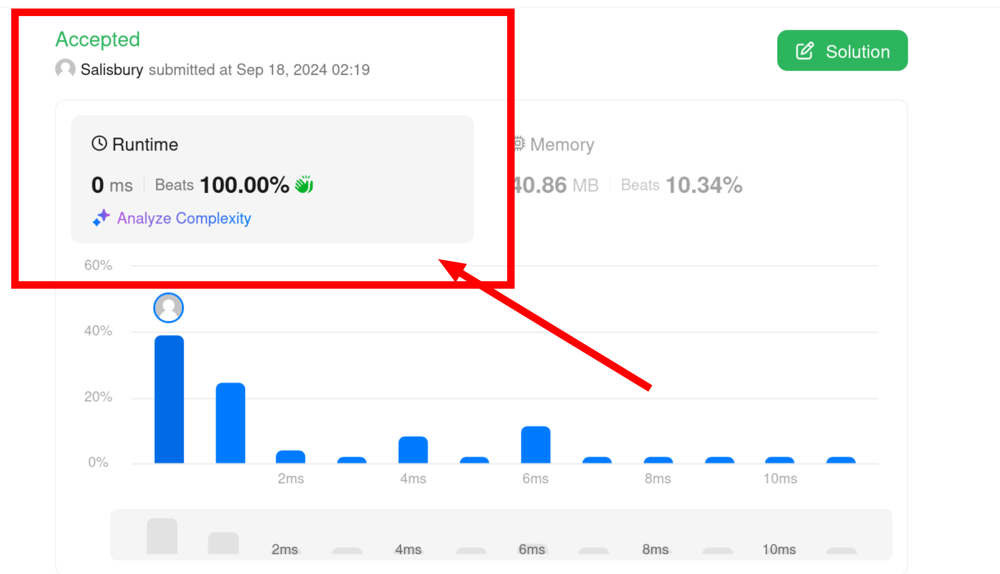

# easy peasy 100% beats runtime

**Author:** salisbury-espinosa
**Votes:** 0
**Link:** [https://leetcode.com/problems/integer-replacement/solutions/5801953/](https://leetcode.com/problems/integer-replacement/solutions/5801953/)

---



# Code
```typescript []
function integerReplacement(n: number): number {
    let operations = 0;
    while (n > 0) {
        if (n === 1) {
            return operations;
        }
        else if (n === 3) {
            return operations + 2;
        }
        else if (n % 2 === 0) {
            operations += 1;
            n /= 2;
        }
        else if ((n + 1) % 4 === 0) {
            operations += 1;
            n += 1;
        }
        else {
            operations += 1;
            n -= 1;
        }
    }
};
```
```Java []
class Solution {
    public int integerReplacement(int n) {
        int operations = 0;
        long num = n;
        while (num > 0) {
            if (num == 1) {
                return operations;
            } else if (num == 3) {
                return operations + 2;
            } else if (num % 2 == 0) {
                operations += 1;
                num /= 2;
            } else if ((num + 1) % 4 == 0) {
                operations += 1;
                num += 1;
            } else {
                operations += 1;
                num -= 1;
            }
        }
        return operations;
    }
}
```
```PHP []
class Solution {

    /**
     * @param Integer $n
     * @return Integer
     */
    function integerReplacement($n) {
        $operations = 0;
        while ($n > 0) {
            if ($n === 1) {
                return $operations;
            } elseif ($n === 3) {
                return $operations + 2;
            } elseif ($n % 2 === 0) {
                $operations += 1;
                $n /= 2;
            } elseif (($n + 1) % 4 === 0) {
                $operations += 1;
                $n += 1;
            } else {
                $operations += 1;
                $n -= 1;
            }
        }
    }
}
```