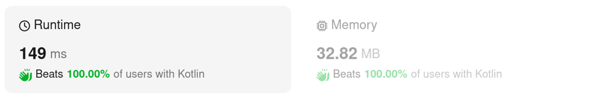
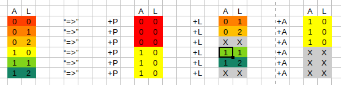
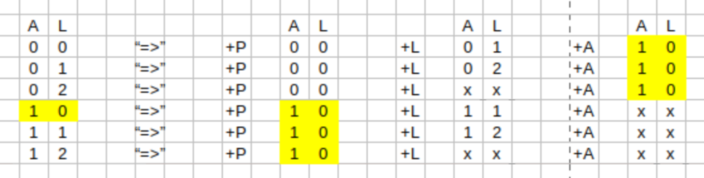
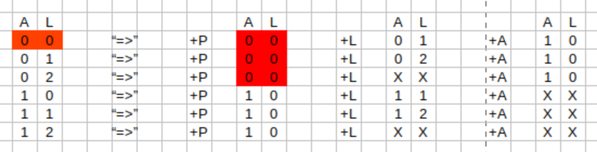
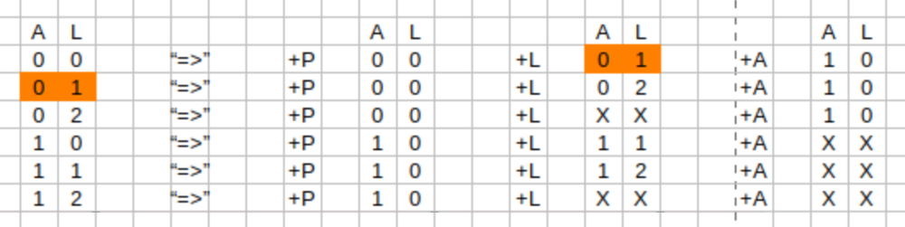
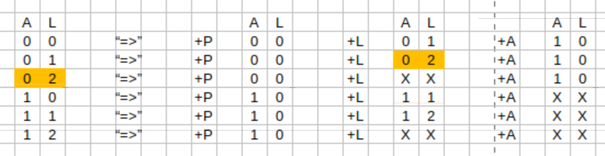
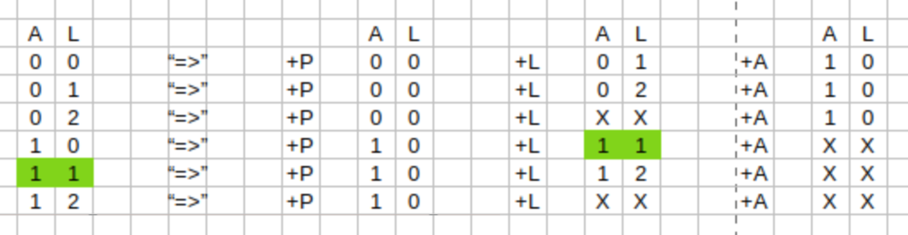
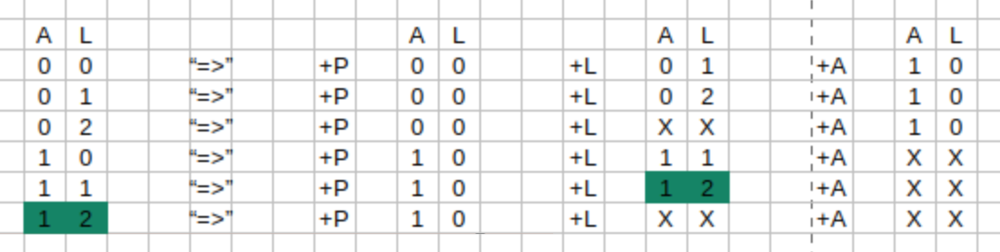
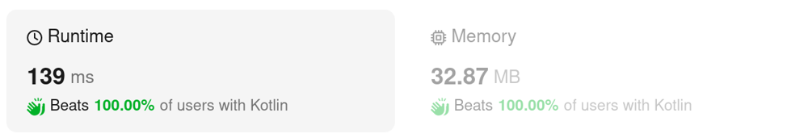
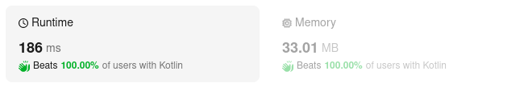

# Kotlin. Beats 100% (149 ms). Simple loop + 6 variables

**Author:** mobdev778
**Votes:** 3
**Link:** [https://leetcode.com/problems/student-attendance-record-ii/solutions/5212104/](https://leetcode.com/problems/student-attendance-record-ii/solutions/5212104/)

---



```
class Solution {
    fun checkRecord(n: Int): Int {
        var c00 = 1 // P
        var c01 = 1 // L
        var c02 = 0
        var c10 = 1 // A
        var c11 = 0
        var c12 = 0

        var n00 = 0
        var n01 = 0
        var n02 = 0
        var n10 = 0
        var n11 = 0
        var n12 = 0

        var days = 1
        while (days < n) {
            n00 = c00.add(c01).add(c02)
            n01 = c00
            n02 = c01
            n10 = n00.add(c10).add(c11).add(c12) // c00.add(c01).add(c02) == n00
            n11 = c10
            n12 = c11

            c00 = n00
            c01 = n01
            c02 = n02
            c10 = n10
            c11 = n11
            c12 = n12
            days++
        }

        return c00.add(c01).add(c02).add(c10).add(c11).add(c12)
    }

    private inline fun Int.add(count: Int): Int {
        return (this + count) % 1_000_000_007
    }
}
```

# Approach



By optimizing my earlier BFS solution, I found out that in this problem there is a fixed number of states at each iteration and a fixed number of transitions from one state to another.

In total we can have 6 states on each day:

1) 0 absenteeism and 0 continuous lateness (Case 00: A:0, L:0)
2) 0 absenteeism and 1 continuous lateness (Case 01: A:0, L:1)
3) 0 absenteeism and 2 consecutive lateness (Case 02: A:0, L:2) 
4) 1 absenteeism and 0 continuous lateness (Case 10: A:1, L:0)
5) 1 absenteeism and 1 continuous lateness (Case 11: A:1, L:1)
6) 1 absenteeism and 2 continuous lateness (Case 12: A:1, L:2)

We can list all these states and possible transitions in the form of a table:


In this table we can see that, for example, we can get the state \u201C10\u201D (A: 1, L: 0) from 6 states in the previous day.



00 +"A" => 10
01 +"A" => 10
02 +"A" => 10
10 +"P" => 10
11 +"P" => 10
11 +"P" => 10

Thus, the number of records containing the state "10" (yellow cells) for day "N", for example, will be equal to the sum of records "c00 + c01 + c02 + c10 + c11 + c12" for day "N-1":

By comparing the transitions from the left column to the 3 right ones (cells with the same colors), we can write 6 equations that calculate the number of entries for the next day:



```
n00 = c00 + c01 + c02
```


```
n01 = c00
```


```
n02 = c01
```


```
n10 = c00 + c01 + c02 + c10 + c11 + c12
```


```
n11 = c10
```


```
n12 = c11
```

Thus, we can create a simple algorithm for finding a solution:
1) Fill in the initial state for day \u201C1\u201D - there are only 3 cases: 00 (\u201CP\u201D), 10 (\u201CA\u201D), 01 (\u201CL\u201D).
2) Perform summation of records according to the specified 6 equations until day \u201CN\u201D is reached.
3) Calculate the final sum for 6 states.

# Performance optimized version

Here I have redistributed the variable read/write operations to increase the probability of reading a value from a CPU register.



```
class Solution {
    fun checkRecord(n: Int): Int {
        var c00 = 1 // P
        var c01 = 1 // L
        var c02 = 0
        var c10 = 1 // A
        var c11 = 0
        var c12 = 0

        var n00 = 0
        var n01 = 0
        var n02 = 0
        var n10 = 0
        var n11 = 0
        var n12 = 0

        var days = 1
        while (days < n) {
            n01 = c00
            n02 = c01
            n00 = n02.add(c00).add(c02)
            n10 = n00.add(c10).add(c11).add(c12) 
            n11 = c10
            n12 = c11

            c12 = n12
            c11 = n11
            c10 = n10
            c02 = n02
            c01 = n01
            c00 = n00
            days++
        }

        return c00.add(c01).add(c02).add(c10).add(c11).add(c12)
    }

    private inline fun Int.add(count: Int): Int {
        return (this + count) % 1_000_000_007
    }
}
```

This is my previous "IntArrays" solution:



# Code
```
class Solution {
    fun checkRecord(n: Int): Int {
        var oldGen = IntArray(8)
        oldGen[0 shl 2 or 0] = 1 // "P": A=0, L=0
        oldGen[0 shl 2 or 1] = 1 // "L": A=0, L=1
        oldGen[1 shl 2 or 0] = 1 // "A": A=1, L=0
        var newGen = IntArray(8)

        for (days in 1 until n) {
            for (i in 0 until newGen.size) {
                newGen[i] = 0
            }
            for (aTotal in 0..1) {
                for (lSeq in 0..2) {
                    val count = oldGen[aTotal shl 2 or lSeq]
                    // +"A"
                    if (aTotal < 1) {
                        newGen.add(count, aTotal + 1, 0)
                    }
                    // +"L"
                    if (lSeq < 2) {
                        newGen.add(count, aTotal, lSeq + 1)
                    }
                    // +"P"
                    newGen.add(count, aTotal, 0)
                }
            }
            val temp = newGen
            newGen = oldGen
            oldGen = temp
        }

        var result = 0
        for (i in 0..7) {
            result += oldGen[i]
            result %= 1_000_000_007
        }
        return result
    }

    private inline fun IntArray.add(count: Int, aTotal: Int, lSeq: Int) {
        val key = (aTotal shl 2) or lSeq
        this[key] += count
        this[key] %= 1_000_000_007
    }
}
```