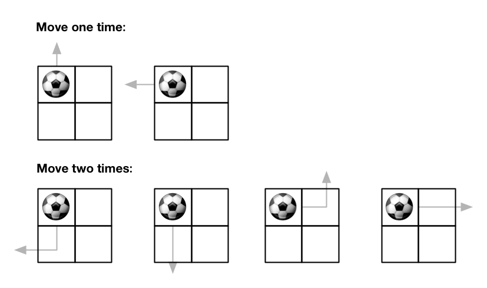
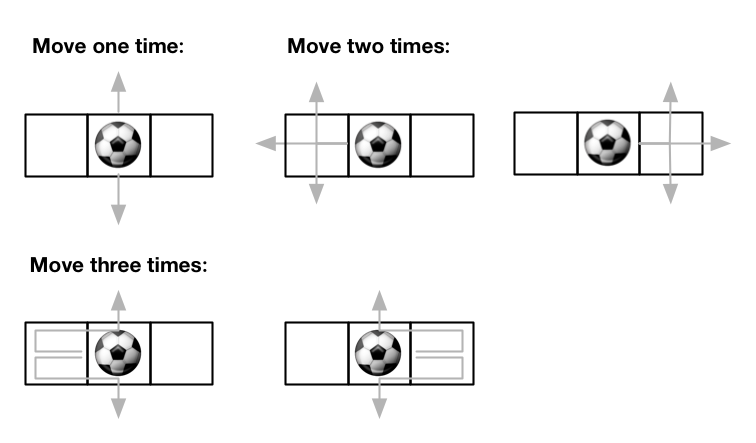

# [576. Out of Boundary Paths](https://leetcode.com/problems/out-of-boundary-paths/)

| Category | Difficulty | Likes | Dislikes |
| :------: | :--------: | :---: | :------: |
| Algorithms | Medium | 3970 | 295 |

**Tags:** [`dynamic-programming`](https://leetcode.com/tag/dynamic-programming)

**Companies:** `amazon`, `bloomberg`, `adobe`, `baidu`

## Description

There is an `m x n` grid with a ball. The ball is initially at the position `[startRow, startColumn]`. You are allowed to move the ball to one of the four adjacent cells in the grid (possibly out of the grid crossing the grid boundary). You can apply **at most** `maxMove` moves to the ball.

Given the five integers `m`, `n`, `maxMove`, `startRow`, `startColumn`, return the number of paths to move the ball out of the grid boundary. Since the answer can be very large, return it **modulo** `10^9 + 7`.

 

**Example 1:**


```

Input: m = 2, n = 2, maxMove = 2, startRow = 0, startColumn = 0
Output: 6

```

**Example 2:**


```

Input: m = 1, n = 3, maxMove = 3, startRow = 0, startColumn = 1
Output: 12

```

 

**Constraints:**

	- `1 <= m, n <= 50`

	- `0 <= maxMove <= 50`

	- `0 <= startRow < m`

	- `0 <= startColumn < n`

---

**Links:** [Submissions](https://leetcode.com/problems/out-of-boundary-paths/) | [Solutions](https://leetcode.com/problems/out-of-boundary-paths/)
