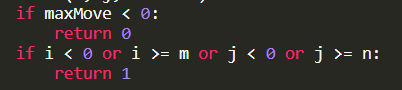
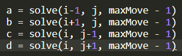
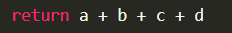
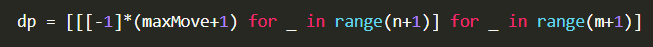

# Python: Easy to Understand Explanation: Recursion and Memoization with time and space complexity.

**Author:** meaditya70
**Votes:** 137
**Link:** [https://leetcode.com/problems/out-of-boundary-paths/solutions/1293697/](https://leetcode.com/problems/out-of-boundary-paths/solutions/1293697/)

---

The naive idea would be to move in all the for directions(up,left,right,bottom) parallely, such that:
1. Moves are no longer left., or
2. We have crossed the boundary.
So, this gives us **the base condition** for recursion.



Now why this return 0 and return 1? -> 
Case 1: when we run out of moves and we have not exceeded the boundary, that means we have not found a way out of the grid, so return 0 in other words we are still inside the grid.
Case 2: We have exceeded the boundary, so return 1 saying that we have this one way to reach out of the boundary.
I hope it is clear till now.

Now the basic **recursive step**:

Move in all the four directions (up,left,right,down) decrementing the moves because when we go from the current state, to any of the four adjacent states, we have already used up a move.

Now the **final return**, 

we return the sum of all the four paths because we want the total number of paths, that can exceed the boundary within the given moves.

***Full Recursive Code:***
```
class Solution:
    def findPaths(self, m: int, n: int, maxMove: int, startRow: int, startColumn: int) -> int:

        def solve(i, j, maxMove):
            if maxMove < 0:
                return 0
            if i < 0 or i >= m or j < 0 or j >= n:
                return 1
            
            a = solve(i-1, j, maxMove - 1)
            b = solve(i+1, j, maxMove - 1)
            c = solve(i, j-1, maxMove - 1)
            d = solve(i, j+1, maxMove - 1)
            
            return a + b + c + d
        
        return solve(startRow, startColumn, maxMove) % 1000000007
```
Time  = O(4 ^ max(m, n, maxMove)) = O(4^n) as we have 4 possible choices to either get out of the boundary or exhaust the number of moves.
Space =  O(4 ^ max(m, n, maxMove)) = O(4^n) for the recursive stack.

**The above method gives TLE** as O(4^n) = O(4^50) = O(2 ^ 100) = O(10 ^ 30) > O(10 ^  8) which is the threshold for TLE.
*Note: 2^10 nearly equal to 10^3.*

**Can we memoize it?** Yes as there are overlapping subproblems.
E.g.: Situations like [ i = 1, j = 1, max_moves = 1] will be calculated many times, e.g.: max_moves = 2 and  coming left from i = 1, j = 2, or going right from i=1, j =0, or coming down from i = 0, j = 1 or going up from i = 2, j =1.

So ,why to solve 4 times for the same [ i = 1, j = 1, max_moves = 1]. Better to memoize/store the computed result in some datastructure and return the result directly next time without actually computing [ i = 1, j = 1, max_moves = 1] again.

I hope you understood why can/should we memoize!

Now, use a dp array of shape [m * n * maxMove] as all the three factors are needed.
At i = 1, j = 1 -> maxMove = 1 and maxMove = 2 will have different answers, so we need all the 3 values.




Thus **we create a 3D DP Array** and each cell of the dp [i, j, x] array represents, the number of paths to move the ball out of the grid boundary form position [i, j] with max_moves = x.

***Memoizing the above recursion code:***
```
class Solution:
    def findPaths(self, m: int, n: int, maxMove: int, startRow: int, startColumn: int) -> int:
        
		# define the dp array
        dp = [[[-1]*(maxMove+1) for _ in range(n+1)] for _ in range(m+1)]
        
        def solve(i, j, maxMove):
            if maxMove < 0:
                return 0
            if i < 0 or i >= m or j < 0 or j >= n:
                return 1
            
			# if the dp array at this position contains some value(not -1) then it means it has been computed earlier
			# so we don't need to compute again, hence return whatever value is present in dp.
            if dp[i][j][maxMove] != -1:
                return dp[i][j][maxMove]
            
			# otherwise compute the value
            a = solve(i-1, j, maxMove - 1)
            b = solve(i+1, j, maxMove - 1)
            c = solve(i, j-1, maxMove - 1)
            d = solve(i, j+1, maxMove - 1)
            
			# store the computed value in dp array so that we do not need to compute it again when the same input occurs again.
            dp[i][j][maxMove] = a + b + c + d
            return dp[i][j][maxMove]
        
        return solve(startRow, startColumn, maxMove) % 1000000007
```
Time = O(m * n * maxMove) = O(n^3)
Space = O(m * n * maxMove) = O(n^3)

I hope it helps!