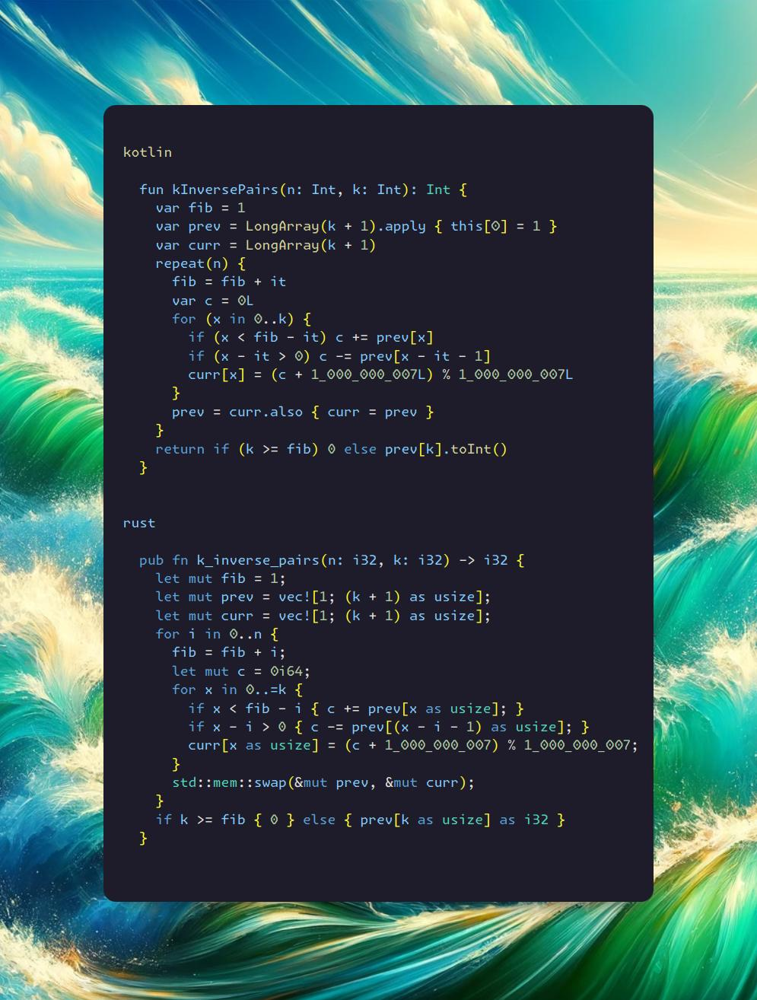

# Kotlin | Rust

**Author:** SamoylenkoDmitry
**Votes:** 3
**Link:** [https://leetcode.com/problems/k-inverse-pairs-array/solutions/4633251/](https://leetcode.com/problems/k-inverse-pairs-array/solutions/4633251/)

---


https://youtu.be/M1umaleU75w
#### Join me on Telegram

https://t.me/leetcode_daily_unstoppable/485

#### Problem TLDR

Number of arrays of 1..n with k reversed order pairs.

#### Intuition

First step: write down all the arrays for some example `n`, for every possible `k`:
```bash

    // 1 2 3 4
    // f(4,1) = 3
    // 1 3 2 4 [.  .  .  32 .  . ] 3  f(3, 1) = 2 = 1 + f(2, 1)
    // 1 2 4 3 [43 .  .  .  .  . ] 4  f(2, 1) = 1
    // 2 1 3 4 [.  .  .  .  .  21] 2
    // f(4, 2) = 5
    // 1 3 4 2 [.  42 .  32 .  . ] 4  f(4, 2) = 1 + f(3, 1) + f(3, 2) = 1 + sum_j_k(f(2, j))
    // 1 4 2 3 [43 42 .  .  .  . ] 4  f(3, 2) = 1 + f(2, 1) = 2
    // 2 1 4 3 [43 .  .  .  .  21] 4  f(2, 2) = 0
    // 2 3 1 4 [.  .  .  .  31 21] 3  f(3, 2) = 2
    // 3 1 2 4 [.  .  .  32 31 . ] 3
    // f(4, 3) = 6
    // 1 4 3 2 [43 42 .  32 .  . ] 4  f(4, 3) = 1 + f(3, 1) + f(3, 2) + f(3, 3) 
    // 2 3 4 1 [.  .  41 .  31 21] 4  
    // 2 4 1 3 [43 .  41 .  .  21] 4
    // 3 1 4 2 [.  42 .  32 31 . ] 4
    // 3 2 1 4 [.  .  .  32 31 21] 3  f(3, 3) = 1
    // 4 1 2 3 [43 42 41 .  .  . ] 4
    // f(4, 4) = 5
    // 2 4 3 1 [43 .  41 .  31 21] 4
    // 3 2 4 1 [.  .  41 32 31 21] 4  f(4, 4) = f(3, 1) + f(3, 2) + f(3, 3) + f(3, 4)
    // 3 4 1 2 [.  42 41 32 31 . ] 4  f(3, 4) = 0
    // 4 1 3 2 [43 42 41 32 .  . ] 4
    // 4 2 1 3 [43 42 41 .  .  21] 4
    // f(4, 5) = 3
    // 3 4 2 1 [.  42 41 32 31 21] 4  f(4, 5) = f(3, 2) + f(3, 3)
    // 4 3 1 2 [43 42 41 32 31 . ] 4
    // 4 2 3 1 [43 42 41 .  31 21] 4
    // f(4, 6) = 1
    // 4 3 2 1 [43 42 41 32 31 21] 4  f(4, 6) = f(3, 3) = 1
    //                                             f(5, 10) = 1
    // f(5, x)  = 1, x = 6 + 4 = 10, f(5, 10) = 1, f(5, 9) = f(4, 6) + f(4, 5) = 1+3=4
    // f(6, 15) = 1                                f(5, 8) = f(4, 6) + f(4, 5) + f(4, 4) = 1+3+5=9
    // f(7, 21) = 1                                f(5, 7) = f(5, 8) + f(4, 3) = 9+6=15
    // f(8, 28) = 1                                f(5, 6) = f(5, 7) + f(4, 2) = 15+5 =20
    //                                             f(5, 5) = f(5, 6) + f(4, 1) = 20+3=23--->22
    //                                             f(5, 4) = f(5, 5) + 1 = 24--->20
    //                                             f(5, 3) = 1 + f(4,1)+f(4,2)+f(4,3) = 1+3+5+6=15
    //                                             f(5, 2) = 1 + f(4,1) + f(4, 2) = 1+3+5 = 9
    //                                             f(5, 1) = 1 + f(4, 1)= 1+3=4
    //                                             f(5, 0) = 1
    // f(0) = 0
    // f(1) = 1
    // f(2) = 1 1
    // f(3) = 1 2 2                       1
    //        0 1 2          3        4 5 6
    //    
    // 1 2 2 1
    //         1 2 2 1
    // 1 3 5 6 5 3 1
    // f(4) = 1 3 5         (6)       5 3 1  1=0+1,3=1+2,5=3+2,6=5+1,5=6-1,3=5-2,1=3-2,0=1-1
    // +      1 3 4  6   5  3  1
    // -                    1  3   5  6 5 3
    //        0 1 2  3   4  5  6   7  8 9 10
    //
    // 1 3 5 6  5  3  1
    //             1  3  5  6 5 3 1
    // 1 4 9 15 20 22 20 15 9 4 1
    // 0 1 2 3  4  5  6  7  8 9 10
    //             5 = 10 - (7 - 2)
    // f(5) = 1 4 9  15 (20 22 20) 15 9 4 1  20 = 15+5, 22 = 20+3-1, 20=22+1-3, 15=20-5, 9=15-6, 4=9-5, 1=4-3
    // f(6) = 1 5 14 28  48 70 90 105    ???                                            10590 70 48 28 14 5  1
    // f(7) = 1 6 20 48
    //                               f(6, 15) = 1
    // f(9, 36) = 1                  f(6, 14) = f(5, 10) + f(5, 9) = 1+4 = 5
    //                               f(6, 13) = f(5, 10) + f(5, 9) + f(5, 8) = 5+9=14
    //                               f(6, 12) = 
    // [15..]+
    // [..15]-
    // [ 21 ]
```
After several hours (3 in my case) of staring at those numbers the idea should came to your mind: there is a pattern. 
For every `n`, if all the numbers are reversed, then there are exactly `Fibonacci(n)` reversed pairs:
```
// f(5, x)  = 1, x = 6 + 4 = 10, f(5, 10) = 1
// f(6, 15) = 1
// f(7, 21) = 1 
// f(8, 28) = 1
```
Another pattern is how we make a move in `n` space: 
```
f(3, 1) = 2 = 1 + f(2, 1)
f(4, 2) = 1 + f(3, 1) + f(3, 2) = 1 + sum_j_k(f(2, j))
f(3, 2) = 1 + f(2, 1) = 2
f(4, 3) = 1 + f(3, 1) + f(3, 2) + f(3, 3)
f(4, 4) = f(3, 1) + f(3, 2) + f(3, 3) + f(3, 4)
```
It almost works, until it not: at some point pattern breaks, so search what is it.
Let's write all the `k` numbers for each `n`:
```
f(0) = 0
f(1) = 1
f(2) = 1 1
f(3) = 1 2 2 1
f(4) = 1 3 5 6 5 3 1
f(5) = 1 4 9 15 20 22 20 15 9 4 1
```
There is a symmetry and we can deduce it by intuition: add the previous and at some point start to remove:
```
    // 1 2 2 1
    //         1 2 2 1
    // 1 3 5 6 5 3 1


    // 1 3 5 6  5  3  1
    //             1  3  5  6 5 3 1
    // 1 4 9 15 20 22 20 15 9 4 1
```
Now, the picture is clear. At some index we must start to remove the previous sequence.

We are not finished yet, however: solution will give TLE. Fibonacci became too big. So, another hint: numbers after `k` doesn't matter.

#### Approach

This is a filter problem: it filters you.
* we can hold only `k` numbers
* we can ping-pong swap two dp arrays

#### Complexity

- Time complexity:
$$O(nk)$$

- Space complexity:
$$O(k)$$

#### Code

```kotlin []

  fun kInversePairs(n: Int, k: Int): Int {
    var fib = 1
    var prev = LongArray(k + 1).apply { this[0] = 1 }
    var curr = LongArray(k + 1)
    repeat(n) {
      fib = fib + it
      var c = 0L
      for (x in 0..k) {
        if (x < fib - it) c += prev[x]
        if (x - it > 0) c -= prev[x - it - 1]
        curr[x] = (c + 1_000_000_007L) % 1_000_000_007L
      }
      prev = curr.also { curr = prev }
    }
    return if (k >= fib) 0 else prev[k].toInt()
  }

```
```rust []

  pub fn k_inverse_pairs(n: i32, k: i32) -> i32 {
    let mut fib = 1;
    let mut prev = vec![1; (k + 1) as usize];
    let mut curr = vec![1; (k + 1) as usize];
    for i in 0..n {
      fib = fib + i;
      let mut c = 0i64;
      for x in 0..=k {
        if x < fib - i { c += prev[x as usize]; }
        if x - i > 0 { c -= prev[(x - i - 1) as usize]; }
        curr[x as usize] = (c + 1_000_000_007) % 1_000_000_007;
      }
      std::mem::swap(&mut prev, &mut curr);
    }
    if k >= fib { 0 } else { prev[k as usize] as i32 }
  }

```