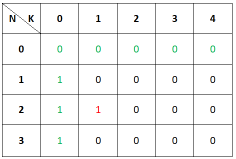
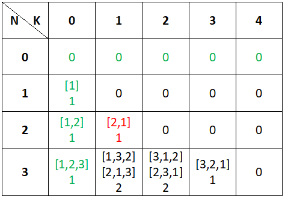

# Python: Explained Bottom-Up DP

**Author:** meaditya70
**Votes:** 70
**Link:** [https://leetcode.com/problems/k-inverse-pairs-array/solutions/1282998/](https://leetcode.com/problems/k-inverse-pairs-array/solutions/1282998/)

---

Cases:
1. We know that the bruteforce way to calculate the number of inversions takes O(n^2) time.
And takes n*(n-1)/2 comparisions. How?

Suppose, arr = [1,3,2] and we count the number of inversions in the below given way
```
count = 0
for i from 0 to n-2:
     for j from i to n-1:
	       if arr[i]>arr[j]:
		          count += 1
return count
```
So, here we compare indices [0,1],[0,2] and [1,2] which is equal to 3 comparisions (for n = 3, n*(n-1)/2 == 3).
For n=4, we compare indices [0,1],[0,2],[0,3],[1,2],[1,3],[2,3] == 6 comparisions  = n * (n-1) / 2.
I hope this is clear.

Now, the maximum number of inversions for a n-sized array = n * (n-1) / 2
So, if K > n * (n-1) / 2, we cannot have any array with k number of inversions, so **return 0.**
But if k == 0 means no inversion, there is only **one possible way** to arrange the elements of array,i.e., sort in ascending order and get 0 inversions, so **return 1**. 
Also, if  k == n * (n-1)/2 means all possible inversions, and this can be achieved by **only one arrangement** of the array, i.e., sort in descending order and get max possible inversions, so **return 1**. 


*Now, it is time to create the DP array.*
2. If n==0 : It means there are no numbers at all, so zero, for any value of k.
Also, If k==0, we have already discussed it above, that only 1 possible arrangement(ascending order sort). 
Initial DP Config.: Assume N = 3 and K = 4.



3. For n = 2, we can have maximum n * (n-1)/2 = 1 inversion, i.e., [2,1]. So, lets fill it directly and avoid computation for n = 2 as there are only two possible cases of inversions, 0 -> no inversion, and 1 -> max inversion.
4. Filling up the dp array.

We start filling the dp array using formula, from i = 3 onwards as upto 2 we have filled the dp array manually.

**Note:** *It's really difficult to explain this problem. Kindly read the whole explanation, so that you get a feel of what is happening internally. Just read once briefly and then read again thoroughly, you will understand what i am trying to say, don't keep reading the same line again and again if you are not understanding it, move forward and ready once breifly till the end, then read again and I am sure you will get it. **The dp[3][3] will clear most of your confusion.*** So, be patient till then.

dp[3][1]  means array containing 1,2 and 3  with 1 number of inversions, so we can use dp[2,1] as we can add 3 at the end of the array [2, 1] and make **[2, 1, 3]** so we have 1 inversion and we can use the array [1,2] and add in the middle **[1,3,2]** to get 1 inversion, so total = 2 inversions = dp[i][j-1] + dp[i-1][j].

For, dp[3][2], we can use dp[2,2], i.e, zero arrangement and [1,2] and add 3 at the 0th index to make **[3,1,2]** and get 2 inversions and we can use [2,1] and add 3 in the middle to get **[2,3,1]** and have 2 inversions here as well, this two arrays comes from dp[3,1]. So total possibilities to arrange the array = 0 + 2 = 2.

Now, for dp[3,3],
we can use dp[2,3] with zero arrangement, and we can use dp[3,2] but here is a catch. 
When we use dp[3,2] we are using arrays [1,2] and [2, 1] and when we want to insert 3 at -1 index of [1,2] it will  be out of bound so we cannot use -1. Why -1? If you observe we are following a sequence, Initially we inserted 3 at the end of [1,2] to make [1,2,3] then we decremented the position and we get [1,3,2] followed by [3,1,2]. We are shifting 3 towards the left and now we don\u2019t have any more position to shift 3 so we cannot consider the array [1,2] but we can still consider [2,1] as previously 3 was in the middle and we had [2,3,1] we still have one more index to shift and we will get **[3,2,1]** with 3 inversions. Hence, only one arrangement possible, thus, dp[3][3] = 1.

Formula for this is, when j >= i, along with doing dp[i][j] = dp[i-1][j] + dp[i][j-1] we also subtract dp[i-1][j-i] for the invalid shifting case.

Now, dp[3,4] = 0, as max_possible_inversions  = 3 * (3-1) /2 = 3, so we will have zero arrangement for 4 inversions.


--------------------------------------------------------------------------------
--------------------------------------------------------------------------------
**EDIT:**

Think this way, dp[3,0] came from dp[2,0] which was [1,2] by append 3 at the end of it and became [1,2,3].
Now, dp[3,1] is coming from dp[3,0] by shifting 3 in [1,2,3] left once to make [1,3,2] and dp[3,1] is also coming from dp[2,1] by appending 3 to [2,1] which was not there earlier to make [2,1,3].

Similarly, dp[3,2] is coming from dp[3,1] by shifting 3 left once in both [1,3,2] and [2,1,3] to make [3,1,2] and [2,3,1] respectively and dp[3,2] is also coming from dp[2,2] but there is nothing in dp[2,2].

I hope this makes it clear.

Now, dp[3,3] is coming from dp[3,2] by shifting 3 left once in both [3,1,2] and [2,3,1] to make [3, - , 1, 2] (which is invalid) and [3,2,1] respectively. Now, we cannot consider the invalid case, so we need to remove it. So, we need to figure it out from where [3,1,2] came actually, it came from [1,2] which is dp[2,0] initially right, so we subtract dp[i-1][j-i].


--------------------------------------------------------------------------------
--------------------------------------------------------------------------------


Now, you guys might be thinking how to solve this problem on our own without any help. 
Honestly, I have no idea. I myself took help from https://leetcode.com/problems/k-inverse-pairs-array/discuss/104815/Java-DP-O(nk)-solution and understood and solved. This was a really tough problem for me. And I tried to make it a little simple by some explanations. 

The full code:
```
class Solution:
    def kInversePairs(self, n: int, k: int) -> int:
        
        max_possible_inversions = (n * (n-1)//2)
        if k > max_possible_inversions:
            return 0
        if k == 0 or k == max_possible_inversions:
            return 1
        
        MOD = pow(10,9) + 7
        
        dp = [[0]*(k+1) for _ in range(n+1)]
        
        for i in range(1, n+1):
            dp[i][0] = 1

        dp[2][1] = 1
        
        for i in range(3,n+1):
            max_possible_inversions = min(k, i*(i-1)//2)
            for j in range(1,  max_possible_inversions + 1):
                dp[i][j] = dp[i][j-1] + dp[i-1][j] 
                if j>=i:
                    dp[i][j] -= dp[i-1][j - i]
                dp[i][j] = (dp[i][j] + MOD) % MOD
            
        return dp[n][k]
```

Time  = Space = O(n * k) owing to DP array.

Hope it helped!


