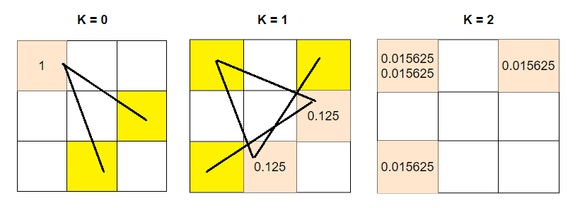

# C++ DP Solution Explained

**Author:** ahsan83
**Votes:** 75
**Link:** [https://leetcode.com/problems/knight-probability-in-chessboard/solutions/889598/](https://leetcode.com/problems/knight-probability-in-chessboard/solutions/889598/)

---

Runtime: 8 ms, faster than 86.35% of C++ online submissions for Knight Probability in Chessboard.
Memory Usage: 6.9 MB, less than 5.54% of C++ online submissions for Knight Probability in Chessboard.

```
Here knight's each move has probability 1.0/8.0 = 0.125. Now intially in position start = (r,c) the proabability
of knight move is 1.0 so, when there is a move from start to new position child (r+x, c+y), the probability of
new position will be prob_new_pos += prob_start/ 8.0 and same goes for all other parent and child positions.
As there can be multiple way to end up in a position from different positions, we add their probability as
those are mutually exclusive events and also from parent to child position we divide parent probability by
8.0 as those events are dependent or in chain and every move has proability 1/8.  After K steps , we sum up
all the probability of the chess board positions.

Example: N = 3, K = 2, r= 0, c = 0
```




```
So, total probability =  0.015625 * 4 = 0.0625

'Time Complexity = O(N * N * K)'
```


```
class Solution {
public:
    
    double knightProbability(int N, int K, int r, int c){
        
        // no moves so probability 1
        if(K==0) return 1.0;
        
        // parent chess board
        vector<vector<double>> parentBoard(N,vector<double>(N,0.0));
        
        // child chess board
        vector<vector<double>> childBoard(N,vector<double>(N,0.0));
        
        // row and col offset for generating next move or child positions
        int rowoffset[] = {-2,-2,-1,-1,2,2,1,1};
        int coloffset[] = {1,-1,2,-2,1,-1,2,-2};
        
        int cx,cy;
        
        // initial position probability 1
        parentBoard[r][c] = 1.0;
        
        // Run K steps
        // Each step update the child position probability from parent position 
        // After each step assign child as parent board and create new child board
        for(int i=0;i<K;i++)
        {
            for(int p=0;p<N;p++)
            {
                for(int q=0;q<N;q++)
                { 
                    // calculate child position proabilty once from parent position probability
                    double moveProb = parentBoard[p][q]/8.0;
                    
                    // generate valid child positions
                    for(int w=0;w<8;w++)
                    {
                        cx = p + rowoffset[w];
                        cy = q + coloffset[w];

                        // update child position probability
                        if(cx>=0 && cx<N && cy>=0 && cy<N)
                            childBoard[cx][cy] += moveProb;
                    }                    
                }
            }
            
            parentBoard = childBoard;
            fill(childBoard.begin(),childBoard.end(),vector<double>(N,0.0));
        }
        

        
        double knightProb = 0.0;
        
        // Loop through parent board after K steps and sum up all probability
        for(int p=0;p<N;p++)
            for(int q=0;q<N;q++)
                   knightProb+=parentBoard[p][q];

        return knightProb;
    }
};
```