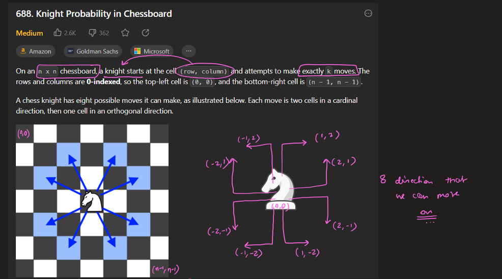
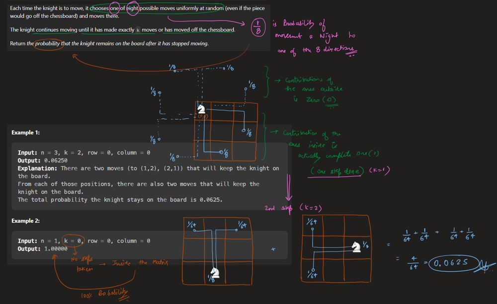
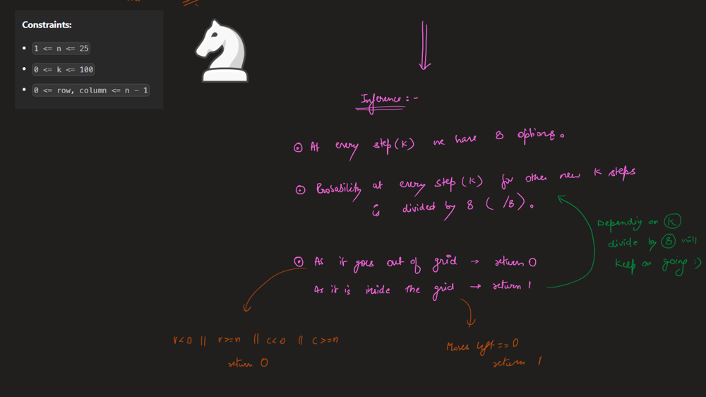
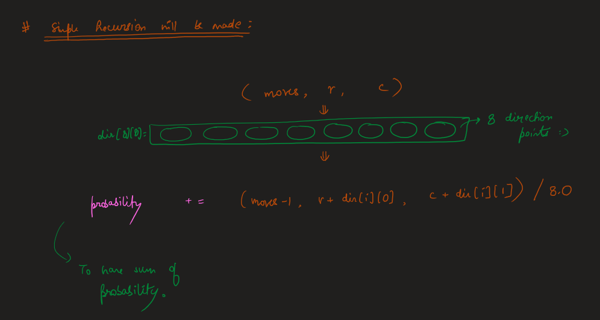
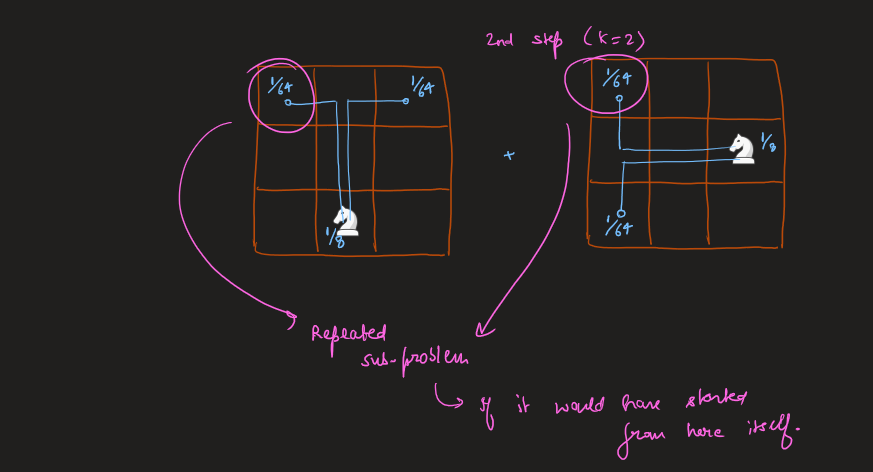
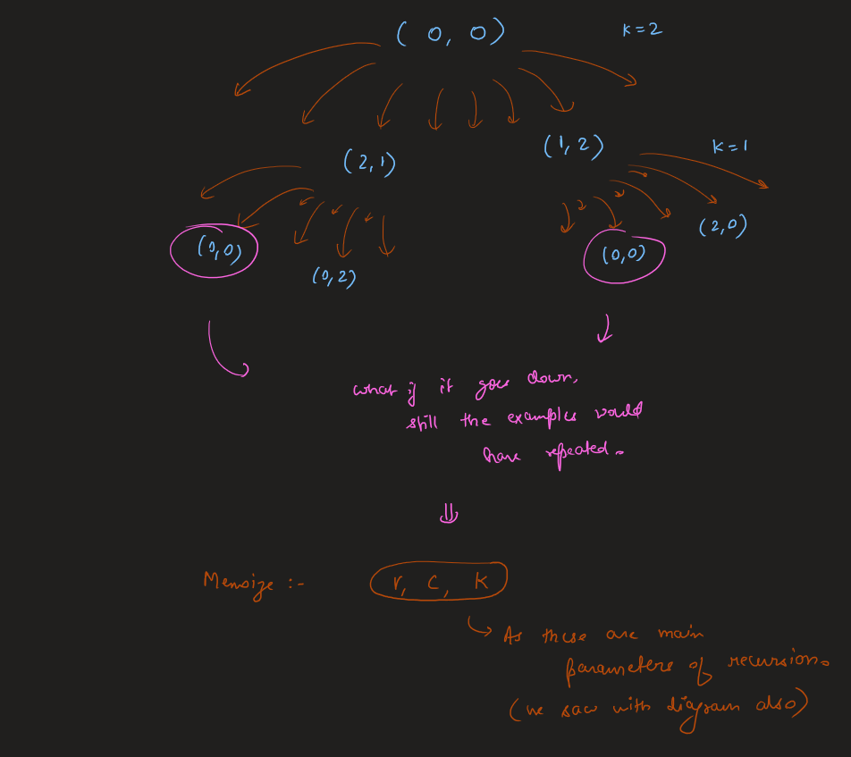
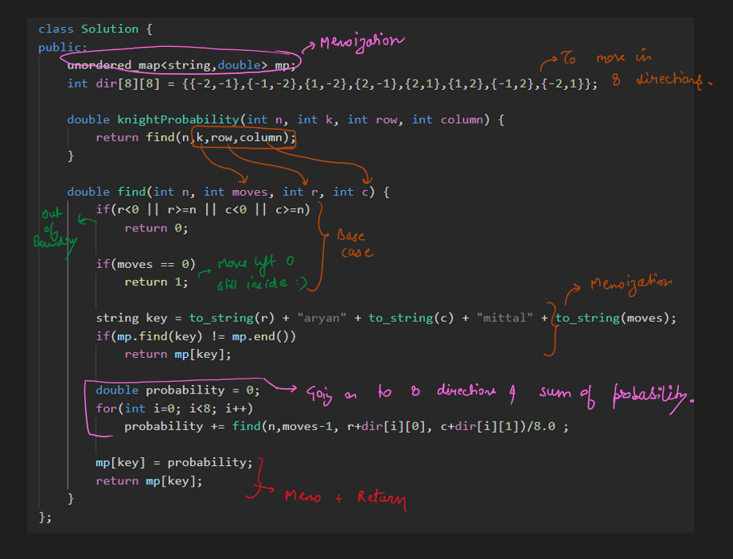

# Image Explanation🏆- [Probability + DP] - Super Easy to Understand

**Author:** aryan_0077
**Votes:** 54
**Link:** [https://leetcode.com/problems/knight-probability-in-chessboard/solutions/3799090/](https://leetcode.com/problems/knight-probability-in-chessboard/solutions/3799090/)

---

# Video Solution (`Aryan Mittal`) - Link in LeetCode Profile
`Knight Probability in Chessboard` by `Aryan Mittal`


# Approach & Intution








# Code
```C++ []
class Solution {
public:
    unordered_map<string,double> mp;
    int dir[8][8] = {{-2,-1},{-1,-2},{1,-2},{2,-1},{2,1},{1,2},{-1,2},{-2,1}};

    double knightProbability(int n, int k, int row, int column) {
        return find(n,k,row,column);
    }

    double find(int n, int moves, int r, int c) {
        if(r<0 || r>=n || c<0 || c>=n)
            return 0;
        
        if(moves == 0)
            return 1;
        
        string key = to_string(r) + "aryan" + to_string(c) + "mittal" + to_string(moves);
        if(mp.find(key) != mp.end())
            return mp[key];
        
        double probability = 0;
        for(int i=0; i<8; i++)
            probability += find(n,moves-1, r+dir[i][0], c+dir[i][1])/8.0 ;
        
        mp[key] = probability;
        return mp[key];
    }
};
```