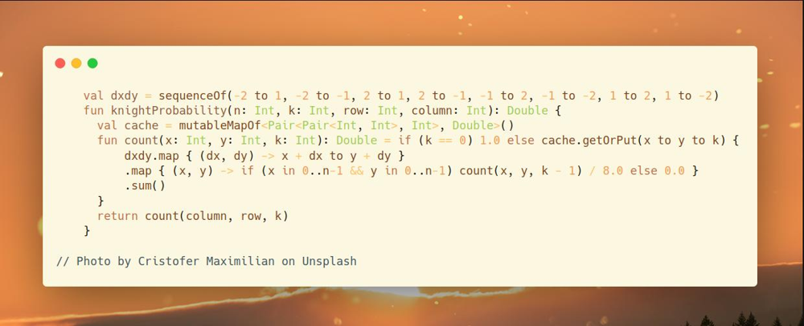
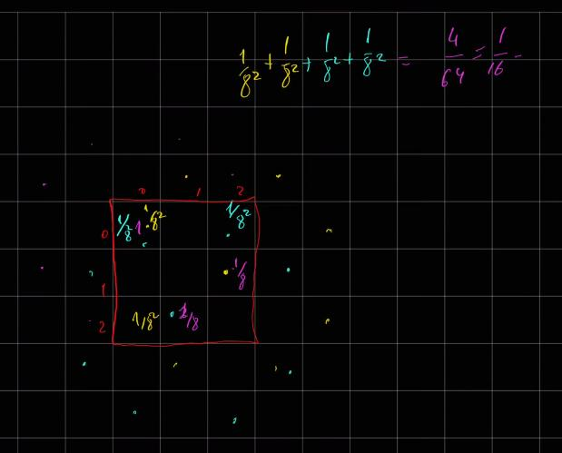

# Kotlin | example how to count probabilities

**Author:** SamoylenkoDmitry
**Votes:** 1
**Link:** [https://leetcode.com/problems/knight-probability-in-chessboard/solutions/3799262/](https://leetcode.com/problems/knight-probability-in-chessboard/solutions/3799262/)

---



#### Join me on Telegram

https://t.me/leetcode_daily_unstoppable/283

#### Problem TLDR

Probability of making `k` steps on a chessboard without stepping outside

#### Intuition
The description example doesn't give a clear picture of how the probability works.



* individual probability is `1/8` each time we make a step. 
* * One step is `1/8`, two steps are `1/8 * 1/8` and so on. 
* * So, the `k-steps` path will have probability of `1/8^k`
* we need to sum all the probabilities of individual `k-steps` paths, that will remain on a board
* * the brute force algorithm for this will be BFS:
* * * for `k` rounds:
* * * * poll all the elements, and make possible steps on the board
* * * * resulting probability will be `queue.size / 8^k`, as queue will contain only the final possible ways after k steps

However, there are too many possible ways, we will quickly run out of memory.

It is noticeable, some ways are repeating, and after `s` steps the same cell [x, y] produces the same amount of possible ways `dp[x, y][s]`. We can cache this result for each cell.

However, the number of ways are still very big and do not fit into `Long` 64 bits. To solve this, we can cache not only the ways, but the `probability`, dividing each step by `8`.


#### Approach

* storing the directions in a sequence helps to reduce some LOC

#### Complexity

- Time complexity:
$$O(kn^2)$$

- Space complexity:
$$O(kn^2)$$

#### Code

```


    val dxdy = sequenceOf(-2 to 1, -2 to -1, 2 to 1, 2 to -1, -1 to 2, -1 to -2, 1 to 2, 1 to -2)
    fun knightProbability(n: Int, k: Int, row: Int, column: Int): Double {
      val cache = mutableMapOf<Pair<Pair<Int, Int>, Int>, Double>()
      fun count(x: Int, y: Int, k: Int): Double = if (k == 0) 1.0 else cache.getOrPut(x to y to k) {
          dxdy.map { (dx, dy) -> x + dx to y + dy }
          .map { (x, y) -> if (x in 0..n-1 && y in 0..n-1) count(x, y, k - 1) / 8.0 else 0.0 }
          .sum()
      }
      return count(column, row, k)
    }

```

#### The magical rundown

```
Step \u2080 - The High Noon Duel \uD83E\uDD20\uD83C\uDFB5\uD83C\uDF35:
\uD83C\uDFB6 The town clock strikes twelve, and the high noon chess duel commences. A 
lone knight \uD83D\uDC0E trots onto the scorching, sun-bleached chessboard, casting a long 
shadow on the sandy squares.

\u2554\u2550\u2550\u2550\uD83C\uDF35\u2550\u2550\u2550\uD83C\uDF35\u2550\u2550\u2550\u2557
\u2551 \uD83D\uDC0E \u2551   \u2551    \u2551
\u2560\u2550\u2550\u2550\uD83C\uDF35\u2550\u2550\u2550\uD83C\uDF35\u2550\u2550\u2550\u2563
\u2551   \u2551    \u2551   \u2551
\u2560\u2550\u2550\u2550\uD83C\uDF35\u2550\u2550\u2550\uD83C\uDF35\u2550\u2550\u2550\u2563
\u2551   \u2551    \u2551   \u2551
\u255A\u2550\u2550\u2550\uD83C\uDF35\u2550\u2550\u2550\uD83C\uDF35\u2550\u2550\u2550\u255D

The Sheriff \uD83E\uDD20, ever the statistician, watches keenly. "For now, the odds are 
all in your favor, Knight," he says, unveiling the initial probability \uD835\uDCF9\u2080 = 1.
\u250C\u2500\u2500\u2500\u2500\u2500\uD83D\uDCB0\u2500\u2500\u2500\u2500\u252C\u2500\u2500\u2500\u2500\uD83D\uDCB0\u2500\u2500\u2500\u2500\u252C\u2500\u2500\u2500\u2500\uD83D\uDCB0\u2500\u2500\u2500\u2500\u2510
\u2502     1     \u2502    0    \u2502     0    \u2502
\u251C\u2500\u2500\u2500\u2500\u2500\uD83D\uDCB0\u2500\u2500\u2500\u2500\u253C\u2500\u2500\u2500\u2500\uD83D\uDCB0\u2500\u2500\u2500\u2500\u253C\u2500\u2500\u2500\u2500\uD83D\uDCB0\u2500\u2500\u2500\u2500\u2524
\u2502     0     \u2502    0    \u2502     0    \u2502
\u251C\u2500\u2500\u2500\u2500\u2500\uD83D\uDCB0\u2500\u2500\u2500\u2500\u253C\u2500\u2500\u2500\u2500\uD83D\uDCB0\u2500\u2500\u2500\u2500\u253C\u2500\u2500\u2500\u2500\uD83D\uDCB0\u2500\u2500\u2500\u2500\u2524
\u2502     0     \u2502    0    \u2502     0    \u2502
\u2514\u2500\u2500\u2500\u2500\u2500\uD83D\uDCB0\u2500\u2500\u2500\u2500\u2534\u2500\u2500\u2500\u2500\uD83D\uDCB0\u2500\u2500\u2500\u2500\u2534\u2500\u2500\u2500\u2500\uD83D\uDCB0\u2500\u2500\u2500\u2500\u2518

Step \u2081 - The Dusty Trail \uD83C\uDF04\uD83C\uDFB5\uD83D\uDC34:
\uD83C\uDFB6 The knight \uD83D\uDC0E leaps into action, stirring up a cloud of dust. He lands in two 
different squares, each with a calculated 1/8 chance. The Sheriff \uD83E\uDD20 nods 
approvingly. "Bold moves, Knight. The probability after this is \uD835\uDCF9\u2081 = 1/8 + 1/8 = 1/4."
\u2554\u2550\u2550\u2550\uD83C\uDF35\u2550\u2550\u2550\uD83C\uDF35\u2550\u2550\u2550\u2557
\u2551   \u2551    \u2551   \u2551
\u2560\u2550\u2550\u2550\uD83C\uDF35\u2550\u2550\u2550\uD83C\uDF35\u2550\u2550\u2550\u2563
\u2551   \u2551    \u2551 \uD83D\uDC0E \u2551
\u2560\u2550\u2550\u2550\uD83C\uDF35\u2550\u2550\u2550\uD83C\uDF35\u2550\u2550\u2550\u2563
\u2551   \u2551 \uD83D\uDC0E \u2551   \u2551
\u255A\u2550\u2550\u2550\uD83C\uDF35\u2550\u2550\u2550\uD83C\uDF35\u2550\u2550\u2550\u255D

He reveals the new odds:
\u250C\u2500\u2500\u2500\u2500\u2500\uD83D\uDCB0\u2500\u2500\u2500\u2500\u252C\u2500\u2500\u2500\u2500\uD83D\uDCB0\u2500\u2500\u2500\u2500\u252C\u2500\u2500\u2500\u2500\uD83D\uDCB0\u2500\u2500\u2500\u2500\u2510
\u2502     0     \u2502    0    \u2502     0    \u2502
\u251C\u2500\u2500\u2500\u2500\u2500\uD83D\uDCB0\u2500\u2500\u2500\u2500\u253C\u2500\u2500\u2500\u2500\uD83D\uDCB0\u2500\u2500\u2500\u2500\u253C\u2500\u2500\u2500\u2500\uD83D\uDCB0\u2500\u2500\u2500\u2500\u2524
\u2502     0     \u2502    0    \u2502    \xB9/\u2088   \u2502
\u251C\u2500\u2500\u2500\u2500\u2500\uD83D\uDCB0\u2500\u2500\u2500\u2500\u253C\u2500\u2500\u2500\u2500\uD83D\uDCB0\u2500\u2500\u2500\u2500\u253C\u2500\u2500\u2500\u2500\uD83D\uDCB0\u2500\u2500\u2500\u2500\u2524
\u2502     0     \u2502   \xB9/\u2088   \u2502     0    \u2502
\u2514\u2500\u2500\u2500\u2500\u2500\uD83D\uDCB0\u2500\u2500\u2500\u2500\u2534\u2500\u2500\u2500\u2500\uD83D\uDCB0\u2500\u2500\u2500\u2500\u2534\u2500\u2500\u2500\u2500\uD83D\uDCB0\u2500\u2500\u2500\u2500\u2518

Step \u2082 - The Sun-Baked Crossroads \u2600\uFE0F\uD83C\uDFB5\uD83C\uDF2A\uFE0F:
\uD83C\uDFB6 The knight \uD83D\uDC0E continues his daring maneuvers, hopping onto a few critical 
spots. He lands on three squares, with probabilities of 1/64, 1/64, and 2/64. 
Adding these up, the Sheriff \uD83E\uDD20 declares, "The stakes have risen, Knight. The 
total is \uD835\uDCF9\u2082 = 1/64 + 1/64 + 2/64 = 1/16."
\u2554\u2550\u2550\u2550\uD83C\uDF35\u2550\u2550\u2550\uD83C\uDF35\u2550\u2550\u2550\u2557
\u2551\uD83D\uDC0E\uD83D\uDC0E\u2551   \u2551 \uD83D\uDC0E \u2551
\u2560\u2550\u2550\u2550\uD83C\uDF35\u2550\u2550\u2550\uD83C\uDF35\u2550\u2550\u2550\u2563
\u2551   \u2551    \u2551   \u2551
\u2560\u2550\u2550\u2550\uD83C\uDF35\u2550\u2550\u2550\uD83C\uDF35\u2550\u2550\u2550\u2563
\u2551 \uD83D\uDC0E \u2551   \u2551   \u2551
\u255A\u2550\u2550\u2550\uD83C\uDF35\u2550\u2550\u2550\uD83C\uDF35\u2550\u2550\u2550\u255D

The updated odds take shape:
\u250C\u2500\u2500\u2500\u2500\u2500\uD83D\uDCB0\u2500\u2500\u2500\u2500\u252C\u2500\u2500\u2500\u2500\uD83D\uDCB0\u2500\u2500\u2500\u2500\u252C\u2500\u2500\u2500\u2500\uD83D\uDCB0\u2500\u2500\u2500\u2500\u2510
\u2502    \xB2/\u2086\u2084   \u2502    0    \u2502   \xB9/\u2086\u2084   \u2502
\u251C\u2500\u2500\u2500\u2500\u2500\uD83D\uDCB0\u2500\u2500\u2500\u2500\u253C\u2500\u2500\u2500\u2500\uD83D\uDCB0\u2500\u2500\u2500\u2500\u253C\u2500\u2500\u2500\u2500\uD83D\uDCB0\u2500\u2500\u2500\u2500\u2524
\u2502     0     \u2502    0    \u2502     0    \u2502
\u251C\u2500\u2500\u2500\u2500\u2500\uD83D\uDCB0\u2500\u2500\u2500\u2500\u253C\u2500\u2500\u2500\u2500\uD83D\uDCB0\u2500\u2500\u2500\u2500\u253C\u2500\u2500\u2500\u2500\uD83D\uDCB0\u2500\u2500\u2500\u2500\u2524
\u2502    \xB9/\u2086\u2084   \u2502    0    \u2502     0    \u2502
\u2514\u2500\u2500\u2500\u2500\u2500\uD83D\uDCB0\u2500\u2500\u2500\u2500\u2534\u2500\u2500\u2500\u2500\uD83D\uDCB0\u2500\u2500\u2500\u2500\u2534\u2500\u2500\u2500\u2500\uD83D\uDCB0\u2500\u2500\u2500\u2500\u2518

Step \u2083 - The Outlaw's Hideout \uD83C\uDFDA\uFE0F\uD83C\uDFB5\uD83D\uDC0D:
\uD83C\uDFB6 As the sun sets, the knight \uD83D\uDC0E lands in a few hidden spots with various 
probabilities. Each calculated leap adds to his total: 1/512 + 1/512 + 3/512 + 3/512. 
The Sheriff \uD83E\uDD20 raises an eyebrow. "Well played, Knight. Your total now is \uD835\uDCF9\u2083 = 
1/512 + 1/512 + 3/512 + 3/512."

\u2554\u2550\u2550\u2550\uD83C\uDF35\u2550\u2550\u2550\uD83C\uDF35\u2550\u2550\u2550\u2557
\u2551   \u2551 \uD83D\uDC0E \u2551    \u2551
\u2560\u2550\u2550\u2550\uD83C\uDF35\u2550\u2550\u2550\uD83C\uDF35\u2550\u2550\u2550\u2563
\u2551 \uD83D\uDC0E \u2551   \u2551\uD83D\uDC0E\uD83D\uDC0E\uD83D\uDC0E\u2551
\u2560\u2550\u2550\u2550\uD83C\uDF35\u2550\u2550\u2550\uD83C\uDF35\u2550\u2550\u2550\u2563
\u2551   \u2551\uD83D\uDC0E\uD83D\uDC0E\uD83D\uDC0E\u2551  \u2551
\u255A\u2550\u2550\u2550\uD83C\uDF35\u2550\u2550\u2550\uD83C\uDF35\u2550\u2550\u2550\u255D

Beneath the twinkling stars, the Sheriff \uD83E\uDD20 surveys the evolving game. "You're 
not an easy one to beat, Knight," he admits, revealing the updated stakes:
\u250C\u2500\u2500\u2500\u2500\u2500\uD83D\uDCB0\u2500\u2500\u2500\u2500\u252C\u2500\u2500\u2500\u2500\uD83D\uDCB0\u2500\u2500\u2500\u2500\u252C\u2500\u2500\u2500\u2500\uD83D\uDCB0\u2500\u2500\u2500\u2500\u2510
\u2502     0     \u2502  \xB9/\u2085\u2081\u2082  \u2502     0    \u2502
\u251C\u2500\u2500\u2500\u2500\u2500\uD83D\uDCB0\u2500\u2500\u2500\u2500\u253C\u2500\u2500\u2500\u2500\uD83D\uDCB0\u2500\u2500\u2500\u2500\u253C\u2500\u2500\u2500\u2500\uD83D\uDCB0\u2500\u2500\u2500\u2500\u2524
\u2502   \xB9/\u2085\u2081\u2082   \u2502    0    \u2502   \xB3/\u2085\u2081\u2082  \u2502
\u251C\u2500\u2500\u2500\u2500\u2500\uD83D\uDCB0\u2500\u2500\u2500\u2500\u253C\u2500\u2500\u2500\u2500\uD83D\uDCB0\u2500\u2500\u2500\u2500\u253C\u2500\u2500\u2500\u2500\uD83D\uDCB0\u2500\u2500\u2500\u2500\u2524
\u2502     0     \u2502  \xB3/\u2085\u2081\u2082  \u2502     0    \u2502
\u2514\u2500\u2500\u2500\u2500\u2500\uD83D\uDCB0\u2500\u2500\u2500\u2500\u2534\u2500\u2500\u2500\u2500\uD83D\uDCB0\u2500\u2500\u2500\u2500\u2534\u2500\u2500\u2500\u2500\uD83D\uDCB0\u2500\u2500\u2500\u2500\u2518

\uD83C\uDFB6 So, under the twinkling stars and to the tune of the whistling wind, our 
knight's adventure continues into the night. The stakes are high, the moves 
unpredictable, but one thing's certain: this wild chess duel is far from over! \uD83C\uDF35\uD83D\uDC0E\uD83C\uDF0C\uD83C\uDFB5

```