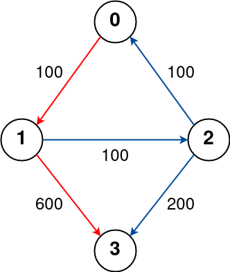
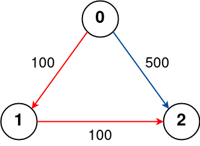
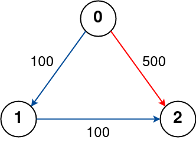

# [787. Cheapest Flights Within K Stops](https://leetcode.com/problems/cheapest-flights-within-k-stops/)

| Category | Difficulty | Likes | Dislikes |
| :------: | :--------: | :---: | :------: |
| Algorithms | Medium | 10995 | 464 |

**Tags:** [`dynamic-programming`](https://leetcode.com/tag/dynamic-programming), [`depth-first-search`](https://leetcode.com/tag/depth-first-search), [`breadth-first-search`](https://leetcode.com/tag/breadth-first-search), [`graph`](https://leetcode.com/tag/graph), [`heap-priority-queue`](https://leetcode.com/tag/heap-priority-queue), [`shortest-path`](https://leetcode.com/tag/shortest-path)

**Companies:** `amazon`, `google`, `microsoft`, `expedia`, `stripe`, `facebook`, `apple`, `bloomberg`, `snowflake`, `tiktok`, `makemytrip`, `airbnb`, `snapchat`, `flipkart`, `coupang`, `salesforce`

## Description

There are `n` cities connected by some number of flights. You are given an array `flights` where `flights[i] = [from_i, to_i, price_i]` indicates that there is a flight from city `from_i` to city `to_i` with cost `price_i`.

You are also given three integers `src`, `dst`, and `k`, return ***the cheapest price** from *`src`* to *`dst`* with at most *`k`* stops. *If there is no such route, return* *`-1`.

 

**Example 1:**


```

Input: n = 4, flights = [[0,1,100],[1,2,100],[2,0,100],[1,3,600],[2,3,200]], src = 0, dst = 3, k = 1
Output: 700
Explanation:
The graph is shown above.
The optimal path with at most 1 stop from city 0 to 3 is marked in red and has cost 100 + 600 = 700.
Note that the path through cities [0,1,2,3] is cheaper but is invalid because it uses 2 stops.

```

**Example 2:**


```

Input: n = 3, flights = [[0,1,100],[1,2,100],[0,2,500]], src = 0, dst = 2, k = 1
Output: 200
Explanation:
The graph is shown above.
The optimal path with at most 1 stop from city 0 to 2 is marked in red and has cost 100 + 100 = 200.

```

**Example 3:**


```

Input: n = 3, flights = [[0,1,100],[1,2,100],[0,2,500]], src = 0, dst = 2, k = 0
Output: 500
Explanation:
The graph is shown above.
The optimal path with no stops from city 0 to 2 is marked in red and has cost 500.

```

 

**Constraints:**

	- `2 <= n <= 100`

	- `0 <= flights.length <= (n * (n - 1) / 2)`

	- `flights[i].length == 3`

	- `0 <= from_i, to_i < n`

	- `from_i != to_i`

	- `1 <= price_i <= 10^4`

	- There will not be any multiple flights between two cities.

	- `0 <= src, dst, k < n`

	- `src != dst`

---

**Links:** [Submissions](https://leetcode.com/problems/cheapest-flights-within-k-stops/) | [Solutions](https://leetcode.com/problems/cheapest-flights-within-k-stops/)
