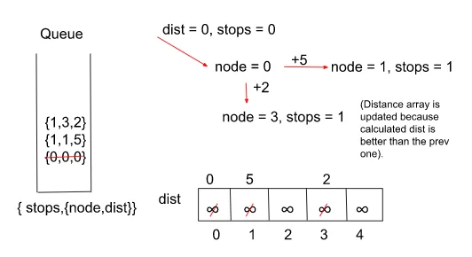

# Clean Codes🔥🔥|| Full Explanation✅|| Dijkstra's Algo✅|| C++|| Java || Python3

**Author:** N7_BLACKHAT
**Votes:** 62
**Link:** [https://leetcode.com/problems/cheapest-flights-within-k-stops/solutions/3100039/](https://leetcode.com/problems/cheapest-flights-within-k-stops/solutions/3100039/)

---

# Intuition :
- Since in this problem, we have to calculate the minimum cost to reach the destination from the source but with a restriction on the number of stops, we would be using Dijkstra\u2019s Algorithm. Now, one must wonder that based on what parameter we should add elements to the priority queue.

- Now, if we store the elements in the priority queue with the priority given to the minimum distance first, then after a few iterations we would realize that the Algorithm will halt when the number of stops would exceed. This may result in a wrong answer as it would not allow us to explore those paths which have more cost but fewer stops than the current answer.

- To tackle this issue, we store the elements in terms of the minimum number of stops in the priority queue so that when the algorithm halts, we can get the minimum cost within limits.

- Also, a point to note here is that do we really need a priority queue for carrying out the algorithm? The answer for that is No because when we are storing everything in terms of a number of stops, the stops are increasing monotonically which means that the number of sops is increasing by 1 and when we pop an element out of the queue, we are always popping the element with a lesser number of stops first. 
- Replacing the priority queue with a simple queue will let us eliminate an extra log(N) of the complexity of insertion-deletion in a priority queue which would in turn make our algorithm a lot faster.
<!-- Describe your first thoughts on how to solve this problem. -->

# Approach :
**Initial configuration:**
- Queue: Define a Queue that would contain pairs of the type {stops, {node,dist} }, where \u2018dist\u2019 indicates the currently updated value of the distance from the source to the \u2018node\u2019 and \u2018stops\u2019 contains the number of nodes one has to traverse in order to reach node from src.

- Distance Array: Define a distance array that would contain the minimum cost/distance from the source cell to a particular cell. If a cell is marked as \u2018infinity\u2019 then it is treated as unreachable/unvisited.

- Source and Destination: Define the source and the destination from where the flights have to run.
<!-- Describe your approach to solving the problem. -->

# Steps to Follow :
- Start by creating an adjacency list, a queue that stores the distance-node and stops pairs in the form {stops,{node,dist}} and a dist array with each node initialized with a very large number ( to indicate that they\u2019re unvisited initially) and the source node marked as \u20180\u2019.
- We push the source cell to the queue along with its distance which is also 0 and the stops are marked as \u20180\u2019 initially because we\u2019ve just started.
- Pop the element at the front of the queue and look out for its adjacent nodes. 
- If the current dist value of a node is better than the previous distance indicated by the distance array and the number of stops until now is less than K, we update the distance in the array and push it to the queue. Also, increase the stop count by 1.
- We repeat the above three steps until the queue becomes empty. Note that we do not stop the algorithm from just reaching the destination node as it may give incorrect results.
- Return the calculated distance/cost after we reach the required number of stops. If the queue becomes empty and we don\u2019t encounter the destination node, return \u2018-1\u2019 indicating there\u2019s no path from source to destination.




# Complexity
- Time complexity: O(\u2223E\u2223 + \u2223V\u2223 log\u2223E\u2223)
<!-- Add your time complexity here, e.g. $$O(n)$$ -->

- Space complexity: O(nk)
<!-- Add your space complexity here, e.g. $$O(n)$$ -->

# Please Upvote\uD83D\uDC4D\uD83D\uDC4D
```
Another Approach \u2B07\uFE0F\u2B07\uFE0F with Python code also( Scroll down to 
check).
```
# Codes for above Explained Approach :
```C++ []
class Solution
{
public:
    int findCheapestPrice(int n, vector<vector<int>> &flights,
                       int src, int dst, int K)
    {
        // Create the adjacency list to depict airports and flights in
        // the form of a graph.
        vector<pair<int, int>> adj[n];
        for (auto it : flights)
        {
            adj[it[0]].push_back({it[1], it[2]});
        }

        // Create a queue which stores the node and their distances from the
        // source in the form of {stops, {node, dist}} with \u2018stops\u2019 indicating 
        // the no. of nodes between src and current node.
        queue<pair<int, pair<int, int>>> q;
        
        q.push({0, {src, 0}});

        // Distance array to store the updated distances from the source.
        vector<int> dist(n, 1e9);
        dist[src] = 0;

        // Iterate through the graph using a queue like in Dijkstra with 
        // popping out the element with min stops first.
        while (!q.empty())
        {
            auto it = q.front();
            q.pop();
            int stops = it.first;
            int node = it.second.first;
            int cost = it.second.second;

            // We stop the process as soon as the limit for the stops reaches.
            if (stops > K)
                continue;
            for (auto iter : adj[node])
            {
                int adjNode = iter.first;
                int edW = iter.second;

                // We only update the queue if the new calculated dist is
                // less than the prev and the stops are also within limits.
                if (cost + edW < dist[adjNode] && stops <= K)
                {
                    dist[adjNode] = cost + edW;
                    q.push({stops + 1, {adjNode, cost + edW}});
                }
            }
        }
        // If the destination node is unreachable return \u2018-1\u2019
        // else return the calculated dist from src to dst.
        if (dist[dst] == 1e9)
            return -1;
        return dist[dst];
    }
};
```
```Java []
class Pair{
    int first;
    int second;
    public Pair(int first,int second){
        this.first = first;
        this.second = second;
    }
}
class Tuple {
    int first, second, third; 
    Tuple(int first, int second, int third) {
        this.first = first; 
        this.second = second;
        this.third = third; 
    }
}
class Solution {
    public int findCheapestPrice(int n,int flights[][],int src,int dst,int K) {

        // Create the adjacency list to depict airports and flights in
        // the form of a graph.
        ArrayList<ArrayList<Pair>> adj = new ArrayList<>(); 
        for(int i = 0;i<n;i++) {
            adj.add(new ArrayList<>()); 
        }
        int m = flights.length; 
        for(int i = 0;i<m;i++) {
            adj.get(flights[i][0]).add(new Pair(flights[i][1], flights[i][2])); 
        }
        
        // Create a queue which stores the node and their distances from the
        // source in the form of {stops, {node, dist}} with \u2018stops\u2019 indicating 
        // the no. of nodes between src and current node.
        Queue<Tuple> q = new LinkedList<>(); 
        
        q.add(new Tuple(0, src, 0));

        // Distance array to store the updated distances from the source. 
        int[] dist = new int[n]; 
        for(int i = 0;i<n;i++) {
            dist[i] = (int)(1e9); 
        }
        dist[src] = 0; 

        // Iterate through the graph using a queue like in Dijkstra with 
        // popping out the element with min stops first.
        while(!q.isEmpty()) {
            Tuple it = q.peek(); 
            q.remove(); 
            int stops = it.first; 
            int node = it.second; 
            int cost = it.third; 
            
            // We stop the process as soon as the limit for the stops reaches.
            if(stops > K) continue; 
            for(Pair iter: adj.get(node)) {
                int adjNode = iter.first; 
                int edW = iter.second; 
                
                // We only update the queue if the new calculated dist is
                // less than the prev and the stops are also within limits.
                if (cost + edW < dist[adjNode] && stops <= K) {
                    dist[adjNode] = cost + edW; 
                    q.add(new Tuple(stops + 1, adjNode, cost + edW)); 
                }
            }
        }
        // If the destination node is unreachable return \u2018-1\u2019
        // else return the calculated dist from src to dst.
        if(dist[dst] == (int)(1e9)) return -1; 
        return dist[dst]; 
    }
}
```


# Another Approach using Priority Queue :
```C++ []
class Solution {
 public:
  int findCheapestPrice(int n, vector<vector<int>>& flights, int src, int dst,
                        int k) {
    vector<vector<pair<int, int>>> graph(n);
    using T = tuple<int, int, int>;  // (d, u, stops)
    priority_queue<T, vector<T>, greater<>> minHeap;
    vector<vector<int>> dist(n, vector<int>(k + 2, INT_MAX));

    minHeap.emplace(0, src, k + 1);  // Start with node src with d == 0
    dist[src][k + 1] = 0;

    for (const vector<int>& f : flights) {
      const int u = f[0];
      const int v = f[1];
      const int w = f[2];
      graph[u].emplace_back(v, w);
    }

    while (!minHeap.empty()) {
      const auto [d, u, stops] = minHeap.top();
      minHeap.pop();
      if (u == dst)
        return d;
      if (stops > 0)
        for (const auto& [v, w] : graph[u]) {
          const int newDist = d + w;
          if (newDist < dist[v][stops - 1]) {
            dist[v][stops - 1] = newDist;
            minHeap.emplace(newDist, v, stops - 1);
          }
        }
    }

    return -1;
  }
};
```
```Java []
class Solution {
  public int findCheapestPrice(int n, int[][] flights, int src, int dst, int k) {
    List<Pair<Integer, Integer>>[] graph = new List[n];
    // (d, u, stops)
    Queue<int[]> minHeap = new PriorityQueue<>((a, b) -> a[0] - b[0]);
    int[][] dist = new int[n][k + 2];
    Arrays.stream(dist).forEach(A -> Arrays.fill(A, Integer.MAX_VALUE));

    for (int i = 0; i < n; ++i)
      graph[i] = new ArrayList<>();

    for (int[] f : flights) {
      final int u = f[0];
      final int v = f[1];
      final int w = f[2];
      graph[u].add(new Pair<>(v, w));
    }

    minHeap.offer(new int[] {0, src, k + 1}); // Start with node src with d == 0
    dist[src][k + 1] = 0;

    while (!minHeap.isEmpty()) {
      final int d = minHeap.peek()[0];
      final int u = minHeap.peek()[1];
      final int stops = minHeap.poll()[2];
      if (u == dst)
        return d;
      if (stops > 0)
        for (Pair<Integer, Integer> pair : graph[u]) {
          final int v = pair.getKey();
          final int w = pair.getValue();
          final int newDist = d + w;
          if (newDist < dist[v][stops - 1]) {
            dist[v][stops - 1] = newDist;
            minHeap.offer(new int[] {d + w, v, stops - 1});
          }
        }
    }

    return -1;
  }
}
```
```Python3 []
class Solution:
  def findCheapestPrice(self, n: int, flights: List[List[int]], src: int, dst: int, k: int) -> int:
    graph = [[] for _ in range(n)]
    minHeap = [(0, src, k + 1)]  # (d, u, stops)
    dist = [[math.inf] * (k + 2) for _ in range(n)]

    for u, v, w in flights:
      graph[u].append((v, w))

    while minHeap:
      d, u, stops = heapq.heappop(minHeap)
      if u == dst:
        return d
      if stops > 0:
        for v, w in graph[u]:
          newDist = d + w
          if newDist < dist[v][stops - 1]:
            dist[v][stops - 1] = newDist
            heapq.heappush(minHeap, (newDist, v, stops - 1))

    return -1
```
# Please Upvote\uD83D\uDC4D\uD83D\uDC4D


