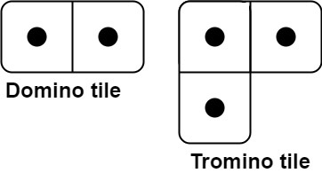
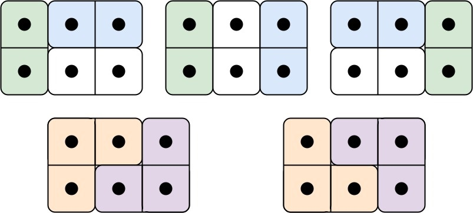

# [790. Domino and Tromino Tiling](https://leetcode.com/problems/domino-and-tromino-tiling/)

| Category | Difficulty | Likes | Dislikes |
| :------: | :--------: | :---: | :------: |
| Algorithms | Medium | 4107 | 1307 |

**Tags:** [`dynamic-programming`](https://leetcode.com/tag/dynamic-programming)

**Companies:** `google`, `amazon`, `facebook`, `bloomberg`

## Description

You have two types of tiles: a `2 x 1` domino shape and a tromino shape. You may rotate these shapes.



Given an integer n, return *the number of ways to tile an* `2 x n` *board*. Since the answer may be very large, return it **modulo** `10^9 + 7`.

In a tiling, every square must be covered by a tile. Two tilings are different if and only if there are two 4-directionally adjacent cells on the board such that exactly one of the tilings has both squares occupied by a tile.

 

**Example 1:**


```

Input: n = 3
Output: 5
Explanation: The five different ways are shown above.

```

**Example 2:**

```

Input: n = 1
Output: 1

```

 

**Constraints:**

	- `1 <= n <= 1000`

---

**Links:** [Submissions](https://leetcode.com/problems/domino-and-tromino-tiling/) | [Solutions](https://leetcode.com/problems/domino-and-tromino-tiling/)
