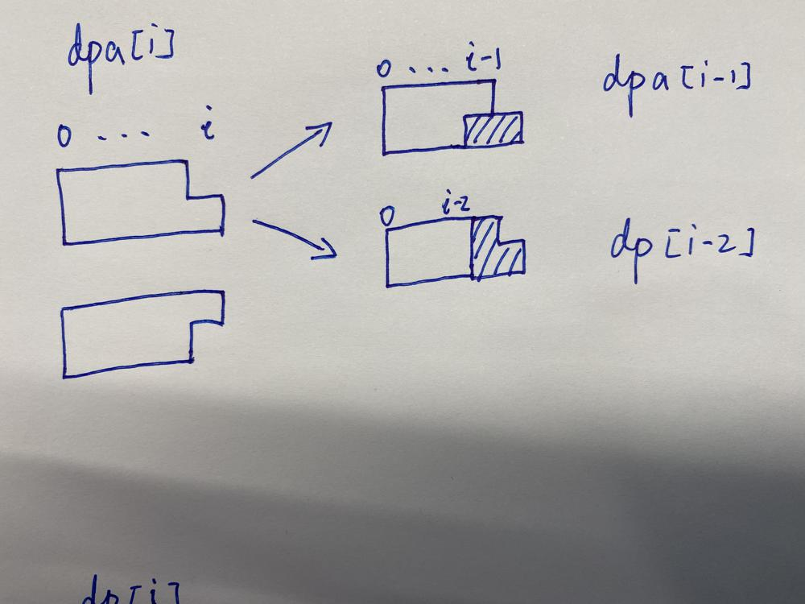
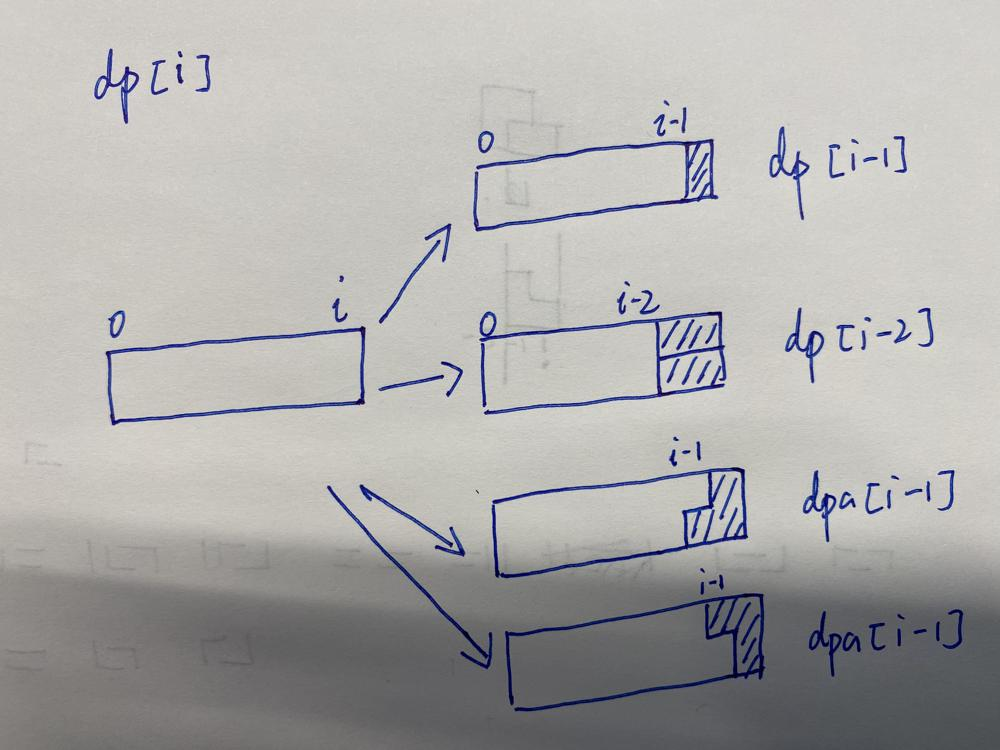
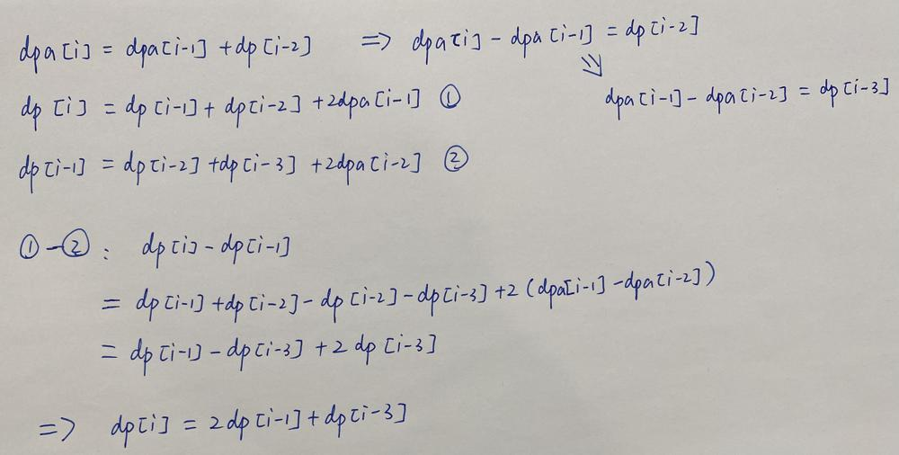

# ✅ [Python/JAVA/C/C++] DP || Image Visualized Explanation || 100% Faster || O(N)

**Author:** linfq
**Votes:** 260
**Link:** [https://leetcode.com/problems/domino-and-tromino-tiling/solutions/1620809/](https://leetcode.com/problems/domino-and-tromino-tiling/solutions/1620809/)

---

* dp[i] denotes the number of ways to tile an 2 * (i + 1) board, note that dp is 0-indexed.
	* Intuitively, dp[0] = 1 and dp[1] = 2
* dpa[i] denotes the number of ways to tile an 2 * i board and 1 more square left below(or above symmetrically).
	* Intuitively, dpa[0] = 0 and dpa[1] = 1
	* I just explained the case where in i-th column, 2nd row is filled. But it should be noted that the two cases(the other is in i-th column, 1st row is filled) are symmetric and the numbers are both dpa[i], you may imagine dpb[i] = dpa[i] for the second case where i-th column 1st row is filled.



Further More!



**If you hava any question, feel free to ask. If you like the solution or the explaination, Please UPVOTE!**

**Python/Python3**
```
class Solution(object):
    def numTilings(self, n):
        dp = [1, 2, 5] + [0] * n
        for i in range(3, n):
            dp[i] = (dp[i - 1] * 2 + dp[i - 3]) % 1000000007
        return dp[n - 1]
```
```
class Solution(object):
    def numTilings(self, n):
        dp, dpa = [1, 2] + [0] * n, [1] * n
        for i in range(2, n):
            dp[i] = (dp[i - 1] + dp[i - 2] + dpa[i - 1] * 2) % 1000000007
            dpa[i] = (dp[i - 2] + dpa[i - 1]) % 1000000007
        return dp[n - 1]
```
**Java**
```
class Solution {
    public int numTilings(int n) {
        long[] dp = new long[n + 3]; dp[0] = 1; dp[1] = 2; dp[2] = 5;
        for (int i = 3; i < n; i ++) {
            dp[i] = (dp[i - 1] * 2 + dp[i - 3]) % 1000000007;
        }
        return (int)dp[n - 1];
    }
}
```
```
class Solution {
    public int numTilings(int n) {
        long[] dp = new long[n + 2]; dp[0] = 1; dp[1] = 2;
        long[] dpa = new long[n + 2]; dpa[1] = 1;
        for (int i = 2; i < n; i ++) {
            dp[i] = (dp[i - 1] + dp[i - 2] + dpa[i - 1] * 2) % 1000000007;
            dpa[i] = (dp[i - 2] + dpa[i - 1]) % 1000000007;
        }
        return (int)dp[n - 1];
    }
}
```
**C/C++**
```
int numTilings(int n) {
    unsigned int dp[n + 3]; dp[0] = 1; dp[1] = 2; dp[2] = 5;
    for (int i = 3; i < n; i ++) {
        dp[i] = (2 * dp[i - 1] + dp[i - 3]) % 1000000007;
    }
    return dp[n - 1];
}
```
```
int numTilings(int n){
    if (n == 1) return 1;
    unsigned int dp[n]; dp[0] = 1; dp[1] = 2;
    unsigned int dpa[n]; dpa[1] = 1;
    for (int i = 2; i < n; i ++) {
        dp[i] = (dp[i - 1] + dp[i - 2] + dpa[i - 1] * 2) % 1000000007;
        dpa[i] = (dp[i - 2] + dpa[i - 1]) % 1000000007;
    }
    return dp[n - 1];
}
```

**Please UPVOTE!**