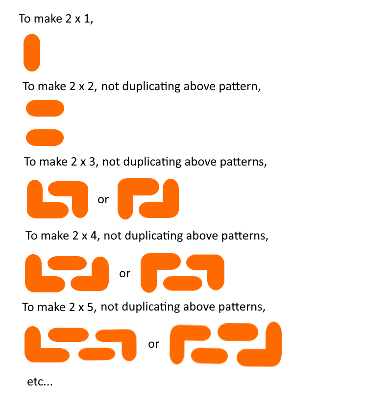

# Elixir DP solution

**Author:** Minamikaze392
**Votes:** 2
**Link:** [https://leetcode.com/problems/domino-and-tromino-tiling/solutions/2944150/](https://leetcode.com/problems/domino-and-tromino-tiling/solutions/2944150/)

---



Let dp[i] be the answer when n = i.
Then we can say:
```
dp[i] = dp[i-1] + dp[i-2] + 2 * (sum of dp[0..=i-3])
```
Substituting i with i + 1,
```
dp[i + 1]
= dp[i] + dp[i-1] + 2 * (sum of dp[0..=i-2])
= dp[i] + (dp[i-1] + dp[i-2] + 2 * (sum of dp[0..=i-3]) + dp[i-2]
= dp[i] + dp[i] + dp[i-2]
```
# Code
```elixir
defmodule Solution do
  @spec num_tilings(n :: integer) :: integer
  def num_tilings(n) when n <= 2, do: n
  def num_tilings(n) do
    count(n - 2, 2, 1, 1)
  end

  defp count(0, dp1, _, _), do: dp1
  defp count(c, dp1, dp2, dp3) do
    count(c - 1, rem(dp1 * 2 + dp3, 1_000_000_007), dp1, dp2)
  end
end
```