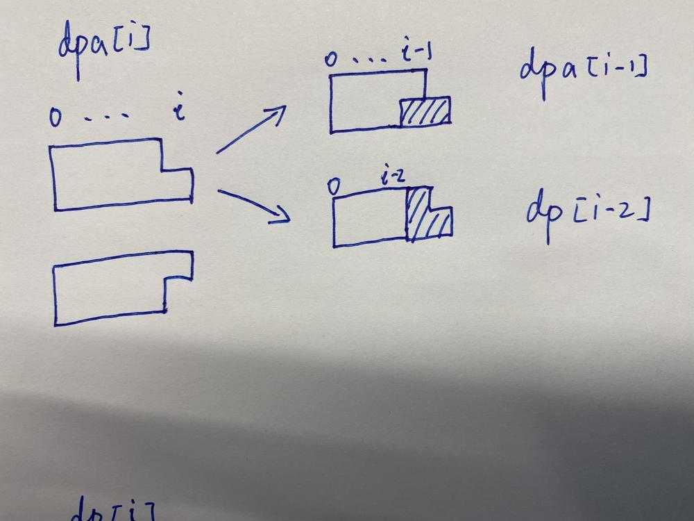
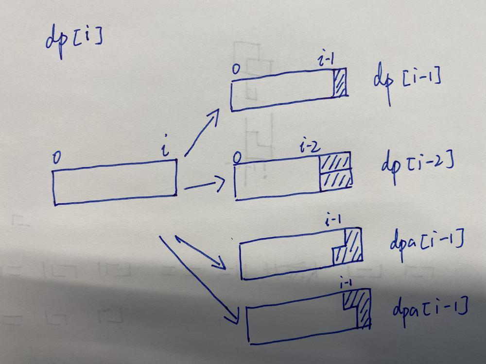
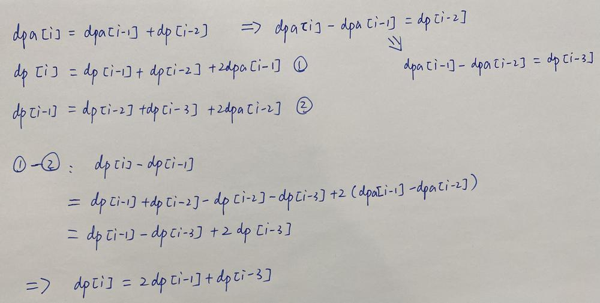

# [Go/Python] DP Approach O(n) || O(1) Space With Explanation

**Author:** vltvdnl
**Votes:** 9
**Link:** [https://leetcode.com/problems/domino-and-tromino-tiling/solutions/4581905/](https://leetcode.com/problems/domino-and-tromino-tiling/solutions/4581905/)

---

# Intuition
Since we are required to have a number that depends on the previous iterations (from n-1), this is an explicit DP. I recommend doing a lot of tests, as the test is extremely simple, as it will help to reach the solution yourself. I hope you have at least attempted to solve this problem on your own.

# First Approach O(n) space
Let's start looking at the different cases in practice (just plug the numbers from 1 to 7 into the tests)
```
1 -> 1
2 -> 2
3 -> 5
4 -> 11
5 -> 24
6 -> 53
7 -> 117
...
```
We can notice that the first three cases are unique, since the whole dependence is built from them (1 is the first occurrence of dominoes, 2 is the dependence on the first, 3 is the first occurrence of trominoes). Therefore, we will spell out the first three cases separately. Let's create an array dp of size N in which we write these cases.
```
dp = [0]*n
dp[0], dp[1], dp[2] = 1, 2, 5 // 1->1, 2->2, 3->5
```
Since it is rather difficult to explain further in words, I want to borrow a couple of hand-drawn diagrams that explain the solution in detail. (https://leetcode.com/problems/domino-and-tromino-tiling/solutions/1620809/)

In this solution:
- dp[i] denotes the number of ways to tile an 2 * (i + 1) board, note that dp is 0-indexed
-  dpa[i] denotes the number of ways to tile an 2 * i board and 1 more square left below(or above symmetrically)






###### Let's move on to the code


```Go []
func numTilings(n int) int {
    module := int(math.Pow(10, 9) + 7)
    if n<3{
        return n
    }
    dp := make([]int, n)
    dp[0],dp[1],d[2] = 1,2,5
    for i:=3; i<n; i++{
        dp[i] = (2*dp[i-1] + dp[i-3])%module
    }
    return dp[n-1]
}
```
```python []
class Solution:
    def numTilings(self, n: int) -> int:
        if n<3:
            return n
        dp = [0] * (n)
        dp[0], dp[1], dp[2] = 1, 2, 5
        for i in range(3,len(dp)):
            dp[i] = (dp[i-1]*2 + dp[i-3]) % (10**9 + 7)
        return dp[n-1]
```


# Second Approach O(1) space
- We can notice that we do not need the whole array of numbers, but we need the last two and the current one. So let's introduce variables that will store these values, thus getting rid of the array
```Go []
func numTilings(n int) int {
    module := int(math.Pow(10, 9) + 7)
    if n< 3{
        return n
    }
    if n == 3{
        return 5
    }
    gpV, pV, curV := 1,2,5 // like grandparent, parent, current

    for i:=3; i<n; i++{
        tmp:= (2*curV + gpV)%module
        gpV, pV, curV = pV, curV, tmp
    }
    return curV
}
```
```python []
class Solution:
    def numTilings(self, n: int) -> int:
        if n<3:
            return n
        if n == 3:
            return 5
        gpV, pV, curV = 1, 2, 5 # like grandparent, parent, current
        for i in range(3,n):
            tmp = (curV*2 + gpV)%(10**9 + 7)
            gpV, pV, curV = pV, curV, tmp
        return curV
```
## If you hava any question, feel free to ask. If you like the solution or the explaination, Please UPVOTE!

