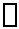
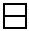
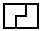
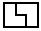
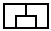
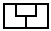
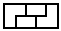
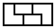

# ✔️ Sneeit Solution: Domino and Tromino Tiling with Explanation

**Author:** timcodex
**Votes:** 8
**Link:** [https://leetcode.com/problems/domino-and-tromino-tiling/solutions/1893115/](https://leetcode.com/problems/domino-and-tromino-tiling/solutions/1893115/)

---

(This problem is solved using Dynamic Programming that you can learn at: **https://sneeit.com/dynamic-progamming/**)

.
____
# Explanation
You can form a board i from
* board i - 1 by adding 
* board i - 2 by adding 
* board i - 3 by adding  or 
* board i - 4 by adding  or 
* board i - 5 by adding  or 
* board i - 6 to board 0 can use the same tile textures like board i - 5 to build board i

So the total ways to build board i is
ways[i] = ways[i-1] + ways[i-2] + 2 * ( ways[i-3] + ways[i-4] + ... + ways[0] )

If we extract the formula like this
ways[i] = ways[i-1] + ***ways[i-2] + ways[i-3] + 2  ( ways[i-4] + ... + ways[0] )*** + ways[i-3]
ways[i] = ways[i-1] + **ways[i-1]** + ways[i-3]
ways[i] = 2 * ways[i-1] + ways[i-3]

There are always 4 variables involved in calculating our results so we can use an array of 4 to reduce our space. And here is the final code
.
____
# Bottom-Up O(n) Time, O(1) Space
```
var numTilings = function(n) {
    let mod = 10 ** 9 + 7;    
    let len = 4;
    let ways = new Array(len).fill(0);

    // base cases
    ways[0] = 1;
    ways[1] = 1;
    ways[2] = 2;

    // already calculated above
    if (n < len - 1) {
        return ways[n];
    }    

    // use % len to circulate values inside our array
    for (var i = len - 1; i <= n;i++) {        
        ways[i % len] = ( 
            ways[(len + i - 1) % len] * 2
            + 
            ways[(len + i - 3) % len] 
        ) % mod;          
    }
    
    return ways[(i - 1) % len];
};
```
