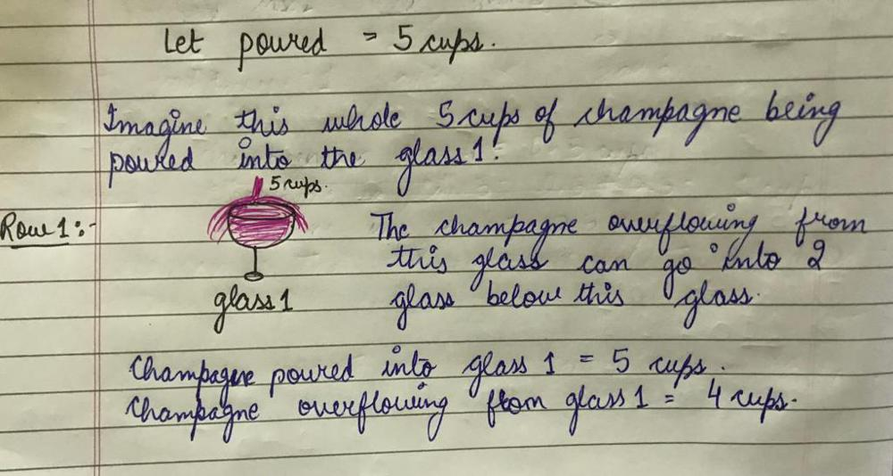
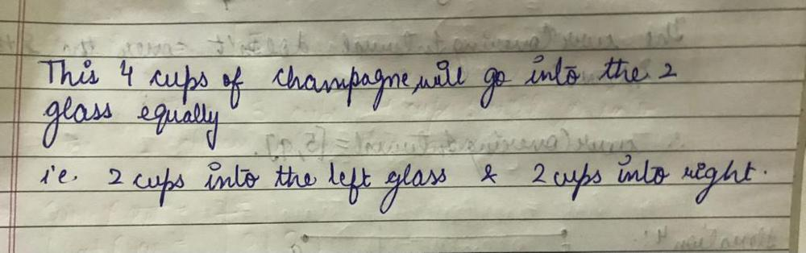
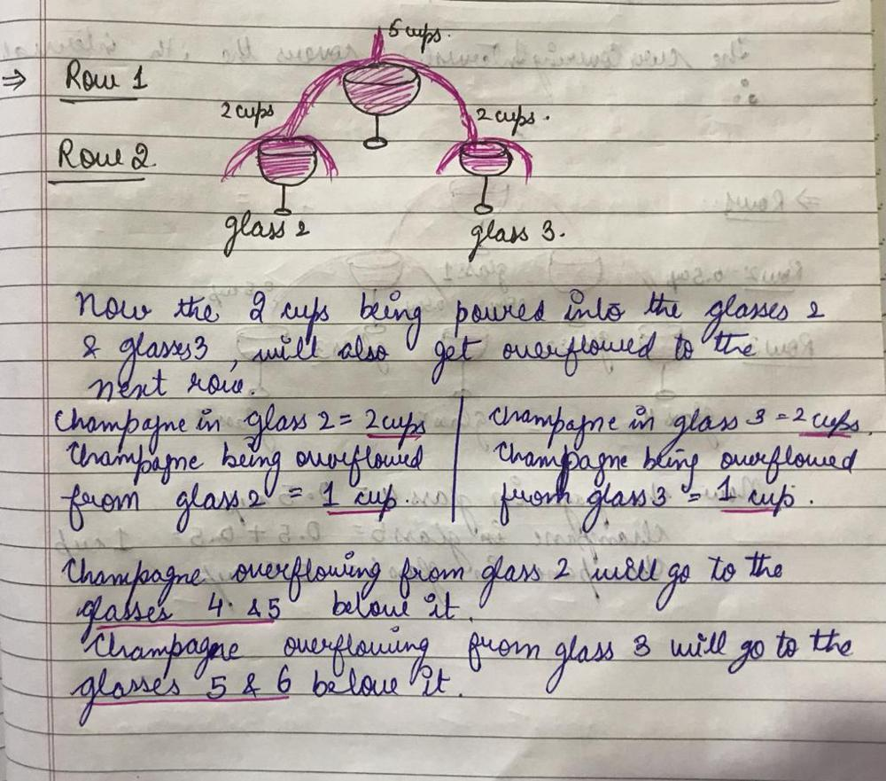
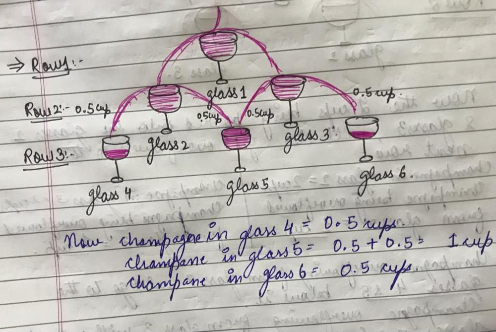
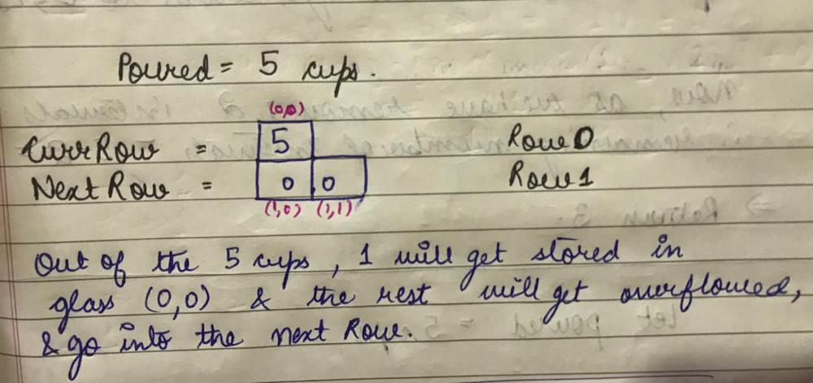
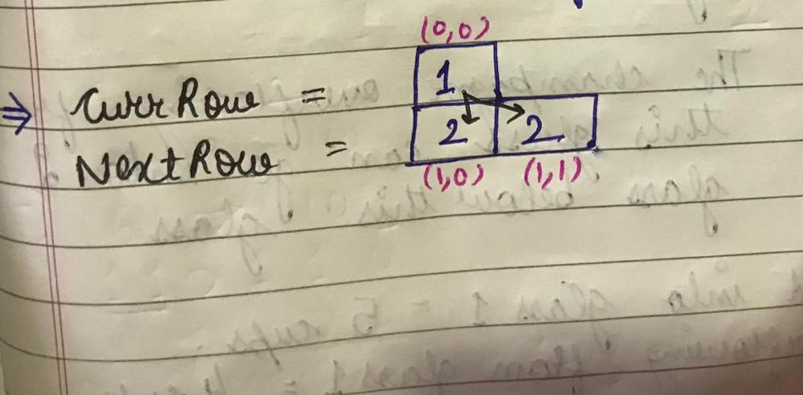
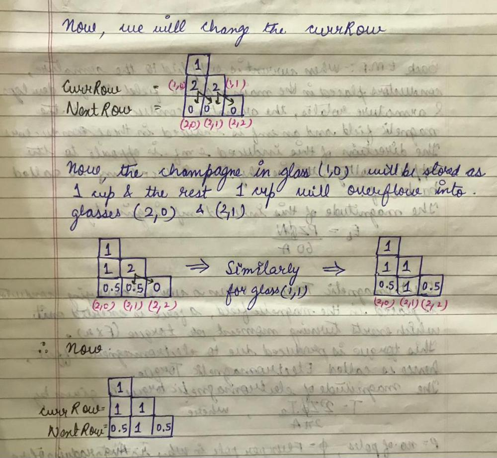

# 🚀FULL VISUAL EXPLANATION || DP || Beginner Friendly || Easy and Simple || C++

**Author:** sukhseeratkaur0226
**Votes:** 344
**Link:** [https://leetcode.com/problems/champagne-tower/solutions/1818599/](https://leetcode.com/problems/champagne-tower/solutions/1818599/)

---

We will be using **DP** here. But how?
Lets first understand the logic.

#### LOGIC:
\u2022 First of all, imagine that the whole champagne is being poured into the first row (1 glass in the first row)
\u2022 Now, whatever is being overflowed from this glass, goes to the 2 glasses just below this glass, equally, in the second row. Equally means, half of the champagne being overflowed goes to the first glass and half of that goes to the second glass.
\u2022 Now, in the second row, from each glass whatever is being overflowed goes to the 2 glasses just below each glass, equally, in the third row. So from each glass in second row, half of what is being overflowed goes to the left glass below it and half goes to the right glass.
\u2022 And this goes on...









#### ALGORITHM:
Using the above concept, we will make our dp matrix.
How will we implement our dp?
Lets see.
\u2022 We will first of all fill the first glass with the whole champagne. That means `champagneInGlass[0][0]=poured`
\u2022 Now we will check, if any champagne is being overflowed from this glass, then we will fill half of the overflowing champagne to the left glass and half to the right glass. That means, whatever is being poured into this glass, 1 cup will be stored in this glass and the rest will get overflowed and this overflowed champagne will get equally distributed among the 2 glass below this glass.
```
champagne stored in this glass = 1 cup (every glass can store only 1 cup of champagne)
champagne being overflowed from glass in ith row and jth column = champagneInGlass[j] of ith row - 1 (as 1 cup is stored in the glass and the rest is being overflowed)
champagne being poured into the left glass below it, because of this glass = champagne being overflowed / 2 = (champagneInGlass[j] of ith row-1) / 2
similarly, champagne being poured into the right glass below it, because of this glass = (champagneInGlass[j] of ith row-1) / 2.
```

#### DRY RUN:








#### CODE:
```cpp
class Solution {
public:
    double champagneTower(int poured, int query_row, int query_glass) {
        vector<double> currRow(1, poured);
		
        for(int i=0; i<=query_row; i++){ //we need to make the dp matrix only till query row. No need to do after that
            vector<double> nextRow(i+2, 0); //If we are at row 0, row 1 will have 2 glasses. So next row will have currRow number + 2 number of glasses.
            for(int j=0; j<=i; j++){ //each row will have currRow number + 1 number of glasses.
                if(currRow[j]>=1){ //if the champagne from the current glass is being overflowed.
                    nextRow[j] += (currRow[j]-1)/2.0; //fill the left glass with the overflowing champagne
                    nextRow[j+1] += (currRow[j]-1)/2.0; //fill the right glass with the overflowing champagne
                    currRow[j] = 1; //current glass will store only 1 cup of champagne
                }
            }
            if(i!=query_row) currRow = nextRow; //change the currRow for the next iteration. But if we have already reached the query_row, then the next iteration will not even take place, so the currRow is the query_row itself. So don't change as we need the currRow only.
        }
        return currRow[query_glass];
    }
};

```

***Plz upvote if you liked the explanation***