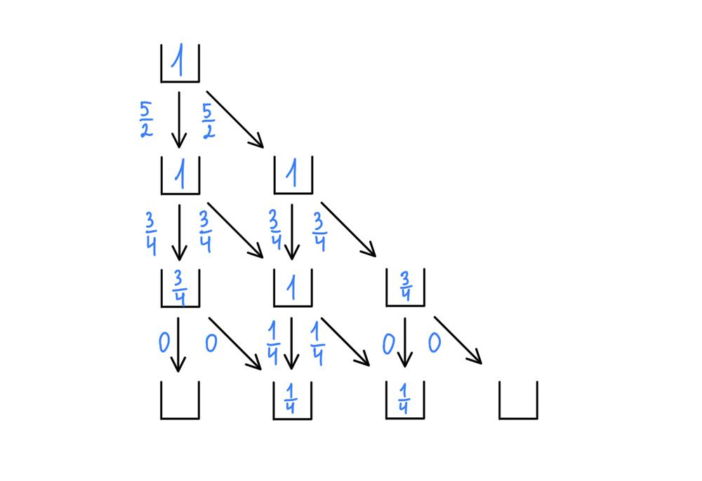

# Explained

**Author:** spektrokalter
**Votes:** 12
**Link:** [https://leetcode.com/problems/champagne-tower/solutions/911032/](https://leetcode.com/problems/champagne-tower/solutions/911032/)

---



Explanations for the picture:

1. Poured = 6. Keep 1 in the first glass. Pass `5/2` to two bottom glasses.
2. `5/2` >= 1. Keep 1 in the two glasses. These two glasses pass `(5/2 - 1) / 2` water, which is `3/4`, to bottom glasses.
3. The first glass on 3rd row has `3/4` water. It is less than 1. For that reason, keep that value in that glass. The second glass has `6/4` water. It is more than 1. For that reason, keep 1 in that glass and pass `(6/4 - 1) / 2` water, which is `1/4`, to bottom glasses.

```golang
func champagneTower(poured, I, J int) float64 {
	tower := [101][101]float64{}
	tower[0][0] = float64(poured)
	for i := 0; i <= I; i++ {
		for j := 0; j < i+1; j++ {
			if tower[i][j] >= 1 {
				pass := tower[i][j] - 1
				tower[i][j] = 1
				tower[i+1][j] += pass / 2
				tower[i+1][j+1] += pass / 2
			}
		}
	}
	return tower[I][J]
}
```