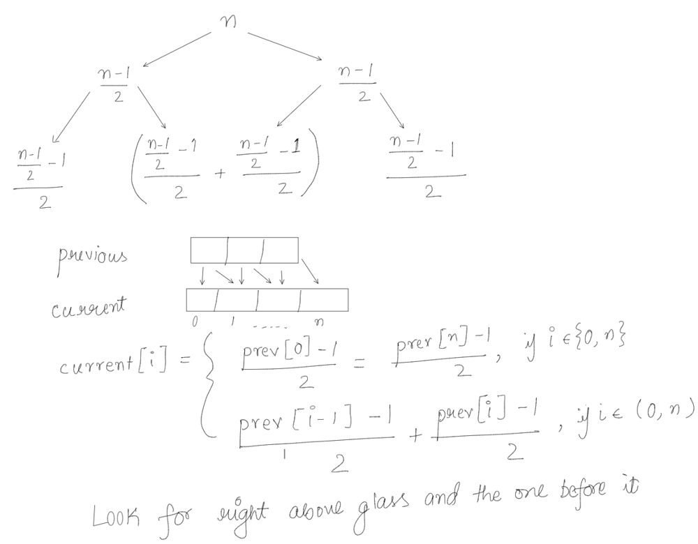

# Java | Simple | Explained

**Author:** prashant404
**Votes:** 114
**Link:** [https://leetcode.com/problems/champagne-tower/solutions/1817822/](https://leetcode.com/problems/champagne-tower/solutions/1817822/)

---

**Idea:**
* The Champagne Tower is a [Pascal's Triangle](https://mathworld.wolfram.com/PascalsTriangle.html) (PT)
* Each row in a PT has 1 more element (glass in this case) than the previous row, so the number of elements in row are `1, 2, 3, ..., n`
* First and last element of a PT are equal. Analogously, the first and last glasses in each row will have the same units of champagne
* To solve this problem, imagine that all the champagne (say n) has been poured into the top most glass all at once, s.t. it'll have `n` units at the beginning. Then it starts to flow down, getting divided equally into its bottom-left and bottom-right glasses.
* Except the terminal glasses, which will have 1 glass, all the other glasses will have 2 glasses pouring into them
* Each glass will take up to 1 unit of champagne and pour the rest to its 2 child glasses, so subtract 1 for self and give the rest away equally to the children
* So if we process 1 row at a time, up to `queryRow` times and maintain the amount of champaign units in an array, then array[queryGlass] will be the required result
* **Visually:**



>**T/S:** O(r\xB2)/O(r), where r = queryRow
>Since max(r) = 100, so technically both are O(1)
```
public double champagneTower(int poured, int queryRow, int queryGlass) {
	if (poured == 0)
		return 0;
	
	var prevRow = new ArrayList<>(List.of((double) poured));

	while (queryRow-- > 0) {
		var champagneInEnds = Math.max(0, (prevRow.get(0) - 1) / 2);  // min champagne can be 0
		var currentRow = new ArrayList<>(List.of(champagneInEnds)); // list with first glass

		for (var i = 1; i < prevRow.size(); i++)
			currentRow.add(Math.max(0, (prevRow.get(i - 1) - 1) / 2) + // flow from top-left glass
						   Math.max(0, (prevRow.get(i) - 1) / 2));     // flow from top-right glass

		currentRow.add(champagneInEnds); // last glass
		prevRow = currentRow;
	}
	
	return Math.min(1, prevRow.get(queryGlass)); // max champagne can be 1
}
```
***Please upvote if this helps***